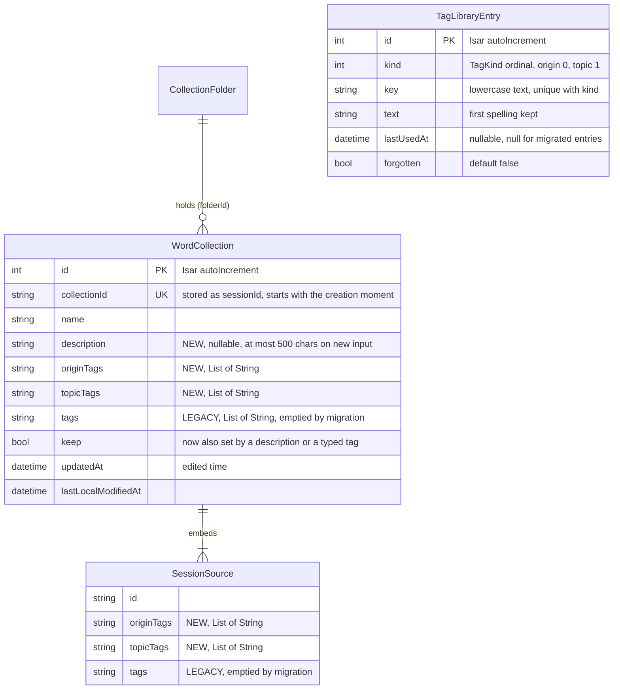

# Data model — collection-tags

> **Inputs:** [spec](./spec.md) §5, §6 · [sad](./sad.md) §4–§6 (Flows 1–9 persist notes), §8 · ADR [0001](adr/0001-store-typed-tags-as-separate-origin-and-topic-lists-beside-the-legacy-list.md), [0002](adr/0002-keep-the-tag-library-in-its-own-isar-collection-and-count-uses-live.md), [0003](adr/0003-migrate-untyped-tags-once-on-store-open-and-empty-the-legacy-lists.md), [0004](adr/0004-protect-description-and-typed-tags-in-put-and-write-them-only-through-store-transactions.md), [0005](adr/0005-derive-created-time-from-the-collection-id-and-keep-updatedat-as-edited-time.md), [0009](adr/0009-write-the-tag-library-inside-collectionstore-transactions-and-expose-it-and-the-summaries-as-core-providers.md) · precedent `lib/core/models/word_collection.dart`, `session_source.dart`, `collection_folder.dart`, `CollectionStore._backfillFiling`.

The feature changes stored data only on the phone, in the Isar database `vocab`:

- **Collection `Session` (Dart `WordCollection`):** three new properties: `description`, `originTags` and `topicTags`. The legacy `tags` stays in the schema and is emptied by the migration.
- **Embedded `SourcePhoto` (Dart `SessionSource`):** two new properties, `originTags` and `topicTags`. The legacy `tags` stays and is emptied.
- **New collection `TagLibraryEntry`:** the learner's tag library (ADR-0002).
- **New enum `TagKind { origin, topic }`:** stored by ordinal, with new kinds only appended.
- **Unchanged:** `CollectionFolder`, `StoryRun`, `WordPair`, `WordGroup`, `FilmDialogue`, `WordResult`, `shared_preferences`. The Worker's D1, R2 and the shared page are untouched. Nothing is published (AC-26).
- **No SQL migrations:** the repo has no SQL on the phone. Isar evolves by adding properties with defaults, plus a one-time backfill in `CollectionStore.open()` (the `_backfillFiling` precedent). So `docs/features/collection-tags/migrations/` stays empty on purpose. The "migration" is the Dart backfill `_backfillTypedTags()` (ADR-0003), specified below.

**Aggregate roots** (inferred from the existing design, no new question):
- **`WordCollection`** owns its description, typed tags and sources. Each source owns its own typed tags.
- **`TagLibraryEntry`** is its own root and refers to no collection. Its use counts are computed live, never stored.
- **`CollectionFolder`** is unchanged.

## ER diagram

## Entities

### WordCollection (Isar collection `Session`) — changed

| Property | Dart type | Stored name | Default | Rule |
|---|---|---|---|---|
| `description` | `String?` | `description` | null | New input is at most 500 characters; blank is stored as null. Protected: `put()`/`update()` copy it from the stored record (ADR-0004). |
| `originTags` | `List<String>` | `originTags` | `[]` | New tags: 1–30 characters, one line, unique within the list ignoring case, added only while there are fewer than 10. Migrated lists may exceed this (AC-17b). Protected. |
| `topicTags` | `List<String>` | `topicTags` | `[]` | Same rules as `originTags`. |
| `tags` (legacy) | `List<String>` | `tags` | `[]` | Never written by new code except the migration, which empties it. Until the migration succeeds, read as topic tags when both typed lists are empty (sad §8 "Legacy fallback"). |
| `keep` (existing) | `bool` | `keep` | false | Also set to true by `setDetails`/`create(details)` when they save a non-empty description or any typed tag. Never cleared. |
| Created (derived) | — | — | — | `creationMomentOf(collectionId) ?? updatedAt`. Not stored (ADR-0005). |

JSON (`fromJson`/`toJson`) gains `description`, `originTags` and `topicTags`. JSON is used for tests and copies only, never for publishing.

### SessionSource (embedded `SourcePhoto`) — changed

| Property | Dart type | Stored name | Default | Rule |
|---|---|---|---|---|
| `originTags` | `List<String>` | `originTags` | `[]` | Same per-kind rules as the collection's. Caller-copied inside `sources` (sad §11 risk). |
| `topicTags` | `List<String>` | `topicTags` | `[]` | Same as above. |
| `tags` (legacy) | `List<String>` | `tags` | `[]` | Emptied by the migration. |

`toJson` writes the typed lists only when they are non-empty, as `tags` is written today. `copy()` copies both lists.

### TagLibraryEntry (new Isar collection) — `lib/core/models/tag_library_entry.dart`

| Property | Dart type | Default | Rule |
|---|---|---|---|
| `id` | `Id` | `Isar.autoIncrement` | |
| `kind` | `TagKind` (`@enumerated`, ordinal) | — | origin = 0, topic = 1. New kinds are only appended. |
| `key` | `String` | — | `text.trim().toLowerCase()`. Unique together with `kind` (index below). |
| `text` | `String` | — | The first spelling the library met. Never rewritten. |
| `lastUsedAt` | `DateTime?` | null | Set to now on every explicit add (typed, tapped, copied up). Null for migrated entries, which rank below any later add (batch 6). |
| `forgotten` | `bool` | false | Set by Forget. Cleared only by an explicit add, never by the migration or a copy made in the background. |

Use counts are not stored. A count is the number of distinct non-binned collections whose own typed list of that kind, or any of whose sources' list, holds the key. The count comes from the summaries (ADR-0006, ADR-0002).

## Indexes

| Collection | Index | Type | Query it serves |
|---|---|---|---|
| `TagLibraryEntry` | (`kind`, `key`) composite | unique, `replace: false` | Upsert-by-key in `touchTags` and the migration (first spelling wins, AC-09, AC-32), and Forget lookup (AC-12) |
| `TagLibraryEntry` | — | — | Suggestions load the whole library once per change (≤ 1,000 rows, spec §6) and rank in memory, so no further index is needed |
| `WordCollection` | none new | — | Search and filter run in memory over summaries (ADR-0006). The typed lists are never queried by Isar, so no multi-entry index is added. |

## Migration (Dart backfill, not SQL) — `CollectionStore._backfillTypedTags()`

Runs from `open()` after `_backfillFiling()`, in **one** `writeTxn` (ADR-0003):

1. **Select** every `WordCollection` whose legacy `tags` is non-empty or any of whose sources has non-empty legacy `tags`. None → return (idempotent: the selection is empty after a success).
2. **Order** them by `creationMomentOf(collectionId) ?? updatedAt`, oldest first.
3. **For each collection**, in its own list order and then each source in source order:
   - Sort each legacy list with the pure `sortLegacyTags(list, originPresets)`: a case-insensitive match with an origin preset goes to origin, everything else to topic. Then `mergeCaseDuplicates`: within one list and kind, the first spelling wins. Nothing is truncated, and over-limit lists are kept.
   - Append to the existing typed lists (normally empty) without duplicating keys.
   - Copy every source tag into the collection's list of the same kind if its key is missing, ignoring the 10 cap (AC-17, C3a).
   - Upsert each (kind, key) into `TagLibraryEntry` if absent, with `text` set to this spelling, `lastUsedAt = null` and `forgotten` left untouched.
   - Empty the legacy `tags` of the collection and of every source.
   - Leave `updatedAt`, `lastLocalModifiedAt` and `keep` alone, except that `keep` is raised to true if the collection now has a typed tag.
4. **Commit.** On an exception: log `VOCAB: tag migration failed`, keep the old data (the legacy fallback reads it as topic tags), and retry on the next open.

**Rollback:** the app can't be downgraded with a schema that keeps the new properties. An older build would read the record without the typed lists and with emptied legacy lists, so its tags would look empty. This is accepted: the app ships forward-only through the stores, as for collections-screen.

## Test fixtures

Not stored anywhere. Built in tests the way `test/seed_collections.dart` builds collections today:
- `legacyTagsFixture()`: collections with "Book", "food", "Friends"; a source with "Podcast"; "Travel" + "travel"; a 40-character tag; 14 non-preset tags; collection X "food" made before Y "Food" (AC-17, AC-17b, AC-31, AC-32).
- `seedSummaries(500, tags: 2000)` for the QG-2 timing tests.
- `seedLibrary(1000)` for the autocomplete timing test.

No personal data. Tag texts are generic words.

## Drift check

The domain layer is the Isar models themselves, and the schema is generated from them by `build_runner`. Drift between the model and the schema can't arise. The checks that matter are covered by tests: `put()` leaves protected fields alone (QG-1), and the JSON round-trip carries the new fields. **Drift findings: none.**
