# Software Architecture Document — collection-tags

## 1. Introduction and goals

**Intent.** Give every collection and every source two kinds of tags, origin tags ("Where does it come from?") and topic tags ("What is it about?"), plus a description for the collection. The learner fills them in one Collection details sheet that teaches by example and autocompletes from a local tag library and the preset tags. The main screen shows the tags as one line under the top bar. Source tags are copied up to the collection. The Collections screen gains search and a filter by tags and by created and edited time, across every folder (spec §1–§2). Everything stays on the learner's phone (spec §3, AC-26).

**Top-3 quality goals (1-liners; full scenarios in §10):**

1. **Write safety.** No background save undoes a typed tag or a description, and the one-time migration loses no tag (spec §6 "Write safety", "Migration accuracy").
2. **Responsiveness.** Search and filter results update ≤ 100 ms after a keystroke with 500 collections. Autocomplete updates ≤ 50 ms with 1,000 library tags (spec §6).
3. **Look unchanged outside the approved additions.** Only the visible changes this feature names are added (CLAUDE.md rule 3; spec §6 "Main-screen tag line").

**Stakeholders.**

| Role | Interest | Sign-off owner? |
|---|---|---|
| learner | tags, describes, searches and filters their collections | No |
| partner | must never see the learner's description or tags on the shared page | No |
| Maksym (app owner), via the Fable 5.1 owner proxy | product decisions, approves visible changes and new data (CLAUDE.md rules 3, 5) | Yes |
| Tech Lead | SAD approval | Yes |

## 2. Constraints

**Technical.**
- Flutter / Dart (SDK `>=3.0.0 <4.0.0`), one app package, one `lib/` with feature folders (`docs/architecture.md`).
- State and dependency injection: `flutter_riverpod` / `riverpod_annotation` 2.6.x. Routes: `go_router` 17.x typed routes via `go_router_builder`.
- Persistence: `isar_community` 3.3.0-dev.1 (pinned; `pubspec.yaml:28-33`). There is no Isar migration framework. Schema evolution adds fields with defaults, plus one-time backfills run from `CollectionStore.open()` (precedent: `_backfillFiling`, `collection_store.dart:100-152`).
- Stored names are pinned with `@Name` (`WordCollection` is stored as `Session`, and `SessionSource` as `SourcePhoto`).

**Organisational.**
- Size L, route full. The pipeline is agent-run, and the owner decisions come from the Fable 5.1 proxy (2026-10-16).
- Tests run through `tool/test.sh smoke|changed`. The full regression runs only when the owner asks (CLAUDE.md rule 7).

**Conventions.**
- CLAUDE.md rules 1–7. Navigation goes only through typed routes, and services come from `lib/core/providers.dart`. Screen data lives in a `@riverpod` notifier, while controllers, focus and loading flags stay in widget `State`. Code is moved by cut-and-paste, and no package is added (rule 5). This feature adds none (ADR-0007).
- Owner-approved new data for this feature (rule 5): `WordCollection.description`, typed tags on `WordCollection` and `SessionSource`, and one new Isar collection for the tag library. A cached created time was offered by the owner but is not used (ADR-0005).
- Owner-approved visible changes (rule 3):
  - the Collection details sheet (New collection and the main screen's edit button);
  - the main screen's tag line;
  - the typed tag fields on the Notes page;
  - search, the filter sheet, the result list and the filter chips on the Collections screen.
  The proposed CLAUDE.md lines are in §9.

**Regulatory / external.**
- N/A. The data never leaves the device, and the app has no accounts (spec §6.1).

## 3. Context and scope

The learner works only in the phone app. The Cloudflare Worker and the shared page are untouched: publishing keeps sending what it sends today (title, words, sources). It sends no description and no tags (`collection_publish_service.dart:91,178,187-189`), and exports carry none either (`share_formats.dart:166-190`).

<!-- brownfield: Flutter app with Riverpod + go_router + Isar; CollectionStore is the only writer of WordCollection; put() copies content fields from the caller and filing fields from the stored record (collections-screen ADR-0003); tags today are untyped List<String> on WordCollection.tags and SessionSource.tags, edited on the Notes page through the main-screen notifier and saved by its debounced autosave. -->

**External systems (in / out):**

| Actor or system | Type | Interaction |
|---|---|---|
| learner | Person | names, describes and tags collections and sources; searches and filters Collections |
| partner | Person | opens a shared link. Sees nothing new, and never the description or tags |
| vocab-photo-api Worker | System (internal, unchanged) | receives publishes, which carry no description and no tags |
| shared page | System (internal, unchanged) | renders a published collection |

**C4 Context (L1):**

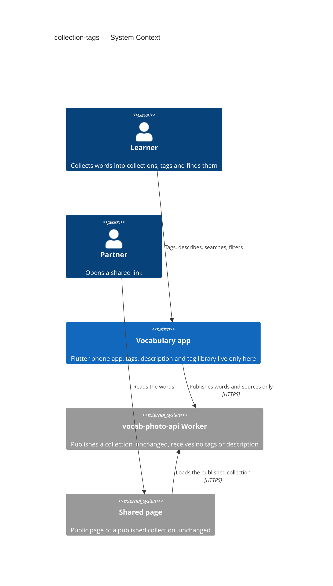

## 4. Solution strategy

**Target surface: `mobile-app` only.** The Worker and the shared page do not change: AC-26 says the new data never leaves the device, and spec §3 makes the shared page a non-goal. One existing surface does not cross the ADR gate (reversible, single module). The UI architecture stays the app's existing one (Flutter + Riverpod + typed go_router), so this feature makes no new UI-architecture decision.

**Top strategic choices (the seeds for ADRs):**

1. **Typed tags as two plain lists per owner, stored next to today's untyped list** — `originTags` and `topicTags` on `WordCollection` and on `SessionSource`. The old `tags` field stays readable only so the migration can empty it. Two lists keep queries, JSON and the existing `TagEditor` simple, and "same text in both kinds" falls out naturally (AC-11). → ADR-0001.
2. **The tag library is its own small Isar collection.** It holds kind, text, a lowercase key, last-used time and a forgotten mark. Use counts are always worked out from the live collections, so they never drift (AC-30, AC-35, glossary). → ADR-0002.
3. **One idempotent migration in the store's open path, in one transaction.** It sorts old tags into the two kinds, merges case duplicates, copies source tags up and seeds the library, and empties the old field so it can never run twice or come back (AC-17, AC-17b, AC-18, AC-31, AC-32). → ADR-0003.
4. **The collection's description and typed tags are protected fields written only by store transactions**, like filing (collections-screen ADR-0003). `put()` copies them from the stored record, so a stale copy held by the autosave, a story, a dialogue delivery or a late lookup cannot undo them (AC-18). → ADR-0004.
5. **Time and search are pure functions over a light summary.** Edited is the existing `updatedAt`. Created is the moment inside the collection id (AC-25, AC-06). Search, filter and sort are one pure function over a list of collection summaries, which the store re-reads only after a write. Keystrokes never touch the database (§6 NFR). → ADR-0005, ADR-0006.
6. **Built-in chips + `RawAutocomplete`, by extending today's `TagEditor`.** No package is added (rule 5, owner batch 1). → ADR-0007.
7. **The tag-tap filter travels in the typed route**, as an optional kind + text on `CollectionsRoute`, pushed rather than navigated with `go`, so Back returns to the main screen (AC-39, rule 1). → ADR-0008.

## 5. Building block view

The style stays the app's own: feature folders, a `@riverpod` notifier per screen, services from `core/providers.dart`, and pure Dart rules in plain files that are unit-tested without widgets (as `filing.dart`, `collection_name.dart` and `quizlet_link.dart` are). New pure rule files hold everything that can be decided without Flutter: tag normalisation, the presets, the migration sort, ranking and matching, filter and sort, and date ranges.

**Internal decomposition:**

```
lib/
  core/
    models/
      word_collection.dart        + description, originTags, topicTags; tags kept (legacy, emptied by migration)
      session_source.dart         + originTags, topicTags; tags kept (legacy)
      tag_kind.dart               enum TagKind { origin, topic } (stored by ordinal: origin first)
      tag_library_entry.dart(+.g) Isar @collection TagLibraryEntry {kind, text, key, lastUsedAt, forgotten}
                                    (written only by CollectionStore, ADR-0009)
    services/
      collection_store.dart       + create(details), setDetails(), addCollectionTags() → notAdded, migration
                                    _backfillTypedTags(), watchSummaries() (300 ms debounce), library writes
                                    (touchTags, forgetTag) inside the same writeTxn, watchLibrary();
                                    put()/update() copy description, typed tags (and filing) from stored
      tag_rules.dart              pure: normalise/validate (1-30, one line), case-insensitive key, limits (10/kind),
                                    presets (ordered lists), migration sort, word-start matching, ranking
      collection_search.dart      pure: CollectionSummary, matches(search, filter), sort, date ranges, tag counts
  features/
    tags/                          (new, shared by the sheet, Notes and Collections)
      tag_chip.dart               the one chip look per kind (icon + tint)
      typed_tag_field.dart        TagEditor grown into one kind's field: hint, helper line, suggestion row
                                    (always shown, or only while focused on the Notes page: AC-34),
                                    autocomplete, limit messages, long-press Forget
      tag_suggestions.dart        moved from notes/ (cut-and-paste) and typed: ranked suggestions per kind
    collections/
      collection_details_sheet.dart   name + description + two typed fields; Create / Save; Discard changes?
      collections_search_notifier.dart  @riverpod: query, filter, sort, mode (folder view vs results)
      collections_results_view.dart flat results with folder path, chips, empty state
      collections_filter_sheet.dart tag sections, Created/Edited choices, sort, Show N collections
    word_input/
      collection_tag_line.dart    the animated line in the AppBar's bottom slot
    notes/
      notes_screen.dart           collection + source fields become two typed fields each
  core/providers.dart             + collectionSummaries (stream of watchSummaries), tagLibrary (stream of watchLibrary)
  router/routes.dart              CollectionsRoute gains optional tagKind + tag
```

**C4 Container (L2):**

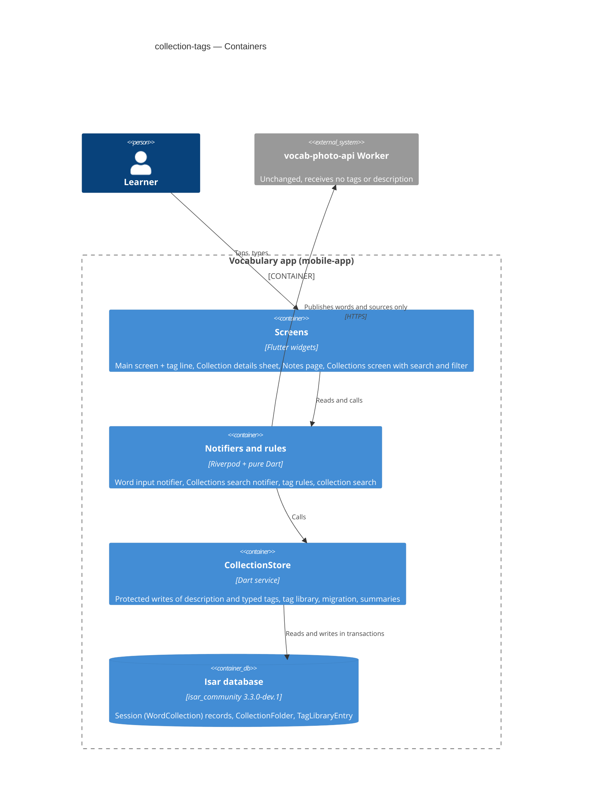

## 6. Runtime view

**Critical flow 1: save the Collection details sheet (edit, current collection)**

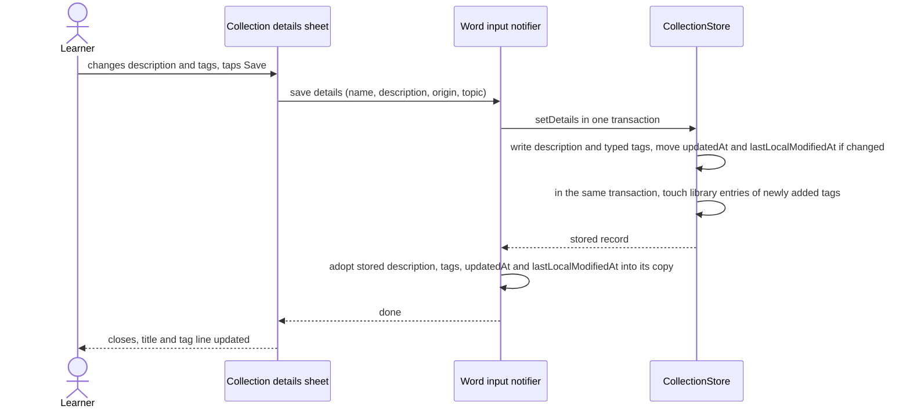

**Critical flow 2: a later autosave holds a stale copy (AC-18)**

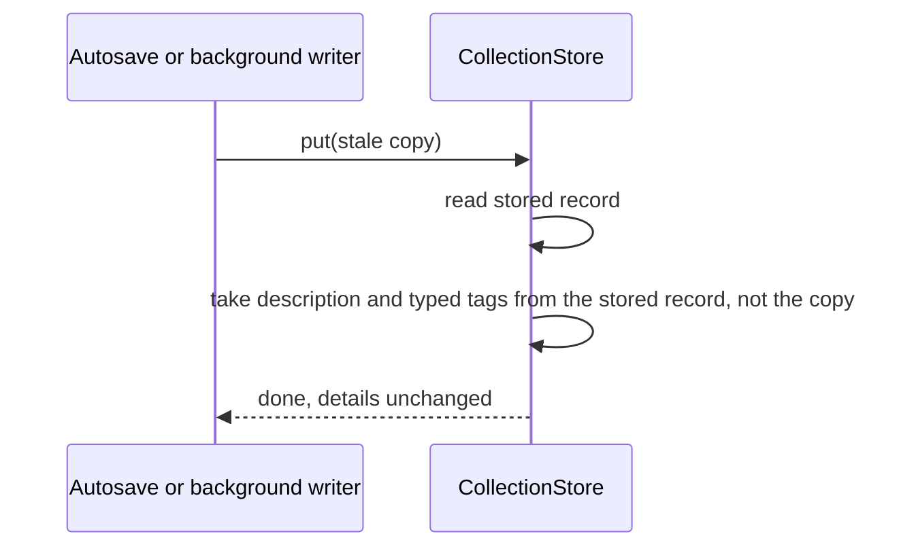

### Flow 3 (US-01): make a new collection with details

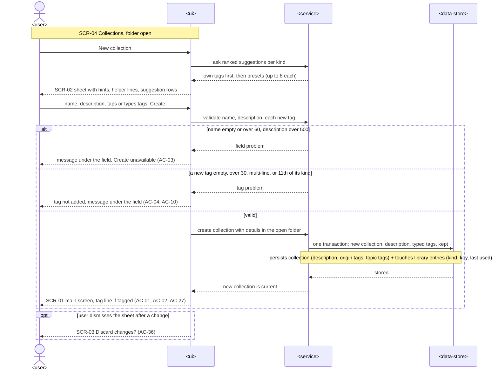

### Flow 4 (US-02): leaving a collection that only has details

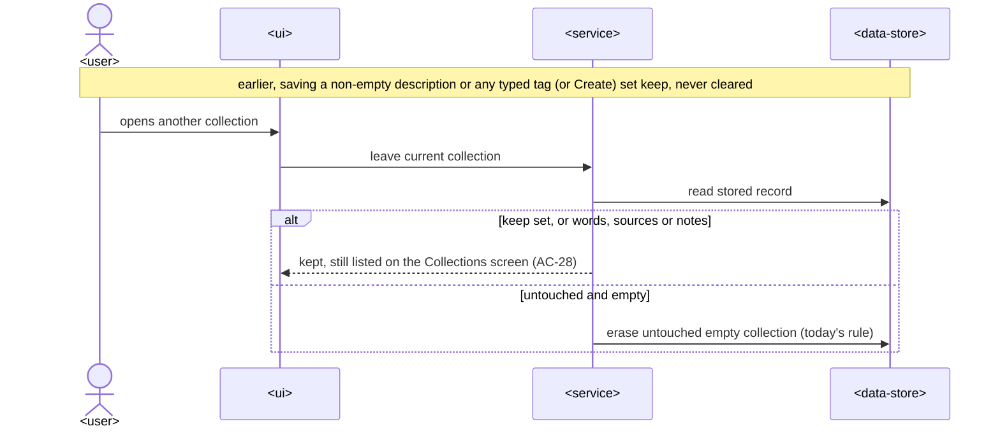

### Flow 5 (US-03, US-04): suggestions, autocomplete and Forget

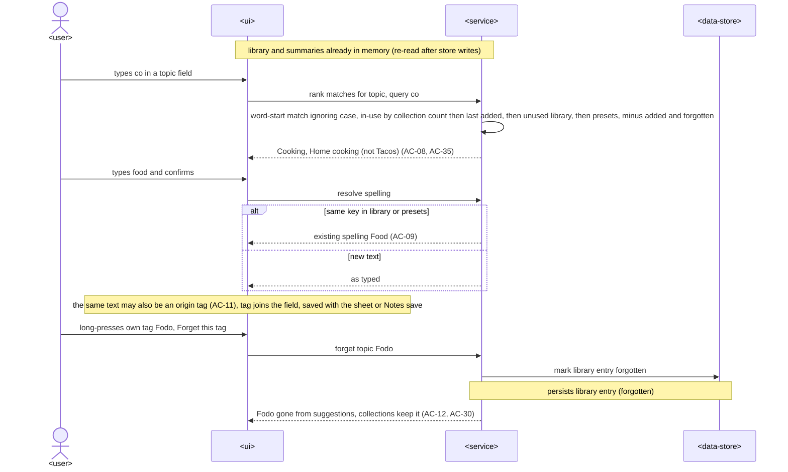

### Flow 6 (US-05): tag line and a tag tap

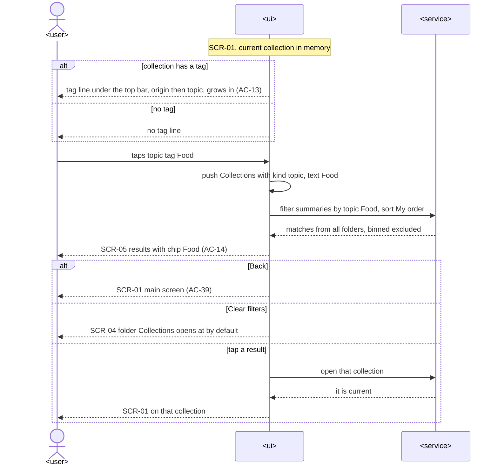

### Flow 7 (US-06): tag a source and copy it up

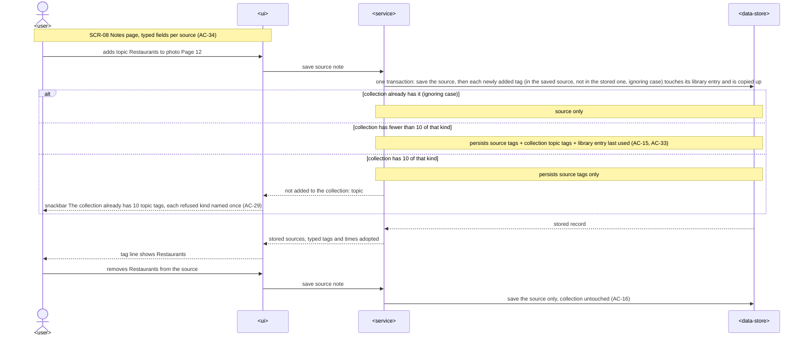

### Flow 8 (US-07): search and filter Collections

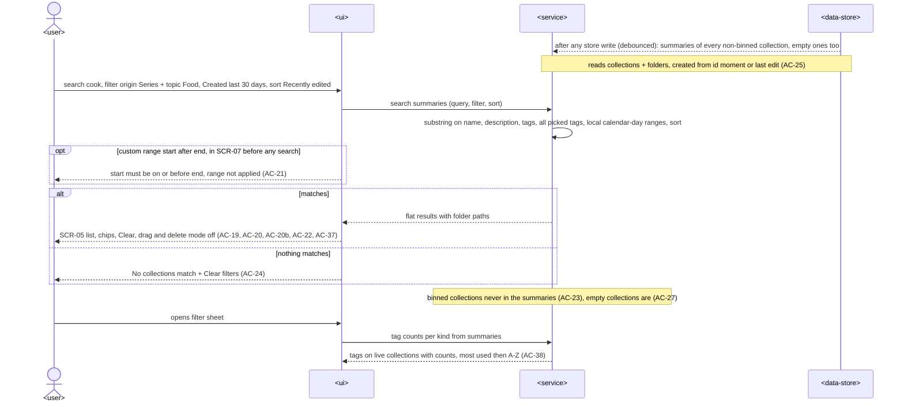

### Flow 9 (US-08): first start after the update — migration

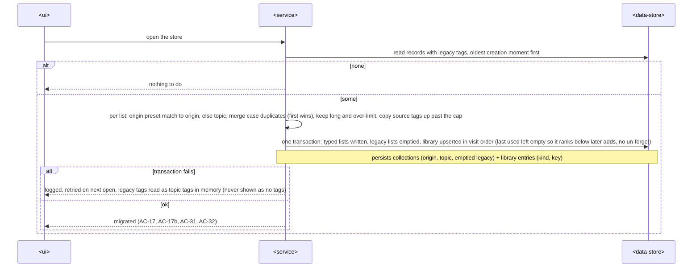

### AC coverage of the runtime view

| AC | Where | AC | Where |
|---|---|---|---|
| AC-01, AC-02 | Flow 3 valid | AC-20, AC-20b, AC-37 | Flow 8 matches |
| AC-03, AC-04, AC-10 | Flow 3 alts | AC-21 | Flow 8 alt |
| AC-05, AC-06 | Flow 1 (save, times move only on change) | AC-22, AC-24 | Flow 8 |
| AC-07, AC-08, AC-35 | Flow 3 suggestions, Flow 5 | AC-23, AC-27 | Flow 8 note; Flow 3 |
| AC-09, AC-11 | Flow 5 | AC-25 | Flow 8 note |
| AC-12, AC-30 | Flow 5 Forget | AC-26 | N/A runtime: publish and export build their payload without description or tags; pinned by a payload test |
| AC-13, AC-14, AC-39 | Flow 6 | AC-28 | Flow 4 |
| AC-15, AC-16, AC-29, AC-33, AC-34 | Flow 7 | AC-31, AC-32, AC-17, AC-17b | Flow 9 |
| AC-18 | Flow 2 (stale put), Flow 7 (adopt) | AC-19, AC-38 | Flow 8 |
| AC-36 | Flow 3 opt | | |

Every §4 user story has a flow: US-01 → 3, US-02 → 1, 2, 4, US-03/US-04 → 5, US-05 → 6, US-06 → 7, US-07 → 8, US-08 → 9. US-09 is non-runtime (AC-26).

Flags for design: none. All participants map to §5 (UI = Screens, service = Notifiers and rules + CollectionStore, data-store = Isar).

## 7. Deployment view

<!-- N/A: the change ships inside the existing phone app build; no Worker deploy, no new infrastructure. The migration runs once on each phone's first start after the update. -->

## 8. Crosscutting concepts

| Concept | Convention | Where defined |
|---|---|---|
| Tag identity | A tag is (kind, text). Equality within a kind ignores case through a lowercase `key`. The first stored spelling wins, and new text is stored as typed. | `tag_rules.dart`, ADR-0001 |
| Legacy fallback | Until the migration has succeeded, a record whose typed lists are empty and whose legacy `tags` are not empty reads its legacy tags as topic tags (summaries, notifier, Notes). | ADR-0003 |
| Tag limits | New input must be 1–30 characters on one line, trimmed, and a new add needs fewer than 10 tags of that kind. Existing over-limit data is kept (grandfathered). | `tag_rules.dart` |
| Protected collection fields | `put()`/`update()` copy filing **and** `description`, `originTags`, `topicTags` from the stored record. Only `setDetails`, `addCollectionTags`, the migration and `create(details)` write them. | ADR-0004 (extends collections-screen ADR-0003) |
| Kept collection | `setDetails` / `create(details)` set `keep` when they save a non-empty description or any typed tag. It is never cleared (AC-28). | ADR-0004, `filing.dart` |
| Times | Edited = `updatedAt`, Created = `creationMomentOf(collectionId) ?? updatedAt`. Day ranges use local calendar days. | ADR-0005, `collection_search.dart` |
| Privacy | Description and typed tags are never added to publish payloads or export files. A test pins that. | AC-26, §3 |
| Error handling | Store methods never throw to the UI (existing convention). Validation messages come from pure rule functions and are shown under the field. | `collection_store.dart` class doc |
| Logging | The existing `VOCAB:` debug prints. The migration logs one line on failure and retries on the next open. | `_backfillFiling` precedent |
| Providers | `collectionSummaries` and `tagLibrary` live in `core/providers.dart` (rule 2). `tagSuggestions(kind)` in `features/tags/` combines them into the ranked list. | ADR-0009 |
| Notifier adoption | After `setDetails`, `addCollectionTags` or a source save, the word input notifier copies the stored description, typed tags, sources, `updatedAt` and `lastLocalModifiedAt` into its in-memory copy before any later `put()`. | ADR-0004 |
| Navigation | Typed routes only. The tag filter rides on `CollectionsRoute` query fields. | CLAUDE.md rule 1, ADR-0008 |
| Internationalisation | N/A — English UI | — |

## 9. Architecture decisions

| # | Title | Status | Section |
|---|---|---|---|
| 0001 | Store typed tags as separate origin and topic lists beside the legacy list | Accepted | §4 |
| 0002 | Keep the tag library in its own Isar collection and count uses live | Accepted | §4 |
| 0003 | Migrate untyped tags once on store open and empty the legacy lists | Accepted | §4 |
| 0004 | Protect description and typed tags in put and write them only through store transactions | Accepted | §4, §8 |
| 0005 | Derive created time from the collection id and keep updatedAt as edited time | Accepted | §4 |
| 0006 | Search and filter collections in memory over summaries re-read after each store write | Accepted | §4, §5 |
| 0007 | Build the typed tag field on built-in chips and RawAutocomplete without a package | Accepted | §4 |
| 0008 | Carry the tag-tap filter in typed CollectionsRoute query fields and push the route | Accepted | §4 |
| 0009 | Write the tag library inside CollectionStore transactions and expose it and the summaries as core providers | Accepted | §5, §8 |

ADR files live under `docs/features/collection-tags/adr/NNNN-<title>.md`. **CLAUDE.md approval lines (proposed; the owner adds them before implementation — not written by an agent):**
- Rule 3: "collection-tags (owner via Fable 5.1 proxy, 2026-10-16) adds the Collection details sheet (name, description, origin and topic tag fields) for New collection and the main screen's edit button, the tag line under the main screen's top bar, typed tag fields with suggestion rows and Forget on the Notes page, and search, the filter sheet, the flat result list and filter chips on the Collections screen".
- Rule 5: "`WordCollection.description`, `WordCollection.originTags`/`.topicTags`, `SessionSource.originTags`/`.topicTags`, the enum `TagKind` and the Isar collection `TagLibraryEntry` by collection-tags (owner via Fable 5.1 proxy, 2026-10-16), no packages".

## 10. Quality requirements

**QG-1. Write safety**
- **When:** the learner saves a description or tags, and then any other save of that collection follows: the main screen's autosave, a rename or move, a source note edit, a finished story, a dialogue delivery, a learn result, a late lookup or import.
- **Then:** "0 cases where a background save undoes a typed tag or description". After the migration, "100 % of pre-update tags present after the move (0 lost, 0 duplicated within a kind; merging spellings that differ only by case into the first one is not a loss, AC-17b)".
- **How verify:** store tests run `put()` with a stale copy after `setDetails` and after `addCollectionTags`, once for each writer path (autosave, `markShared`, `updateDialogues`, `markDialoguesPublished`, a story run, a learn result, a late lookup). They check that description, typed tags, `updatedAt` and `lastLocalModifiedAt` stay as the details save left them. A notifier test checks the tag line updates at once after a Notes-page save and stays after the next autosave (owner D4). A test checks a source tag survives the autosave (owner D11). A migration test runs over a fixture of untyped tags on collections and sources, covering case duplicates, a 40-character tag, 14 tags and source-only tags.

**QG-2. Responsiveness**
- **When:** the learner types in search, changes a filter, or types in a tag field.
- **Then:** "results update ≤ 100 ms after a keystroke or filter change with 500 collections and 2,000 tags". "Suggestions update ≤ 50 ms after a keystroke with 1,000 library tags". The migration adds "≤ 1 s added to startup for 500 collections; runs once".
- **How verify:** search uses a "widget/perf test with a seeded store of 500 collections, on the CI runner", seeded with 2,000 tags. It times the pure `collection_search` call per keystroke. Autocomplete uses a "unit test timing the suggestion function" with 1,000 library tags. The migration uses a "test with a seeded store; launch log on the owner's phone".

**QG-3. Look unchanged outside the approved additions**
- **When:** a collection has no tags.
- **Then:** the main screen looks exactly as today. With tags, "adds no more than one line (≈ 40 dp) under the top bar and none when the collection has no tags".
- **How verify:** a "widget test on a phone-width screen" checks the AppBar's bottom height: 0 without tags, one line (≈ 40 dp) with tags. Existing main-screen golden and widget tests stay green.

## 11. Risks and technical debt

| Risk / debt | Severity | Mitigation | Owner |
|---|---|---|---|
| Source tags still live inside `sources`, which `put()` copies from the caller, so a stale writer holding old sources could undo a source tag edit (a pre-existing risk for source notes: `updateSourceNote` today ends in the debounced autosave, `word_input_notifier.dart:471-489`) | Medium | `updateSourceNote` becomes async. It saves the source through `store.update` at once and sends new tags to `addCollectionTags`, then adopts the stored sources, typed tags and times (ADR-0004). A required test pins a source tag surviving the autosave. | Tech Lead |
| The summary re-read loads whole records (words included) after store writes, and the 500 ms autosave writes often | Medium | `watchSummaries()` coalesces store events with a trailing 300 ms debounce, so one burst means one re-read (ADR-0006). Keystrokes filter in memory only. A test with 500 seeded collections checks it. Revisit with Isar property queries if it lags. | Tech Lead |
| The migration sorts on the origin presets: an old "Travel" becomes an origin tag | Low | Owner accepted (C4). The learner can move it. | owner |
| "First spelling wins" locks in a typo's case across the library; there is no rename | Low | Owner accepted (V7). Forget clears unused entries. | owner |
| No tag on folders or words, and no auto-tags on import | Low | Non-goals (spec §3), tracked in spec §8. | owner |

**Accepted debt (acceptable in v1, plan to fix later):**
- The legacy `tags` field stays in the schema, emptied, because removing a stored field from an Isar schema is not needed and would only add risk.

## 12. Glossary

| Term | Meaning |
|---|---|
| origin tag / topic tag / preset tag / tag library | as in the project [CONTEXT](../../../CONTEXT.md) |
| tag key | the lowercase form of a tag's text, used to compare tags of one kind ignoring case |
| legacy tags | the untyped `tags` lists on collections and sources from before this feature; emptied by the migration |
| collection summary | a light, read-only view of one collection for search and filter: id, name, description, both tag lists (search and filter match these), its sources' tag keys (used only for the library's use counts), folder path, order position, created and edited times |
| protected field | a collection field that `put()` takes from the stored record, never from the caller's copy |
| tag line | the one sideways-scrolling row of tags in the main screen's top-bar area |
