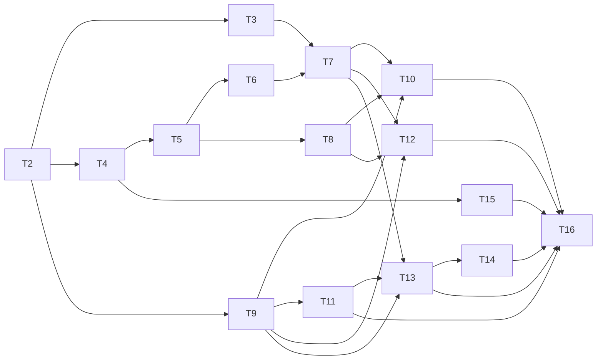

# Epic — collection-tags

Origin and topic tags on collections and sources, a Collection details sheet, the main screen's tag line, typed tag fields on Notes, a local tag library with presets and autocomplete, and search + filter on Collections. Links: [spec](../spec.md) · [ux-flows](../ux-flows.md) · [sad](../sad.md) · [data-model](../data-model.md) · [screens](../screens.md) · [ADRs](../adr/).

plan-tests was skipped at the owner's request (2026-10-16). Each task's DoD names its tests.

## Dependency graph

## Parallel waves

1. T1, T2
2. T3, T4, T9 (T15 after T4)
3. T5, T15
4. T6, T8, T11
5. T7
6. T10, T12, T13 (T10 and T13 share `collections_screen.dart`: serialize)
7. T14
8. T16
