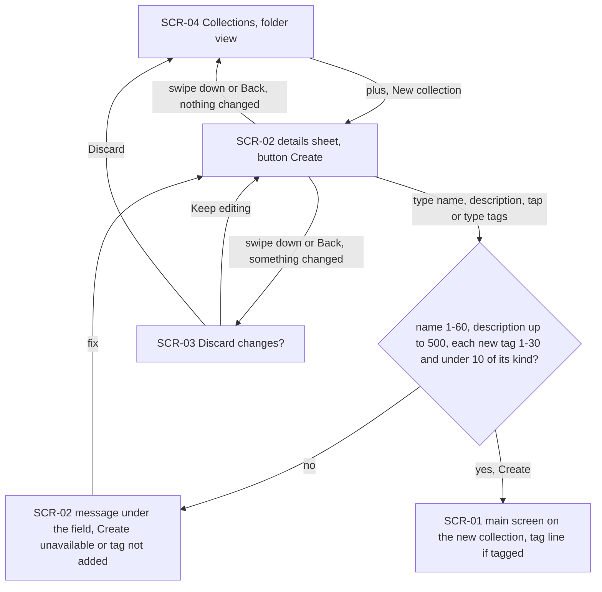
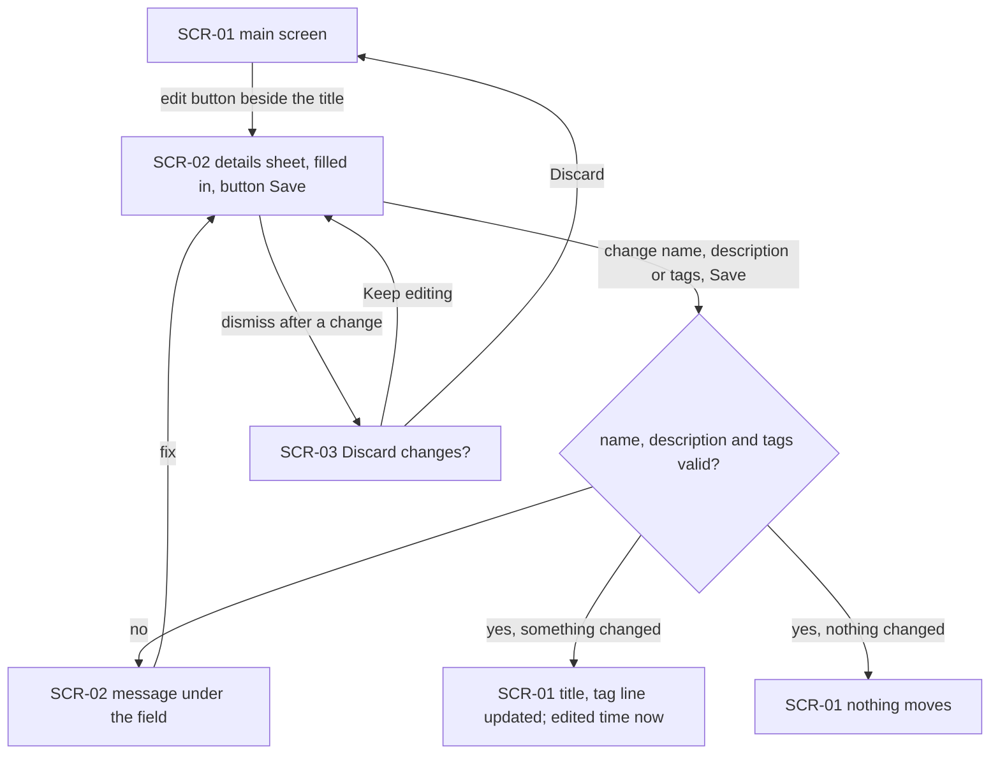
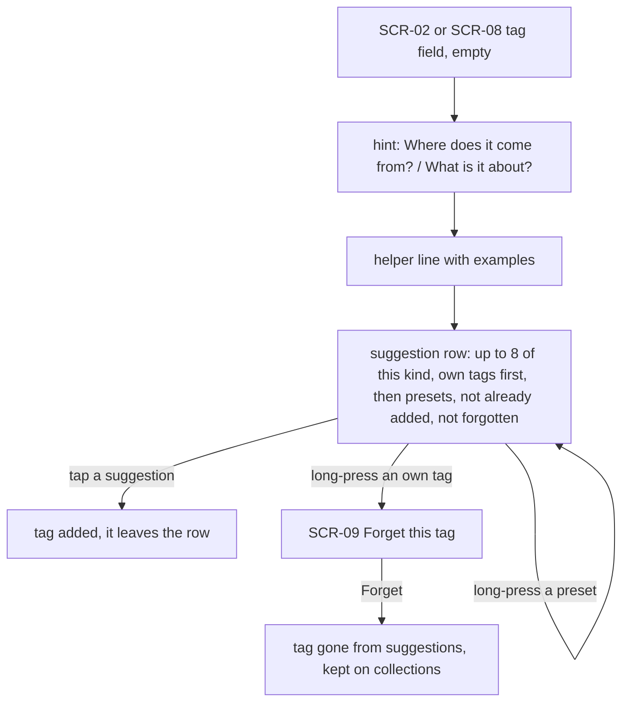
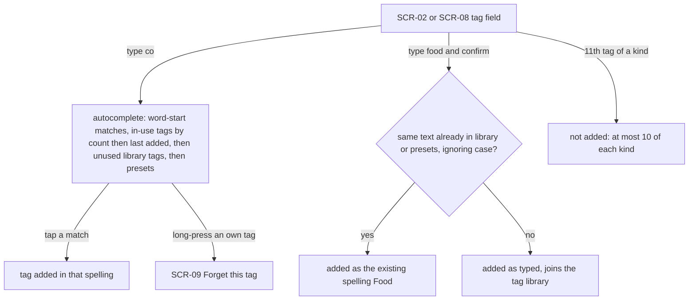
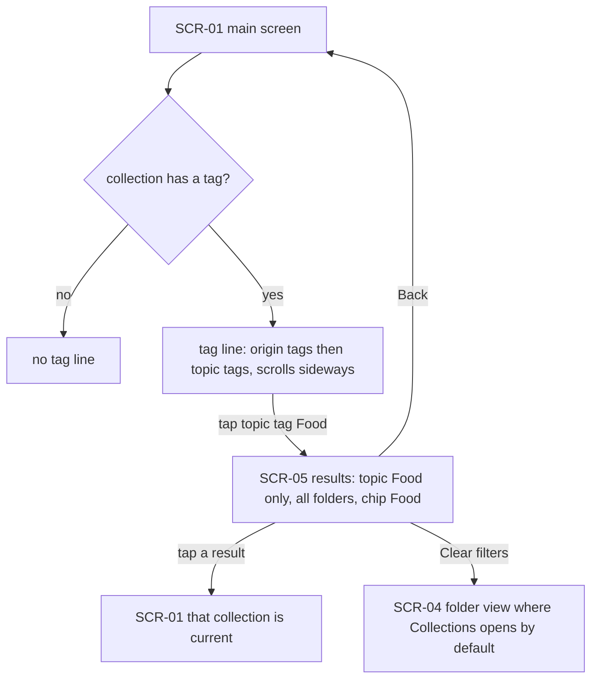
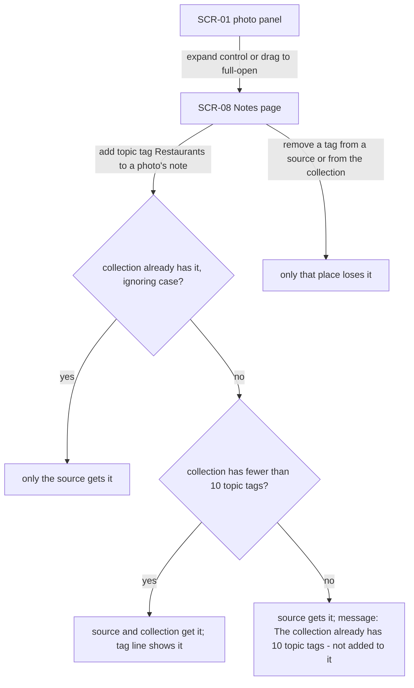
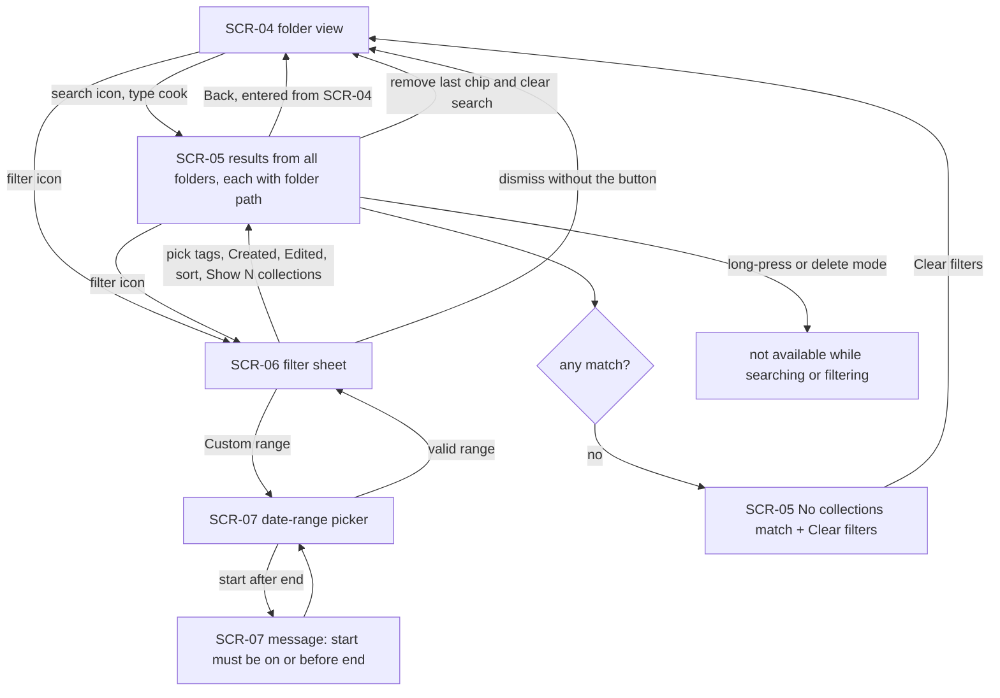
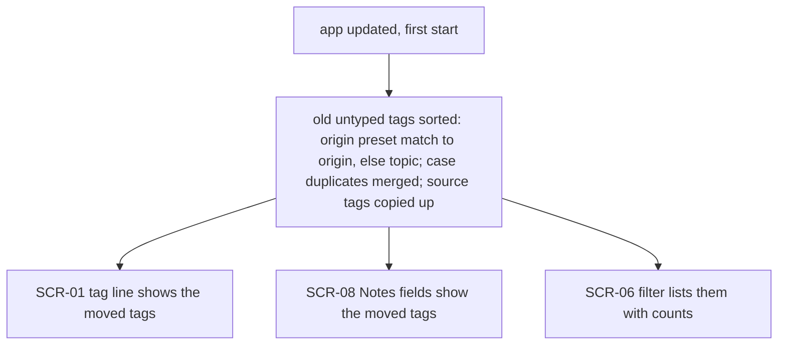

# UX flows — collection-tags

> User flows for every UI-touching §4 user story of [spec.md](./spec.md), produced by `ux-flows`
> (after `clarify`, before `design`) and read by `design`, `sequences`, `screens` and `plan-tests`.
> Markdown + mermaid `flowchart` only — flow altitude, not visual design. Product decisions were
> made by the Fable 5.1 owner proxy (2026-10-16).

## Platform decisions

- **Posture:** mobile-first, as for collections-screen. The app runs on a phone, held upright, worked by finger. There is still no `docs/design-system.md`.
- **Modality:** the Collection details sheet is a bottom sheet over the screen it starts from: the Collections screen for New collection, the main screen for the edit button. "Discard changes?" is a dialog over the sheet. The filter is a bottom sheet over the Collections screen, and a custom range opens the phone's date-range picker.
- **Search mode stays on one screen:** search and filter results are a state of the Collections screen (a flat list across folders), not a separate screen. Leaving search or filter mode returns to the folder view.
- **A tag tap on the main screen pushes the Collections screen** with that one filter. Back pops it straight back to the main screen.
- **Folders keep the name-only Name dialog.** Only collections get the details sheet.
- **Source tags stay on the Notes page.** It gains two typed fields per collection and per source, with no new screen.
- **No UI change for the partner (US-09):** the shared page shows nothing new. AC-26 is a guarantee that the details stay off the page.

## Screen inventory

| ID | Screen | Purpose | Entry | Exit |
|---|---|---|---|---|
| SCR-01 | Main screen | Edit the current collection's words. Its new tag line under the top bar shows origin tags, then topic tags, only when there is at least one | app start, opening a collection, Back from SCR-04/SCR-05 | SCR-02 (edit button), SCR-05 (tap a tag), SCR-08 (Notes, via the photo panel) |
| SCR-02 | Collection details sheet | Name (required), description, origin tags, topic tags, each tag field with a hint, a helper line, a suggestion row and autocomplete. Its button reads Create when making a collection and Save when editing one | SCR-04 New collection, SCR-01 edit button | Create/Save → SCR-01 (new collection opened) or back to SCR-01; dismiss → SCR-03 or closes |
| SCR-03 | Discard changes dialog | "Discard changes?" with Keep editing / Discard | dismissing SCR-02 after a change | SCR-02 (Keep editing), the sheet's origin screen (Discard) |
| SCR-04 | Collections screen — folder view | Today's folder window, plus a search icon and a filter icon in the top bar | side menu Collections, Clear filters on SCR-05 | SCR-05 (search or filter), SCR-02 (New collection), SCR-01 (tap a collection) |
| SCR-05 | Collections screen — results | Flat list of matching collections from all folders, each with its folder path, plus removable filter chips, Clear, and the sort. Drag, reorder and delete mode are off. Shows "No collections match" + Clear filters when the list is empty | search typed or filter applied on SCR-04, a tag tap on SCR-01 | SCR-01 (tap a result: it becomes current), SCR-06 (filter icon), SCR-04 (Clear), SCR-01 (Back when opened from a tag) |
| SCR-06 | Filter sheet | Tag sections per kind (count, first 12, Show all, narrow field), Created and Edited choices, sort | filter icon on SCR-04/SCR-05 | SCR-05 (apply), SCR-07 (Custom range), dismissed back |
| SCR-07 | Date-range picker | Pick a custom Created or Edited range. A start after the end is refused with a message | Custom range on SCR-06 | SCR-06 |
| SCR-08 | Notes page | Collection origin + topic fields at the top, and two typed fields on each source's note. A suggestion row shows only while a field has focus | the photo panel's expand control / drag to full-open on SCR-01 | SCR-01 (Back) |
| SCR-09 | Forget-tag menu | A small popup menu anchored on the long-pressed chip or row: "Forget this tag" for a library tag in a suggestion row or the autocomplete list (never for presets) | long-press a suggestion on SCR-02 or SCR-08 | the same field, the tag no longer suggested |

### States worth naming (not separate screens)

- **SCR-01 covered:** the half-open photo panel or its flares cover the tag line, and taps there go to the panel.
- **SCR-02 / SCR-08 field messages:** the tag length and tag limit messages show under the field, not as a snackbar.
- **SCR-05 entry:** opening search puts the field in the top bar with the keyboard up. While the query is empty and no filter is set, the folder view (SCR-04) stays. Search updates live as the learner types.
- **SCR-05 sort when opened from a tag:** My order (the default).
- **SCR-06 apply:** a primary button "Show N collections" with the live count. With N = 0 it still applies, so the empty state shows. A header "Reset" clears the sheet's choices, and dismissing without the button changes nothing.
- **SCR-08 snackbar:** "The collection already has 10 origin/topic tags — not added to it" (AC-29).
- **Back from SCR-05:** if it was entered from SCR-04 (search icon or filter), the first Back closes search and clears the filters, returning to SCR-04, and a second Back leaves the Collections screen. If it was entered from a tag tap on SCR-01, Back returns straight to SCR-01.
- **Migration (US-08):** silent, with no notice or dialog.

## Flows

### Flow: US-01 — Describe a new collection

From the Collections screen the learner chooses New collection, and the details sheet opens with a Create button. Only the name is required. The learner can type a description and add origin and topic tags by tapping suggestions or typing with autocomplete. If the name is empty or longer than 60 characters, or the description is over 500, Create stays unavailable and the field says why. A new tag that is empty, over 30 characters, multi-line, or an 11th tag of its kind is not added, and the field says why. Create makes the collection in the open folder and opens it on the main screen, the same way New collection does today. Dismissing the sheet after a change asks "Discard changes?". Keep editing returns to the sheet and Discard closes it with no collection made. With no change the sheet just closes.

### Flow: US-02 — Edit the current collection's details

The edit button beside the main screen's title opens the same sheet, filled in, with a Save button. The name is editable here too. Saving a valid change updates the title (for a new name) and the tag line. The tag line grows in when the first tag is added and shrinks out when the last is removed, and the collection counts as edited now. Saving with no change moves nothing. Invalid input and dismissing after a change behave as in US-01.

### Flow: US-03 — Learn the two kinds of tag from examples

Each tag field explains itself. The origin field's hint asks "Where does it come from?" and the topic field's asks "What is it about?". Under each is a line of examples, then a row of up to 8 tappable suggestions of that kind: the learner's own tags first, then presets, never ones already added or forgotten. On the sheet the row is always visible. On the Notes page it shows only while the field has focus. Tapping a suggestion adds it and it leaves the row. Long-pressing one of the learner's own tags offers "Forget this tag", which removes it from suggestions but not from any collection. Presets offer nothing on long-press.

### Flow: US-04 — Reuse my tags with autocomplete

Typing in a tag field lists matches by the start of any word, ignoring case. Tags in use come first (by how many collections use them, then by when the learner last added them), then library tags no collection uses any more, then presets. Confirming typed text that matches an existing spelling (library first, then presets) adds that spelling. New text is added as typed and joins the tag library. An 11th tag of one kind is refused with a message. The same text can be both an origin tag and a topic tag. Long-pressing one of the learner's own tags in the list offers Forget.

### Flow: US-05 — See the collection's tags on the main screen

A collection with tags shows one sideways-scrolling line under the top bar, origin tags first and then topic tags, each kind with its own icon and colour. The half-open photo panel may cover the line, as it may cover the top bar. Tapping a tag pushes the Collections screen showing only collections with that tag of that kind, from every folder, with the tag as a removable chip. Back returns straight to the main screen. Tapping a result opens that collection as the current one. Clear filters shows the folder the Collections screen normally opens at.

### Flow: US-06 — Tag a source and have the collection follow

On the Notes page each source's note has origin and topic fields. Adding a tag to a source also adds it to the collection, in the same kind, unless the collection already has it. That includes a tag the learner removed from the collection earlier, since a new add is a new intent. If the collection already has 10 tags of that kind, the source keeps the tag and a short message says the collection was not given it. Removing a tag from a source or from the collection affects only that place. The collection's own two fields sit at the top of the Notes page.

### Flow: US-07 — Search and filter collections

The Collections screen's search icon opens a search field in the top bar. Typing lists matching collections from all folders by name, description or tags, each with its folder path, with folders and binned collections hidden. The filter icon opens a sheet: tag chips for each kind (with counts, the first 12 and Show all, plus a narrowing field), Created and Edited choices (Any time, Last 7 days, Last 30 days, This year, Custom range) and a sort. Applying it shows the results with each filter as a removable chip. A custom range whose start is after its end is refused. Search and filters combine: a collection must match all of them. With no matches the screen says "No collections match" and offers Clear filters. Drag, reorder and delete mode are off until search and filters are cleared.

### Flow: US-08 — Keep my existing tags

There is no new screen. On the first start after the update the learner's old tags are already sorted into the two kinds: a tag that matches an origin preset becomes an origin tag, and every other tag becomes a topic tag. Spellings that differ only by case within one list are merged, nothing is lost, and source tags are copied up to their collections. The learner sees the result in the tag line, on the Notes page and in the filter sheet.

### Out of scope: US-09 — Partner sees only the words

No flow, because the partner's shared page does not change. AC-26 promises that description and tags are never published or exported, and it is tested at the publish/export boundary, not through a screen.

## AC coverage

| AC | Shown by | Notes |
|---|---|---|
| AC-01 | Flow US-01 → Create → SCR-01 | |
| AC-02 | Flow US-01 → Create with name only | |
| AC-03 | Flow US-01 / US-02 → "no" branch of the validity check | |
| AC-04 | Flow US-01 → tag not added; Flow US-04 | |
| AC-05 | Flow US-02 → Save → tag line updated | |
| AC-06 | Flow US-02 → "edited time now" / "nothing moves" | timing rule; tests in plan-tests |
| AC-07 | Flow US-03 → hint, helper line, suggestion row | |
| AC-08 | Flow US-04 → autocomplete ranking | |
| AC-09 | Flow US-04 → existing spelling branch | |
| AC-10 | Flow US-04 → 11th tag | |
| AC-11 | Flow US-04 prose (same text in both kinds) | |
| AC-12 | Flow US-03 → SCR-09 Forget | |
| AC-13 | Flow US-05 → tag line / no tag line | |
| AC-14 | Flow US-05 → tap tag → SCR-05 | |
| AC-15 | Flow US-06 → source and collection get it | |
| AC-16 | Flow US-06 → removal affects one place | |
| AC-17 | Flow US-08 | migration |
| AC-17b | Flow US-08 → case merge, grandfathered lists | |
| AC-18 | N/A: no UI — a background-save guarantee | covered in sequences / tests |
| AC-19 | Flow US-07 → search | |
| AC-20 | Flow US-07 → filter sheet → results with chips | |
| AC-20b | Flow US-07 → Edited choice | |
| AC-21 | Flow US-07 → SCR-07 start after end | |
| AC-22 | Flow US-07 → drag/delete not available | |
| AC-23 | Flow US-07 prose (binned hidden) | |
| AC-24 | Flow US-07 → No collections match | |
| AC-25 | Flow US-07 → Created choice | the created moment is a data rule |
| AC-26 | Out of scope: US-09 | publish/export boundary, no screen |
| AC-27 | Flow US-01 → Create; Flow US-07 search finds it | |
| AC-28 | N/A: no new screen — a kept-collection rule when leaving SCR-01 | |
| AC-29 | Flow US-06 → 10-tag message | SCR-08 snackbar state |
| AC-30 | Flow US-04 → unused library tags band | |
| AC-31 | Flow US-03 → presets; Flow US-08 | |
| AC-32 | Flow US-08 | migration spelling order |
| AC-33 | Flow US-06 prose (re-copy on a new add) | |
| AC-34 | Flow US-06 → SCR-08 fields; Flow US-03 (focus-only row) | |
| AC-35 | Flow US-04 → matching, ranking, preset spelling | |
| AC-36 | Flow US-01 / US-02 → SCR-03 | |
| AC-37 | Flow US-07 → search + filter combined, choices, sort | |
| AC-38 | Flow US-07 → SCR-06 tag sections | |
| AC-39 | Flow US-05 → Back, Clear filters, tap a result | |
