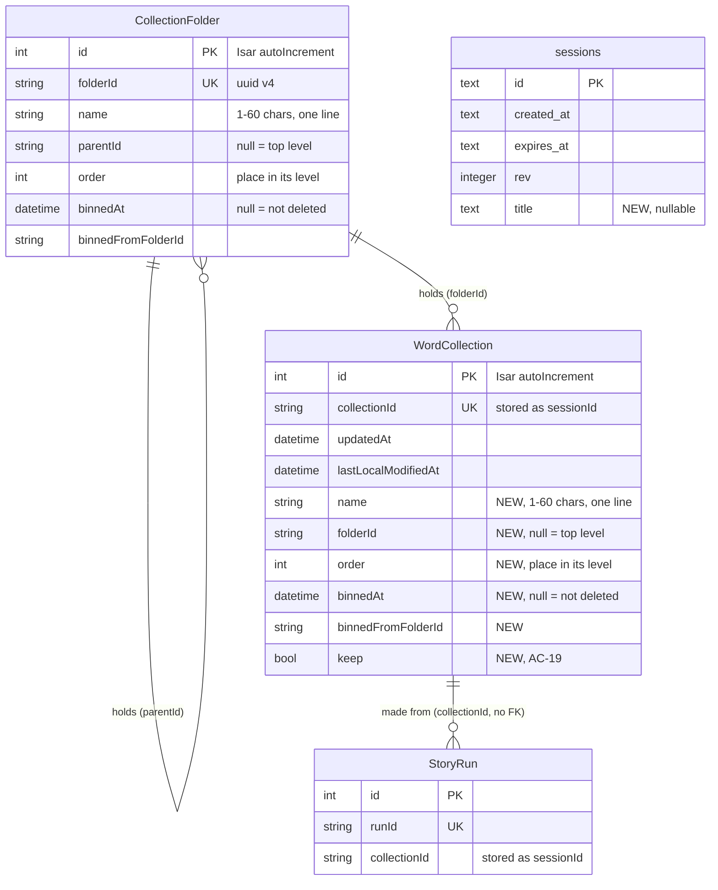

# Data model — collections-screen

> **Inputs:** [spec](./spec.md) §1, §5, §6 · [sad](./sad.md) §4–§6 (F1–F13 persist notes) · [ADR-0002](adr/0002-rename-session-to-wordcollection-with-stored-names-pinned.md), [ADR-0003](adr/0003-keep-filing-on-the-collection-row-written-only-by-store-transactions.md), [ADR-0004](adr/0004-store-folders-as-their-own-isar-collection-linked-by-parent-id.md), [ADR-0005](adr/0005-mark-a-deleted-item-in-place-and-let-a-binned-folders-contents-follow-it.md), [ADR-0007](adr/0007-reopen-the-current-collection-after-any-pause.md), [ADR-0008](adr/0008-send-the-collection-name-as-the-shared-pages-title-in-a-nullable-column.md) · precedent `lib/core/models/session.dart`, `session_source.dart` (`@Name('SourcePhoto')`), `vocab-photo-api/migrations/0001_sessions.sql`, `0005_film_dialogues.sql`.

The feature changes stored shapes in three places:

- **Phone — Isar `vocab`, collection `Session` → Dart `WordCollection`:** renamed in code with every stored name pinned (ADR-0002), and six new filing properties (ADR-0003, ADR-0005). No SQL. A `build_runner` regeneration plus a one-time backfill when the store opens.
- **Phone — Isar `vocab`, new collection `CollectionFolder`:** folders with a parent link (ADR-0004).
- **Server — D1 `sessions`:** a nullable `title` column (ADR-0008). One staged migration.
- **Phone — `shared_preferences`:** `current_session_id` stays as it is. `switched_session_id`, `switched_at`, `seen_session_id` and `seen_at` are removed once at startup (ADR-0007).
- **Unchanged:** `WordPair`, `SessionSource`, `WordGroup`, `FilmDialogue`, `WordResult`, `StoryRun` apart from its Dart field name, D1 `rows`/`sources`/`dialogues`, R2, the photo files under `source_photos/` and `mnemonic_pictures/`.
- **Never stored:** folders, the bin and other collections' names anywhere off the phone (spec §3, AC-30). A folder name never leaves the phone.

**Aggregate roots.** On the phone there are two roots, linked by id only (Isar has no foreign keys):
- **`WordCollection`** owns its words, sources, groups, dialogues, results and tags (embedded, unchanged), plus its own filing fields.
- **`CollectionFolder`** owns only its own filing fields. It does not own its contents: a collection points up at its folder through `folderId`, and a folder points at its parent through `parentId`.
- **`StoryRun`** keeps pointing at its collection by id. It outlives an erased collection by design (spec §8, resolved 2026-10-16).

On the server, **`sessions`** stays the root of `rows`, `sources` and `dialogues`. `title` is just one more column on it.

## ER diagram

## Entities

### Phone — Isar `WordCollection` (root; Isar collection name `Session`)

The class is `@collection @Name('Session') class WordCollection`. Every existing property keeps its stored name: `sessionId` is renamed in Dart to `collectionId` with `@Name('sessionId')`. All other existing names are unchanged, and the embedded lists stay as they are. New properties:

| Property | Dart type | Default for an old record | Notes |
|---|---|---|---|
| `name` | `String?` | `null` → backfilled once | The display name. Written at creation as the creation moment in local time, `dd.MM.yyyy HH:mm` (AC-03). After that, only `rename` writes it. The 1–60 characters, one line, not-only-spaces rule is checked in `collection_name.dart` (AC-02). It never stays null after the backfill. |
| `folderId` | `String?` | `null` | The `CollectionFolder.folderId` it sits in; `null` = top level. Written only by `create`, `move`, `bin` (AC-22's move-up) and `restore`. |
| `order` | `int` | `0` → backfilled once | Its place in its level, shared with the folders of that level. Renumbered `0..n-1` across the level on every insert and move (sad §5). |
| `binnedAt` | `DateTime?` | `null` | Set only on the item the learner deleted (ADR-0005). Bin expiry is `binnedAt + 30 × 24 h` (AC-26); "N days left" comes from its calendar day (sad §8). |
| `binnedFromFolderId` | `String?` | `null` | The folder it was deleted from; the restore target if that folder exists and is not in the bin (AC-24). |
| `keep` | `bool` | `false` → backfilled once | `true` once it was made with New collection, renamed, moved, reordered or given a word (AC-19). Never set back to `false`. `put()` may only raise it (ADR-0003). |

**One-time backfill** (inside `CollectionStore.open`, beside `_fillRowIdsEverywhere`), for every record with `name == null` (AC-04):
- `name` comes from the creation moment encoded in `collectionId`: the base-36 microseconds before the `-`, from `WordCollection.create()`, shown in local time. If that can't be parsed, the earliest of `updatedAt`, `lastLocalModifiedAt` and the sources' `takenAt` is used.
- `folderId = null`.
- `order` is the record's rank by that creation moment, oldest first.
- `keep` is `!isEmpty`.
- Words, sources and every other property are untouched (QG-2). A failed write is logged and retried on the next open; the store never throws.

**`put()` contract** (ADR-0003):
- The six properties above are copied from the stored record, not from the caller.
- The one exception: `keep` becomes `true` when the caller's copy has a non-empty word.
- No stored record with that `collectionId` → no write (an erased collection never returns).

**Access patterns:**
- One level's items (F2, F6): `folderId == x` and not binned, sorted by `order` → index `folderId`.
- Bin list and sweep (F4, F9): `binnedAt != null` → index `binnedAt`.
- By id (every writer): `collectionId` → the existing unique hash index (stored as `sessionId`, unchanged).
- History (F11) and the launch fallback (F4): newest by `lastLocalModifiedAt`, not in the bin. This stays the existing sort with a filter, no new index (§ Indexes).

### Phone — Isar `CollectionFolder` (root; new collection)

| Property | Dart type | Constraints | Notes |
|---|---|---|---|
| `id` | `Id` | `Isar.autoIncrement` | As `Session`. |
| `folderId` | `String` | `@Index(unique: true, replace: true)` | `uuidV4()` from `source_photo_store.dart` (sad §8). What collections and child folders point at. |
| `name` | `String` | required | 1–60 characters, one line, checked in `collection_name.dart` (AC-02, AC-13). Two folders may share a name (spec §1). |
| `parentId` | `String?` | — | Parent `folderId`; `null` = top level. Never itself or a descendant: `filing.dart` checks this inside the `move` transaction (AC-15). |
| `order` | `int` | — | Its place in its level, shared with that level's collections. |
| `binnedAt` | `DateTime?` | indexed | As on `WordCollection`. The contents of a binned folder carry no mark of their own (ADR-0005). |
| `binnedFromFolderId` | `String?` | — | As on `WordCollection`. |

**Access patterns:**
- The folder grid, the path and the "in the bin through an ancestor" rule all need the folder tree. At the spec's 50 folders the whole collection is read at once and walked in memory (`filing.dart`), so there is no `parentId` index.
- By id → the unique `folderId` index.
- Bin list and sweep → index `binnedAt`.

**Erase** (Delete forever, Empty recycle bin, the sweep) deletes the folder and, recursively, every `CollectionFolder` and `WordCollection` under it, in one write transaction. The photo files of the erased collections are deleted after the commit (F4, F9).

### Phone — Isar `StoryRun` (unchanged shape)

The Dart field `sessionId` becomes `collectionId` with `@Name('sessionId')`. Nothing else changes. When a run's `collectionId` matches no `WordCollection`, Story runs shows it as "from a deleted collection" (sad §5). That is worked out at display time and never stored.

### Phone — `shared_preferences`

| Key | Change |
|---|---|
| `current_session_id` | Unchanged string key. Read by the launch rule, written by open, New collection, first launch and the fallback (F3, F4, F7). |
| `switched_session_id`, `switched_at`, `seen_session_id`, `seen_at` | Removed once at startup and no longer written (ADR-0007). |

### Server — D1 `sessions` (root)

| Column | Type | Constraints | Notes |
|---|---|---|---|
| `title` | TEXT | NULL allowed | NEW. Written only by create and republish (`POST /sessions`) when the body carries `title`. The 1–60 characters, one line rule is checked in `handlers.ts`; as `0001` does, text limits live in code. NULL for every page published before this feature and for publishes from an older app: the page shows "Vocabulary" (AC-29). Rendered only through `escapeHtml` (spec §6.1). |

**Access patterns:** read with the session on every page render, by the existing primary key, so no index. `StoredSession` in `src/session/types.ts` gains `title: string | null`.

## Indexes

| Index | Columns | Query it serves |
|---|---|---|
| `WordCollection.sessionId` (existing, unique hash; Dart `collectionId`) | `collectionId` | Every by-id read and write: `update`, `put`, `rename`, `move`, `bin` (F1, F3, F6, F8, F10) |
| `WordCollection.folderId` (NEW, value index, nullable) | `folderId` | One level's collections in Collections, `folderId == x` or `isNull` for the top level (F2, F6), against QG-3's 500 ms with 300 collections. Without it every grid open would read every record and its words |
| `WordCollection.binnedAt` (NEW, value index, nullable) | `binnedAt` | The bin list and the 30-day sweep at every launch and resume, `binnedAt != null` / `binnedAt <= now − 30 × 24 h` (F4, F9), without reading every collection |
| `CollectionFolder.folderId` (NEW, unique hash) | `folderId` | By-id reads and writes of a folder: `rename`, `move`, `bin`, `restore`, the restore-target check (F1, F6, F8, F9) |
| `CollectionFolder.binnedAt` (NEW, value index, nullable) | `binnedAt` | The bin list and the sweep for folders (F4, F9) |

**Considered and not added:**
- `CollectionFolder.parentId`: the tree is read whole and walked in memory at ≤ 50 folders.
- `WordCollection.lastLocalModifiedAt`: History and `newest()` already sort without one today, and this feature doesn't change those queries. If QG-3 profiling shows History slow, it is the first candidate.
- Any D1 index: `title` is never queried.

## Test fixtures

Tests build records the way the repo already does, in Dart, with no seeds in any migration:
- `WordCollection.create()` with `..name`, `..folderId`, `..order`, `..binnedAt`, `..keep` set directly, over an Isar instance opened with `CollectionStore.open(directory: <temp dir>)` (the pattern in `test/session_store_test.dart`).
- A pre-feature record: a `WordCollection` with `name == null`, `order == 0`, `keep == false` and a known `collectionId` timestamp, for the backfill test (AC-04, QG-2).
- `CollectionFolder()..folderId = 'folder-1'..name = 'English course'..parentId = null`, plus nested folders built from that.
- Worker: a create body with `title: "Speaking club 12"`, one with no `title`, and one with an over-long or two-line `title`, in `vocab-photo-api/test/` (AC-29).
- No personal data: names like "Lesson 3", "Unit 3", "Phrasal verbs".
