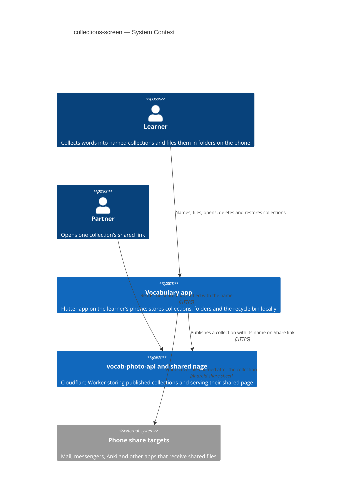
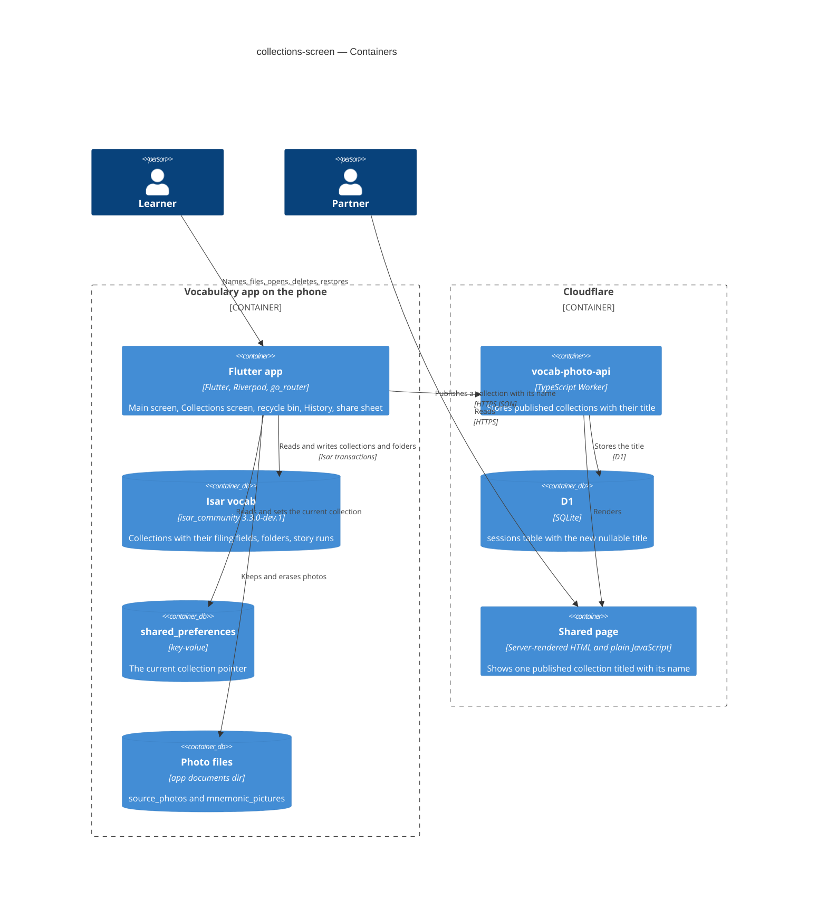
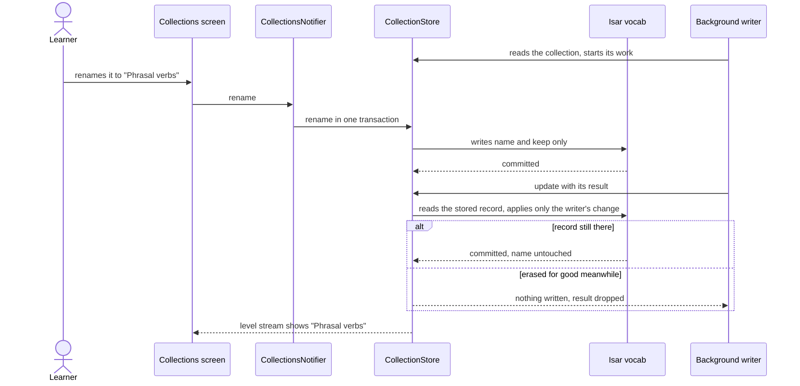
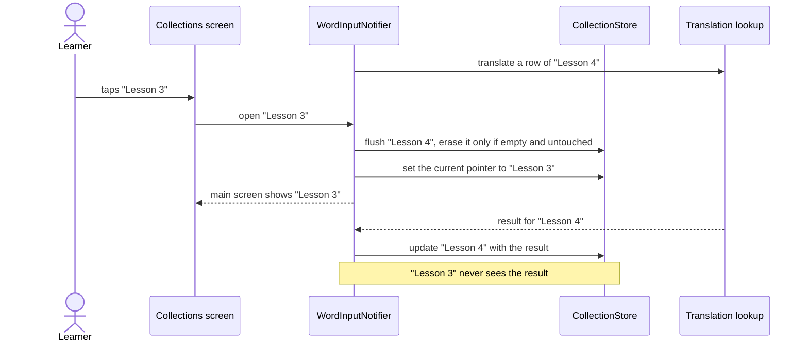

# Software Architecture Document — collections-screen

<!-- 12 Arc42 sections. Empty section → <!-- N/A: <one-line reason> -->. -->
<!-- C4 Context (L1) lives inline in §3. C4 Container (L2) lives inline in §5. -->
<!-- Numbers in §10 come VERBATIM from spec.md §6 NFR — no inventing, no rounding. -->

## 1. Introduction and goals

**Intent.** Give every collection a name and a place. The main screen's title shows the current collection's name, with an edit button beside it. A new Collections screen, opened from the side menu, works like a folder window: nested folders, finger drag, a path and Up. A 30-day recycle bin restores deleted items to where they were. The app always reopens the collection the learner chose and never makes one by itself. The word "session" becomes "collection" in the app's code and in every text the learner and the partner read ([spec](./spec.md) §1–§2).

**Top-3 quality goals (1-liners; full scenarios in §10):**

1. Name and place stability: no background writer can undo a rename, a move or a delete, or bring a collection back from the bin (AC-27).
2. Update safety: moving to the updated app, with the rename and the new filing data, loses no word, photo, note, story or exercise result (AC-04).
3. A responsive folder window: Collections opens fast with hundreds of collections, and a drag never switches the current collection.

**Stakeholders.**

| Role | Interest | Sign-off owner? |
|---|---|---|
| learner | names, files, opens and deletes collections on the phone | No |
| partner | reads the name on a shared page, and nothing else of the learner's filing | No |
| Security Lead | the learner-typed name newly shown on a public, editable page (spec §6.1) | No |
| Tech Lead (Maksym) | SAD approval | Yes |

## 2. Constraints

**Technical.**
- Flutter, Dart SDK `>=3.0.0 <4.0.0`; `flutter_riverpod` / `riverpod_annotation` 2.6.x with `riverpod_generator` ^2.6.1; `go_router` 17.2.3 with `go_router_builder` 3.0.0 typed routes (`lib/router/routes.dart`).
- Persistence: `isar_community` pinned to `3.3.0-dev.1` (database `vocab`: collections `Session` and `StoryRun`). Isar keys a stored collection and its properties by name, so a class or field renamed in Dart must keep its stored name with `@Name` (precedent: `SessionSource` is stored as `SourcePhoto`). Isar adds new properties with null/default values to old records; there is no migration framework, so one-time fixes run when the store opens (precedent: `_fillRowIdsEverywhere`).
- `shared_preferences` holds the current-collection pointer (`current_session_id`), plus the History pick and seen records that this feature retires.
- `SessionStore.put` is a whole-record upsert from the caller's copy. Only `results` is protected today (`session_store.dart:113-151`). Writers that read, change and put a whole copy: the main screen's debounced autosave (`word_input_notifier.dart`), `story_run_tracker.dart:465,489`, `word_groups_notifier.dart:213` and `dialogue_push.dart:327-331`.
- Worker: TypeScript on Cloudflare Workers with D1 (`vocab-photo-api/`, migrations `0001`–`0006`). The shared page is server-rendered HTML from `src/session/page.ts`, today titled "Vocabulary".
- No drag-and-drop or reorderable-grid package is in `pubspec.yaml`, and none may be added (CLAUDE.md rule 5).

**Organisational.**
- One owner designs, builds, reviews and ships. No deadline. Effort budget: L (several PRs over more than a week, per `.size`).

**Conventions.**
- [`CLAUDE.md`](../../../CLAUDE.md) rules 1–7 and [`docs/architecture.md`](../../architecture.md): typed routes only; services from `lib/core/providers.dart`; screen data in a `@riverpod` notifier, controllers/focus/drag flags in widget `State`; no new packages; new data only as the spec approves (§1 last decision: name, folder, place in the order, folders, recycle bin entries).
- Rule 3 exception approved by the spec (§1, decision 1): the app's classes, fields, files and providers are renamed from session to collection, not only moved; stored names stay pinned.
- Tests per [`docs/testing.md`](../../testing.md): `tool/test.sh smoke` while developing, `tool/test.sh changed` before finishing; Worker tests in `vocab-photo-api/test/`.

**Regulatory / external.**
- No accounts and no personal-data processing beyond the learner's own phone. The collection name leaves the phone only in a shared link or a shared file the learner makes (spec §6.1). Security review required: a learner-typed field newly appears on a public, editable page.

## 3. Context and scope

The learner keeps many collections on the phone, one per lesson, club, set or film. This feature names them, files them into folders, and adds a recycle bin, all on the phone. The only thing that crosses the phone's boundary is the collection's name: it goes to the Worker with a shared-link publish and appears as the shared page's title, and it names shared files. Folders, other collections and the bin never leave the phone.

<!-- brownfield: Isar `Session` rows + a shared_preferences pointer (SessionStore); WordInputNotifier owns the current session and runs a 5-minute launch rule with a RESTORE offer; History watches non-empty sessions; the drawer shows only with other sessions; whole-record put() by four writers; the Worker's D1 `sessions` table has no title. -->

**External systems (in / out):**

| Actor or system | Type | Interaction |
|---|---|---|
| learner | Person | names, files, opens, deletes and restores collections on the phone |
| partner | Person | opens a shared link and reads the collection's name as the page title |
| vocab-photo-api (Worker) | System (internal) | receives the name with a shared-link publish and stores it beside the published collection |
| shared page | System (internal) | served by the Worker; shows the name as its title, nothing about folders or the bin |
| phone's share targets | System (external) | receive shared files named after the collection |

**C4 Context (L1):**



## 4. Solution strategy

**Top strategic choices (the seeds for ADRs):**

1. **Three surfaces: the app, the Worker and the shared page** ([ADR-0001](adr/0001-change-the-app-the-worker-and-the-shared-page-as-three-surfaces.md)). `target_surfaces: [mobile-app, backend-service, web-frontend]`. Almost all the work is in the app. The Worker gains a nullable title stored with a published collection; the shared page shows it as its heading and swaps "session" for "collection" in its text. UI architecture is unchanged on both UI surfaces: the app stays Flutter (cross-platform, typed go_router routes, Riverpod notifiers); the page stays server-rendered HTML with one plain-JavaScript file (good-looking-web ADR-0002). Serves quality goal 2 and spec AC-29–AC-31, AC-33.
2. **Rename first, as a mechanical step with stored names pinned** ([ADR-0002](adr/0002-rename-session-to-wordcollection-with-stored-names-pinned.md)). `Session` becomes `WordCollection`, `sessionId` becomes `collectionId`, `SessionStore` becomes `CollectionStore`, and so on through files and providers. `@Name('Session')`, `@Name('sessionId')` and the unchanged `shared_preferences` keys keep every stored record readable as it is. Worker routes, JSON field names and shared links do not change. The rename lands before any behaviour change, with every existing test green, so that a data problem can only come from one place. Serves quality goal 2.
3. **Filing lives on the records, and only dedicated store transactions write it** ([ADR-0003](adr/0003-keep-filing-on-the-collection-row-written-only-by-store-transactions.md), [ADR-0004](adr/0004-store-folders-as-their-own-isar-collection-linked-by-parent-id.md), [ADR-0005](adr/0005-mark-a-deleted-item-in-place-and-let-a-binned-folders-contents-follow-it.md)). A collection gets `name`, `folderId`, `order`, `binnedAt`, `binnedFromFolderId` and `keep`. `put()` never writes these fields and never creates a missing record. A new Isar collection `CollectionFolder` holds folders with a parent link. Deleting marks the item in place, and a binned folder's contents follow it. Rename, move, reorder, bin, restore and erase are each one Isar write transaction in `CollectionStore`. Serves quality goals 1 and 3.
4. **Late work lands in its own collection through an atomic update** ([ADR-0006](adr/0006-deliver-late-results-into-their-own-collection-through-an-atomic-store-update.md)). `CollectionStore.update(collectionId, change)` reads, changes and writes one record inside one transaction, and does nothing when the record is gone. Every background writer uses it, and so does a translation, photo reading, Quizlet or subtitle result that returns after the learner opened another collection. This replaces "drop a result for another session" (edit-session-from-history ADR-0003, import-from-quizlet). Serves quality goal 1 and AC-11.
5. **The current collection is the learner's choice, nothing else** ([ADR-0007](adr/0007-reopen-the-current-collection-after-any-pause.md)). The launch rule loses its 5-minute window, the RESTORE offer, and the seen and History-pick records. It reopens the pointer's collection; if that is missing or in the bin, it reopens the newest collection outside the bin; with nothing stored, it starts a first one. The store refuses to bin the current collection. Serves AC-12, AC-21.
6. **The name reaches the shared page only through Share link** ([ADR-0008](adr/0008-send-the-collection-name-as-the-shared-pages-title-in-a-nullable-column.md)). The publish payload carries `title`. D1 migration `0007` adds a nullable `title` column. Only a create or republish writes it; dialogue and picture deliveries never touch it. The page shows `title`, escaped, or "Vocabulary" when it is null. Serves AC-29, AC-30.

Each tactical decision in later sections should trace to one of these seeds. Tactical decisions that *contradict* a strategic choice are red flags — surface them in §11.

## 5. Building block view

The app keeps the repo's layering: feature folders under `lib/features/`, shared models and services under `lib/core/`, typed routes in `lib/router/routes.dart`, services reached through `lib/core/providers.dart`. The new screens are a feature folder of their own. They talk to the rest only through `CollectionStore` and routes, never by importing another feature's screen (architecture.md rule 3).

**Internal decomposition:**

```
lib/
  core/
    models/
      word_collection.dart (+.g)   WordCollection — renamed Session, @Name('Session'); new fields:
                                   name, folderId, order, binnedAt, binnedFromFolderId, keep (ADR-0003, ADR-0005)
      collection_folder.dart (+.g) CollectionFolder — new Isar collection: folderId, name, parentId,
                                   order, binnedAt, binnedFromFolderId (ADR-0004)
      collection_name.dart         pure: the 1–60 characters, one-line rule; the default name
                                   "dd.MM.yyyy HH:mm"; the creation moment from a collectionId
    services/
      collection_store.dart        renamed SessionStore. put() keeps filing fields and never inserts;
                                   create(); update(id, change) (ADR-0006); rename, move, reorder,
                                   bin, restore, erase, sweepBin; watchLevel(folderId), watchBin(),
                                   watchHistory(); the one-time filing backfill on open
      filing.dart                  pure rules: ancestors/descendants of a folder, "is it in the bin
                                   (itself or an ancestor)", a folder into itself (AC-15), the level
                                   renumbering, the restore target (AC-24), days left (AC-23),
                                   the 30-day expiry (AC-26), the empty-and-untouched rule (AC-19)
  features/
    collections/
      collections_screen.dart      the folder window: path, Up, New folder, New collection, grid
      collections_notifier.dart(+.g) the open folder id, the level's items, the path; actions
                                   call CollectionStore
      collection_icon.dart         one folder or collection icon with its ⋮ button; LongPressDraggable
                                   and DragTarget built into Flutter
      collection_drag.dart         drop-target rules for the grid, Up, the path and the bin zone,
                                   the 1 s hover-to-open timer (widget State)
      recycle_bin_screen.dart      bin list with "N days left", item menu, Empty recycle bin
      name_dialog.dart             the name dialog shared by the main screen and Collections
    word_input/                    title shows the name + edit button; the side menu always on,
                                   with Main / Collections / History; launch rule (ADR-0007)
    history/                       rows show name + word count; binned collections left out
    words_table/                   share_formats.dart: safeFileName(name); PDF heading; share subject
  router/routes.dart               + CollectionsRoute, RecycleBinRoute
vocab-photo-api/
  migrations/0007_session_title.sql  nullable title on sessions (+ down)
  src/session/                       handlers.ts reads title on create/republish; page.ts heading
                                     and "collection" wording
```

- **Extend vs new module.** `CollectionStore` stays the one owner of collection persistence. Folders go in the same store (same Isar instance, same transactions), because a move, a bin or an erase must change a folder and its collections in one transaction.
- **Story runs after an erase** (spec §8 open question, resolved by the owner 2026-10-16): the runs stay in Words settings → Story runs, marked "from a deleted collection", and their pictures are kept. The mark is worked out when the list is shown (no collection with that id exists any more); `StoryRun` and its store do not change.
- **The 30-day sweep** (`sweepBin`) runs when the store opens and when the app comes back to the foreground. It erases the records and the `source_photos/` files of each expired collection and of everything inside an expired folder.

**C4 Container (L2):**



## 6. Runtime view

**Critical flow 1: a rename survives a background writer finishing (AC-27)**



**Critical flow 2: opening another collection while a lookup runs (AC-09, AC-11, AC-19)**



**Critical flow 3: the 30-day sweep at launch (AC-26)** — the store opens, `sweepBin` finds items whose `binnedAt` is at least 30 × 24 h ago, and in one transaction erases them (and every record inside an expired folder); their photo files are deleted after the commit. The `sequences` stage draws this flow and covers every remaining AC.

## 7. Deployment view

<!-- 🎯 Why: the TOPOLOGY DevOps must know without reading the deploy charts — how many replicas,
     where the background worker lives, AT WHAT NUMBERS we scale.
     📋 Write: 2–3 sentences on topology + monitoring + concrete threshold numbers.
     📌 e.g. «500 authors → partition by quarter» (not «we'll think about scale later»).
     🎯 N/A allowed for XS/S that reuses an existing deployment unit with no change.
     Deployment-diagram scaffold → templates/deployment.md. -->

<Topology in 2–3 sentences. Where it runs, replicas, scaling thresholds.>

**Monitoring:**
- <Metrics — e.g. `<metric_name>`>
- <Alerts — e.g. «worker lag > 10 min → page on-call»>
- <Tracing — e.g. spans on the request boundary>

**Scaling thresholds:**
- <e.g. comfortable in one table up to N rows/year>
- <e.g. partition by quarter above N rows/year>

<!-- For XS/S with no deployment change: <!-- N/A: reuses existing deployment unit, no infra change --> -->

## 8. Crosscutting concepts

<!-- 🎯 Why: CROSS-CUTTING PATTERNS spanning several modules: logging, errors, authorization, ID
     strategy, events, caching. ⭐ The second-densest section. A pattern inside one module is NOT
     here; a project-wide convention belongs in the convention file.
     📋 Write: a table — concept / convention / where defined. One row per concept.
     📌 e.g. «sortable time-based IDs generated in the app layer» as a default from the convention file. -->

| Concept | Convention | Where defined |
|---|---|---|
| Logging | <e.g. structured, fields `module=<name>`> | <convention file §X or here> |
| Authentication | <e.g. token-based via middleware> | <convention file §X> |
| Error handling | <e.g. domain sentinel → ports error mapping → JSON> | <convention file §X> |
| ID strategy | <e.g. sortable time-based ID in the app layer> | <convention file §X> |
| Internationalisation | <e.g. N/A, single language> | — |
| Observability | <e.g. tracing on the request boundary> | — |
| Events | <module-specific patterns, if any> | <here> |

## 9. Architecture decisions

<!-- 🎯 Why: the REVERSE INDEX onto the adr/ folder. `ls adr/` gives the files; §9 gives the
     semantics — why they exist, which SAD section they attach to, what status.
     📋 Write: a 4-column table, one row per ADR. Mixed status is fine.
     📌 e.g. «0001 | Store content as a table of typed blocks | Accepted | §4». -->

| # | Title | Status | Section |
|---|---|---|---|
| <NNNN> | <imperative — e.g. "Use a sliding-window counter for rate limiting"> | Accepted | §<N> |
| <NNNN> | <imperative — e.g. "Co-locate the worker in the API process"> | Accepted | §<N> |

ADR files live under `docs/features/<slug>/adr/NNNN-<title>.md`.

## 10. Quality requirements

<!-- 🎯 Why: the QUALITY TREE — take a goal from §1 and break it into concrete leaves: tests,
     metrics, configs, drills. ⭐ Without §10, §1 is a manifesto. With §10 each declaration maps
     to something PROVABLE.
     📋 Write: per §1 goal — When / Then / How-verify. Numbers from spec §6 NFR VERBATIM (don't
     round ≤250ms to ≤300ms — that's a critic F6 hit).
     📌 e.g. «p95 ≤ 500 ms on a block update, verified by a 100 req/s load test». -->

Each top-3 goal from §1 expanded into a full scenario:

**QG-1. <quality attribute>**
- **When:** <trigger condition>
- **Then:** <expected behaviour with numbers from spec §6 NFR>
- **How verify:** <test / chaos drill / load test / metric>

**QG-2. <quality attribute>**
- **When:** <trigger>
- **Then:** <expected>
- **How verify:** <how>

**QG-3. <quality attribute>**
- **When:** <trigger>
- **Then:** <expected>
- **How verify:** <how>

## 11. Risks and technical debt

<!-- 🎯 Why: ⭐ collects EVERYTHING that can break — not only the technical. Without §11 risks get
     discussed at standups and lost; debt lives only in the head of whoever accepted it.
     📋 Write: a risk/debt table — severity — mitigation — owner. Accepted debt in its own block.
     📌 The first risk is often a product risk, not a technical one. That's normal. -->

<!-- Severity literals: Low / Medium / High for regular risks; "Open question" for rows created by
     a Save-as-OQ resolution during the Socratic walk (see references/socratic.md). -->

| Risk / debt | Severity | Mitigation | Owner |
|---|---|---|---|
| <e.g. Worker lag may reach hours during a downstream outage> | Medium | <alert >10 min, on-call playbook, retry backoff> | <DevOps> |
| <e.g. No event-schema versioning in v1> | Medium | <ADR-NNNN planned for v2, tolerate unknown fields> | <Backend> |
| Open architectural decision: <decision-headline> | Open question | Resolve before <stage trigger or YYYY-MM-DD>; <inline rationale from the Save-as-OQ> | <owner> |

**Accepted debt (acceptable in v1, plan to fix later):**
- <e.g. the entity is immutable / unversioned — OK for v1, may need audit versioning in v2>

## 12. Glossary

<!-- 🎯 Why: ⭐ the DOMAIN GLOSSARY that ends arguments a year later («checkpoint — weekly or
     biweekly? quarter — calendar or fiscal?»).
     📋 Write: a term / meaning table. Business + technical terms mixed.
     📌 e.g. «Lesson | a unit inside a course made of blocks (text, video)». -->

| Term | Meaning |
|---|---|
| <e.g. domain object A> | <its meaning in this domain> |
| <e.g. domain object B> | <its meaning> |
| <e.g. domain invariant name> | <the rule, in plain language> |
