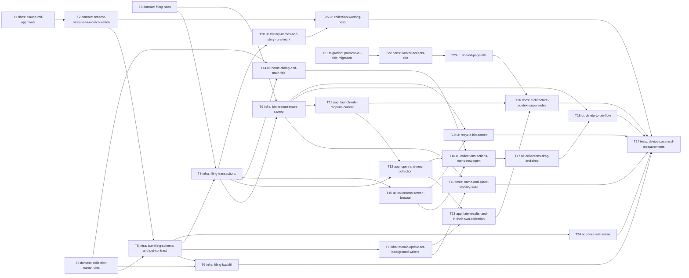

# Epic — collections-screen

> **Spec:** [spec.md](../spec.md) · **Design:** [sad.md](../sad.md) · **UX flows:** [ux-flows.md](../ux-flows.md) · **Screens:** [screens.md](../screens.md) · **Data model:** [data-model.md](../data-model.md) · **API:** [openapi.yaml](../contracts/openapi.yaml) · **ADRs:** [adr/](../adr/)

## Goal

Every collection gets a name shown wherever it appears, the learner files collections into nested folders by finger drag on a new Collections screen, and a 30-day recycle bin restores deleted items to their old place. The app reopens the collection the learner chose and never makes or switches one by itself, and no background writer can undo a rename, a move or a delete (spec §2).

## Scope

- **In:** the session → collection rename with stored names pinned; the Isar filing fields, `CollectionFolder`, the backfill and the store's filing, bin and update transactions; the launch rule; the main screen's title and edit button; the Collections and recycle bin screens; History and Story runs labels; share link title, share sheet warning and file names; the wording pass; D1 migration 0007, the Worker's `title` and the shared page heading; docs and a device pass. Surfaces: `[mobile-app, backend-service, web-frontend]` (sad frontmatter, ADR-0001).
- **Out:** folders on the shared page or in exports, changes to History's role, multi-select or batch moves, sorting/search, merging collections, a retro look, renaming from the shared page, taking a page down (spec §3).

## Task map

Three lanes start together: the **rename** (T1 → T2) and the **pure rules** (T3, T4) on the phone, and the **Worker** (T21 → T22 → T23). The store lane (T5 → T6/T7/T8 → T9) serializes on `collection_store.dart`; the screens fan out from it and meet the Worker lane only through the contract (T24 needs no Worker change to ship).

## Tasks

See [tracker.md](./tracker.md) for status. Machine contract: [tasks.json](../tasks.json).

| # | Task | Layer | Blocked by | ACs |
|---|---|---|---|---|
| T1 | Record the owner's approvals for collections-screen in CLAUDE.md rules 3 and 5 | docs | — | — |
| T2 | Rename Session to WordCollection across the app with every stored name pinned | domain | T1 | AC-04 |
| T3 | Add the pure name rule, the default date name and the creation moment from a collection id | domain | — | AC-02, AC-03, AC-04 |
| T4 | Add the pure filing rules: tree walks, folder into itself, level renumbering, restore target, days left and expiry | domain | — | AC-15, AC-19, AC-23, AC-24, AC-26 |
| T5 | Add the filing fields and CollectionFolder to Isar, and make put() keep filing and never insert | infra | T2, T3 | AC-19, AC-27 |
| T6 | Backfill names, top-level order and keep for pre-feature collections when the store opens | infra | T3, T5 | AC-04 |
| T7 | Add CollectionStore.update(id, change) and move every background writer onto it | infra | T5 | AC-11, AC-27 |
| T8 | Add rename, new folder, move and reorder transactions and the level, path and History streams | infra | T4, T5 | AC-01, AC-13, AC-14, AC-15, AC-17, AC-28 |
| T9 | Add bin, restore, erase, empty-bin and the 30-day sweep to CollectionStore | infra | T4, T8 | AC-20, AC-21, AC-22, AC-24, AC-25, AC-26 |
| T10 | Run the QG-1 stability suite: 100 interleavings of every background writer with every filing change | tests | T7, T9 | AC-27 |
| T11 | Make launch and resume reopen the current collection, sweep the bin, and drop the RESTORE offer | app | T9 | AC-12, AC-26 |
| T12 | Add open(id) and newCollection(folderId) to the main screen's notifier with the AC-19 leave rule | app | T8, T11 | AC-09, AC-10, AC-12, AC-18, AC-19 |
| T13 | Deliver late translation, photo reading, Quizlet and subtitle results into the collection they started in | app | T7, T12 | AC-11, AC-27 |
| T14 | Show the collection's name as the main screen's title with a white edit button and the shared NameDialog | ui | T3, T8 | AC-01, AC-02, AC-03, AC-05 |
| T15 | Add the Collections route and screen with path, Up and the icon grid, and keep the side menu always on | ui | T8 | AC-06, AC-07, AC-08 |
| T16 | Open a collection with a tap, add New folder and New collection, and the item menu with Rename | ui | T12, T14, T15 | AC-09, AC-10, AC-13, AC-17, AC-18 |
| T17 | Drag icons into folders, up a level, onto the path and into a new order, with hover-to-open | ui | T16 | AC-14, AC-15, AC-16 |
| T18 | Delete from the menu or the bin drop zone with the confirmation, the current-collection refusal and the stayed message | ui | T9, T17 | AC-14, AC-20, AC-21, AC-22 |
| T19 | Add the recycle bin screen with days left, Restore, Delete forever and Empty recycle bin | ui | T9, T15 | AC-23, AC-24, AC-25 |
| T20 | Show name and word count in History rows, and mark story runs of an erased collection | ui | T8 | AC-28 |
| T21 | Promote the staged D1 title migration into the Worker as 0007 | migration | — | AC-29 |
| T22 | Accept, validate and store the optional title on POST /sessions create and republish | ports | T21 | AC-02, AC-29, AC-30 |
| T23 | Show the stored title as the shared page's heading and document title, escaped, with Vocabulary as the fallback | ui | T22 | AC-29, AC-30, AC-33 |
| T24 | Send the name with Share link, warn that it is public, and name shared files after it | ui | T5 | AC-29, AC-31, AC-32 |
| T25 | Replace "session" with "collection" in every text the learner reads | ui | T2, T20 | AC-33 |
| T26 | Update architecture.md, CONTEXT.md, the superseded ADRs and the Worker README | docs | T11, T13, T23 | — |
| T27 | Run the device pass: the update over a copy of the owner's data, open time, force-close durability, and deploy the Worker | tests | T6, T10, T18, T19, T24, T25, T26 | AC-04, AC-05, AC-14, AC-26, AC-27 |

## Risks / Hard rules

- **Rename first, alone** (ADR-0002, sad §11 top risk): T2 is one mechanical commit on a quiet master; nothing else in flight. Visible wording waits for T25.
- **put() never writes filing and never inserts** (ADR-0003); every background writer goes through `update` (ADR-0006). T10 is the guard; a new writer added later must use `update` (T26 writes the rule into architecture.md).
- **CLAUDE.md rules 3 and 5:** only the visible changes and new data approved in spec §1 (T1 records them). No new packages: drag and drop uses Flutter's own `LongPressDraggable`/`DragTarget`. Navigation only through typed routes.
- **The current collection is never binned** — checked by the store inside the transaction, not only by the screen (AC-21).
- **Name rule counts code points on both sides** (api-sync-report): T3 and T22 share the same test cases.
- **QG-3 fallback needs the owner:** if the grid misses 500 ms, a stored word count is new data — ask, don't add (T27).
- Tests: `tool/test.sh smoke` while developing, `tool/test.sh changed` before each task's commit; full regression only when the owner asks.
