# UX flows — collections-screen

> User flows for every UI-touching §4 user story of [spec.md](./spec.md), produced by `ux-flows`
> (after `clarify`, before `design`) and read by `design` (evidence for the target-surface + UI
> decisions), `sequences` (UI-driven flows align on SCR ids), `screens` (details every inventory
> row) and `plan-tests` (the e2e-through-UI paths). Markdown + mermaid `flowchart` only — flow
> altitude, not visual design.

## Platform decisions

- **Posture:** mobile-first. The app runs on a phone, held upright, worked by finger. There is no `docs/design-system.md` yet, so this posture is set here (owner, 2026-10-16) and should move into the design canon (`/sdd:design-system`).
- The shared page keeps the layouts it has today, one for phones and one for wider screens. This feature changes only its title (AC-29, AC-30).
- **Navigation shape:** Collections, the recycle bin and History are full screens, opened from the side menu or from Collections. Moving between folders stays on the Collections screen, which shows the path and an Up button (one screen whose folder changes, not one screen per folder).
- **Modality:** naming (rename, new folder), delete and erase confirmations are dialogs over the screen they start from, not screens of their own. The item menu (long press released without moving, or the ⋮ button) is a small menu over the Collections screen or the recycle bin.
- **Gesture split:** a tap opens (a folder, or a collection for work). A long press that moves becomes a drag; a long press released without moving opens the item menu. During a drag, a recycle bin drop zone appears in every folder.
- Leaving a collection always lands on the main screen: a tap, "New collection", or the launch rule.

## Screen inventory

| ID | Screen | Purpose | Entry | Exit |
|---|---|---|---|---|
| SCR-01 | Main screen | Edit the current collection's words; title shows its name with the edit button (icon only, white background, no text) beside it | app start, a tap on a collection, "New collection", Main in the side menu | SCR-02 (edit button), SCR-03 (side menu), SCR-13 (Next) |
| SCR-02 | Name dialog | Type a name for a collection or folder, or a new folder; checks the 1–60 characters, one line rule | SCR-01 edit button, SCR-05 Rename, SCR-04 New folder | back to where it came from, saved or cancelled |
| SCR-03 | Side menu | Main, Collections, History — always available | SCR-01 menu | SCR-01, SCR-04, SCR-11 |
| SCR-04 | Collections screen | Folder window: icons of folders and collections in the learner's order, path, Up, New folder, New collection; at the top level the recycle bin is the last icon | SCR-03 Collections; Back from SCR-08 | SCR-01 (tap a collection, New collection), SCR-04 another folder (tap folder, Up, path), SCR-05, SCR-07, SCR-08 |
| SCR-05 | Item menu | Rename / Delete for one collection or folder | long press released without moving, or ⋮, on SCR-04 | SCR-02, SCR-07, the refusal message on SCR-04 |
| SCR-07 | Delete confirmation | Names what goes to the bin (a collection with its word count, or a folder with how many collections and folders), and names the current collection as staying | SCR-05 Delete, or a drop onto the bin zone | SCR-04 |
| SCR-08 | Recycle bin | Deleted items with "N days left"; Empty recycle bin | the bin icon on SCR-04 at the top level | SCR-04, SCR-09, SCR-10 |
| SCR-09 | Bin item menu | Restore / Delete forever for one item in the bin | tap, long press or ⋮ on an item in SCR-08 | SCR-08, SCR-10 |
| SCR-10 | Erase confirmation | Warns that erasing cannot be undone, and that a shared page stays online but can no longer be updated | SCR-09 Delete forever, SCR-08 Empty recycle bin | SCR-08 |
| SCR-11 | History | Collections with words, newest first, each row with its name and word count, the date below, and "current" on the current one | SCR-03 History | SCR-13 (a row) |
| SCR-12 | Share sheet | Share file or share link; the public-page warnings, now also about the name | Share on SCR-13 | SCR-14 (link published), SCR-15 (Share file) |
| SCR-13 | Words table | The existing words screen of a collection (read-only for one opened from History) | SCR-01 Next, SCR-11 row | SCR-12, SCR-01 |
| SCR-14 | Shared page | The partner's web page of one published collection, now titled with its name | the link | — |
| SCR-15 | Share format sheet | The existing second sheet with the five file formats | SCR-12 Share file | the phone's own share targets, outside the app |

## Flows

### Flow: US-01 — Name the collection I'm working in

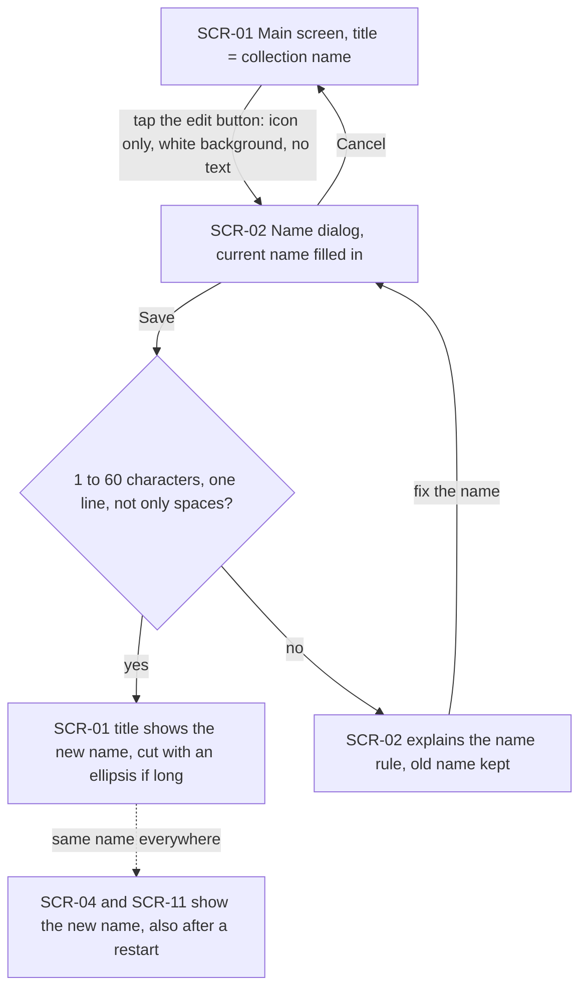

The learner taps the edit button beside the main screen's title, an icon only on a white background with no text (styled like the Next button, minus its label), and the name dialog opens with the current name in it. Cancel goes back with nothing changed. Save checks the name. If it is fine, the title shows the new name, cut short with an ellipsis when it is long (the edit and Next buttons always stay visible), and Collections and History show the same name, also after a restart. If it is empty, only spaces, longer than 60 characters or has a line break, the dialog stays open, says the name must be 1 to 60 characters on one line, and the old name is kept until the learner fixes it or cancels. A collection never renamed shows its creation date and time.

### Flow: US-02 — See all my collections as folders and files

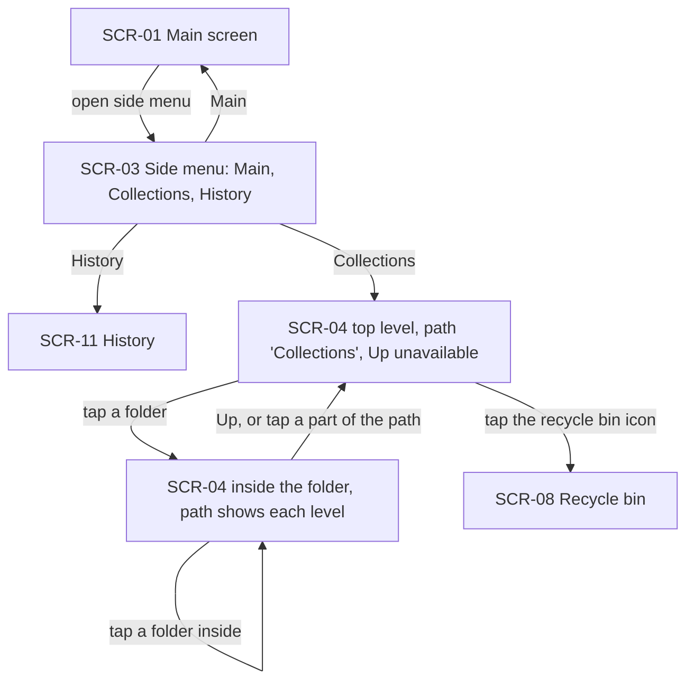

The side menu is always there, even with a single collection, and holds Main, Collections and History. Collections opens the top level: the path reads "Collections", Up is unavailable, and folders and collections appear as icons in the learner's own order, with the recycle bin always last. Each collection icon shows its name and word count, and the current one is marked. Tapping a folder opens it on the same screen and the path grows ("Collections › English course › Unit 3"). Up, or a tap on a part of the path, goes back up. The bin icon opens the recycle bin.

### Flow: US-03 — Open a collection to work in it

```mermaid
flowchart TD
    A["SCR-04 any folder"] -->|tap a collection| B{"Is it the current collection?"}
    B -->|yes| M["SCR-01 Main screen on it, nothing else changes"]
    B -->|no| C{"Is the collection being left empty and untouched?"}
    C -->|yes| D["the left collection is erased, no bin entry"]
    C -->|no| E["the left collection stays in its folder with all it had"]
    D --> F["the tapped collection becomes current"]
    E --> F
    F --> G["SCR-01 Main screen with its words, its name as title, no question asked"]
    W["work still running for the left collection"] -.->|finishes into the left one, even in the bin| E
```

A tap on a collection on the Collections screen opens it for work, with no question asked. If it is already current, the main screen opens and nothing else changes. Otherwise the collection being left is either kept in its folder with everything it had, or, when it has no words, photos, notes or tags and the learner never created it with the button, renamed, moved or reordered it, and it never had words, erased at once without going to the bin. Then the tapped collection becomes current and the main screen shows its words with its name as the title. A translation, photo reading or import still running for the left collection finishes into that collection, never into the one just opened.

### Flow: US-04 — Stay in the collection I chose

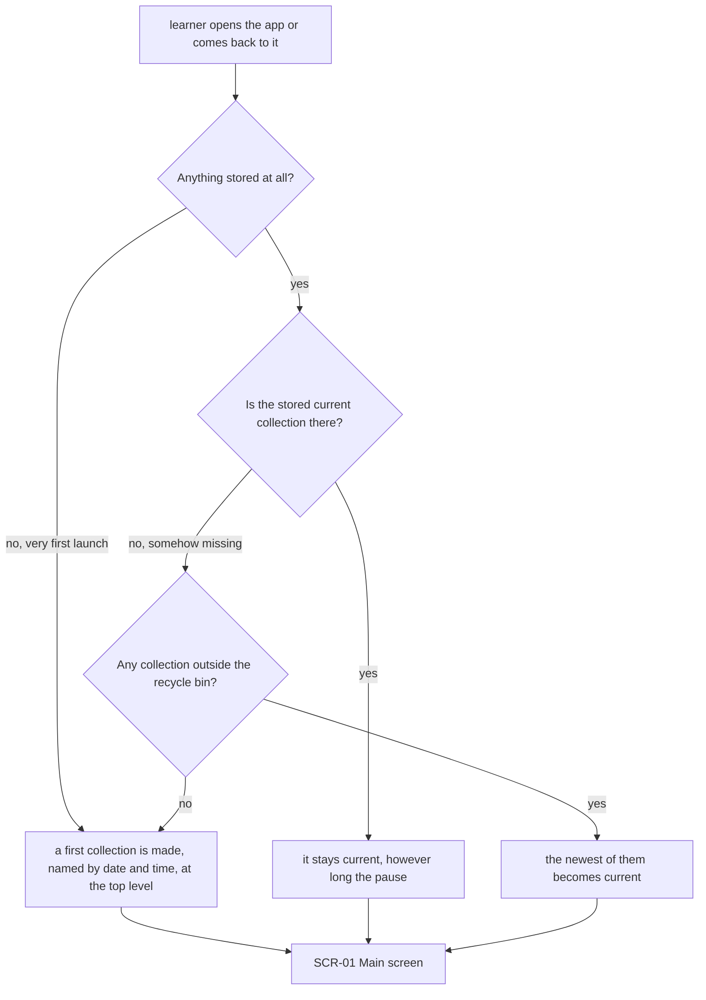

Opening the app, or coming back to it after any pause, lands on the main screen of the current collection. No new collection is made and no restore offer appears. Only a very first launch with nothing stored makes a first collection, named by its date and time, at the top level. The current collection is the learner's stored choice. Nothing in the background changes it. If it is somehow missing, the newest collection outside the recycle bin opens, or a new one when there is none.

### Flow: US-05 — File collections into folders

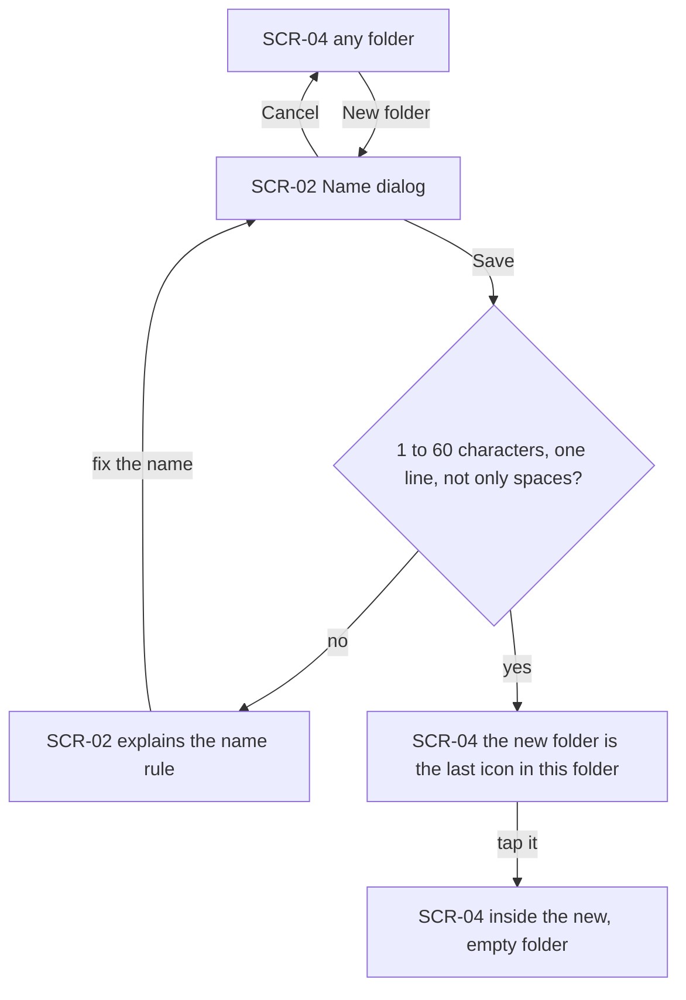

On any folder of the Collections screen the learner chooses New folder, and the name dialog opens. Cancel changes nothing. A name that breaks the 1 to 60 characters, one line rule is refused with the same explanation as a rename. A good name adds the folder as the last icon of the folder the learner is in, and it is still there after a restart. A tap opens it like any other folder, so folders nest to any depth.

### Flow: US-06 — Rearrange by dragging

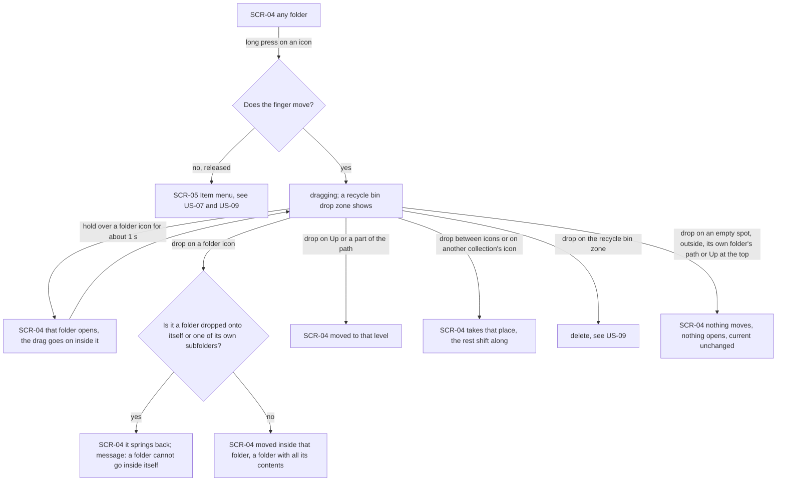

A long press on any icon becomes a drag only when the finger moves. Released without moving, it opens the item menu instead. While dragging, a recycle bin drop zone appears (at the top level it is the bin icon itself). Holding the dragged item over a folder for about a second opens that folder, and the drag carries on inside it, so an item can go several levels deep in one move. Dropping on a folder moves the item inside, and a folder takes all its contents with it. A folder dropped onto itself or one of its own subfolders springs back, with a message that a folder cannot go inside itself. Dropping on Up or a part of the path moves the item to that level. Dropping between icons, or on another collection's icon, puts it in that place in the order and shifts the rest along; collections never merge. Dropping on the bin zone starts a delete, with the same rules and confirmation as the menu's Delete. A drop that would change nothing — an empty spot, outside the grid, its own folder's path part or Up, or Up at the top level — changes nothing, opens nothing and never switches the current collection. Every change is still there after a restart.

### Flow: US-07 — Rename anything from Collections

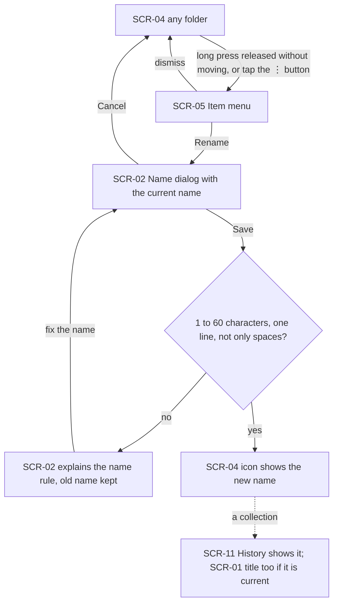

The item menu opens two ways: a long press released without moving, or the ⋮ button on the icon. Rename opens the name dialog with the current name, for a collection or a folder alike. The same name rule applies, with the same refusal and explanation. A saved name shows on the icon at once. For a collection it also shows in History, and in the main screen's title when it is the current one.

### Flow: US-08 — Start a new collection

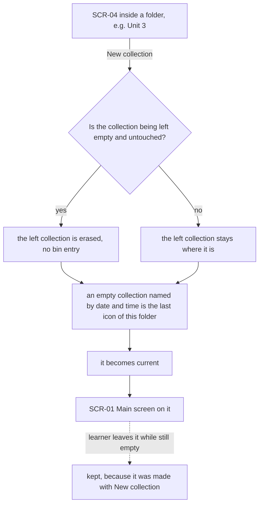

On any folder the learner chooses New collection. An empty collection named by its creation date and time appears as the last icon of that folder, becomes the current collection, and the main screen opens on it. The collection being left follows the same rule as a tap: kept, unless it is empty and untouched, in which case it is erased without going to the bin. A collection made with New collection is kept even if the learner leaves it empty, though it never shows in History until it has words.

### Flow: US-09 — Delete without fear

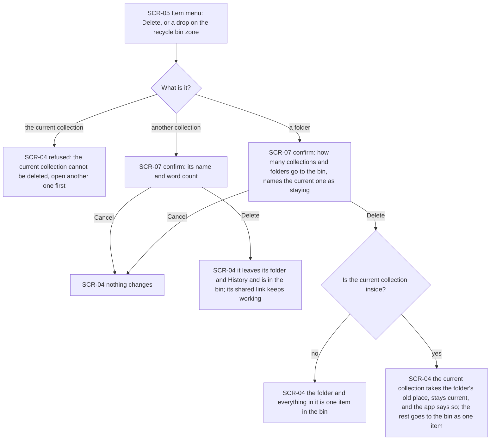

Delete is reached from the item menu or by dropping an icon on the recycle bin zone. The current collection is never deleted: the app refuses and says to open another collection first. Any other collection gets a confirmation that names it and its word count. On Delete it leaves its folder and History and appears in the bin, and its shared link keeps working. A folder gets a confirmation that counts the collections and folders going to the bin, and names the current collection as staying when it is inside. On Delete the folder and its contents become one item in the bin, while the current collection, if it was inside, takes the folder's old place one level up and stays current, and the app says so. Cancel always changes nothing.

### Flow: US-10 — Restore or erase from the recycle bin

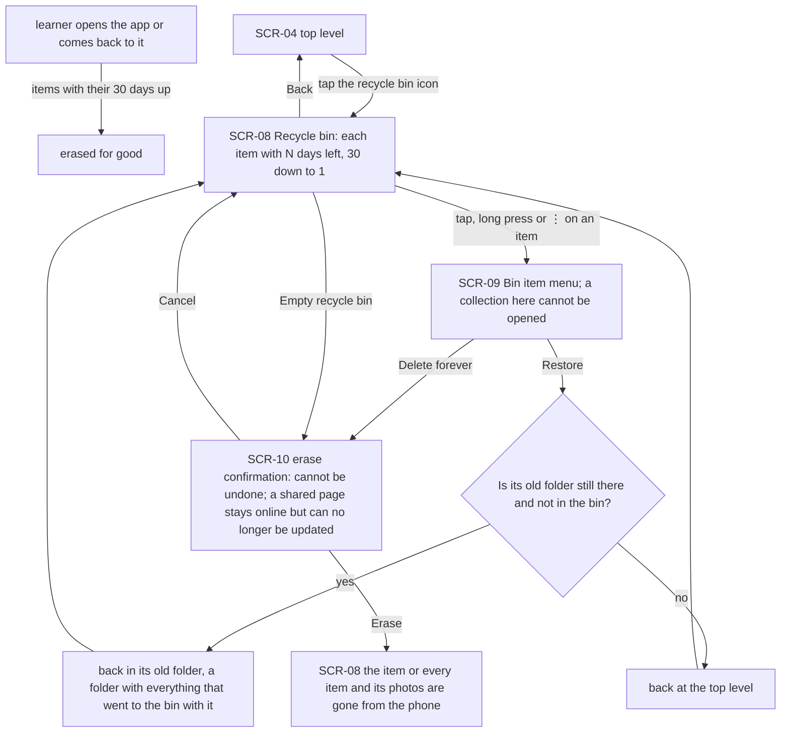

The recycle bin opens only from its icon at the top level. It lists every deleted item with "N days left", from 30 on the day it was deleted to 1 on its last day. A collection in the bin cannot be opened or made current: tapping it, long-pressing it or using its ⋮ opens the bin item menu. Restore puts the item back in the folder it came from, or at the top level if that folder is gone or is itself in the bin, and a folder comes back with everything that went to the bin with it. Delete forever on one item, or Empty recycle bin for all of them, asks first. The question warns that this cannot be undone and, for a collection with a shared link, that the page stays online but can no longer be updated from the app. Cancel changes nothing. Whenever the learner opens or comes back to the app, items whose 30 days are up are erased for good.

### Flow: US-11 — Recognise collections in History

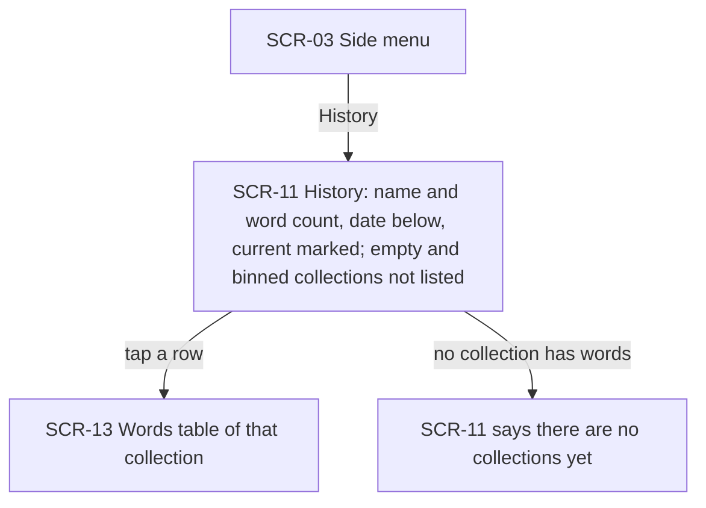

History, from the side menu, lists every collection that has words, newest first. Each row shows the collection's name and word count with the date below, and the current one is still marked "current". Empty collections and collections in the recycle bin are not listed. When none has words, History says there are no collections yet. Tapping a row opens that collection's words table, as today.

### Flow: US-12 — See the collection's name on the shared page

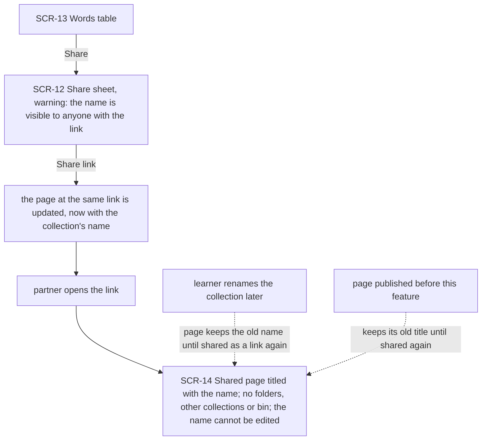

The learner shares from the words table. The share sheet now also warns that the collection's name will be visible to anyone with the link. Share link publishes, or republishes over the same page at the same link, carrying the name. The partner opening the link sees the name as the page title and nothing about the learner's folders, other collections or bin, and cannot change the name. A later rename reaches the page only when the learner shares as a link again. Automatic deliveries of dialogues and pictures never change it, and a page published before this feature keeps its old title until it is shared again.

### Flow: US-13 — Share files named after the collection

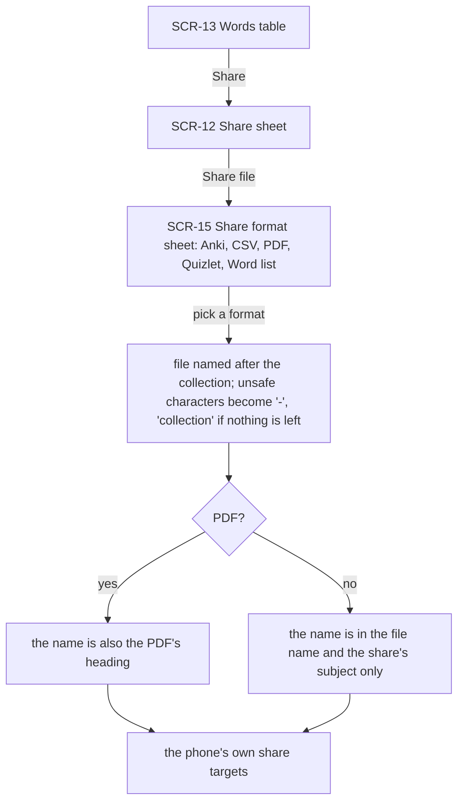

Share file leads, as today, to the sheet with the five formats. Whichever format is picked, the file is named after the collection. Each of the characters a file name cannot hold becomes "-", so "16.10.2026 14:30" becomes "16.10.2026 14-30", and "collection" is used if nothing is left. The share's subject carries the name too. Only the PDF also shows it inside, as its heading. The collection's own name is never changed by this.

### Not drawn

- **US-14 — One word for one thing:** a wording change on screens that already exist (History's empty list, the photo panel's heading, the Notes page's tag field, the import results, the shared page). Nobody moves anywhere new, so there is no flow; AC-33 is covered by the screens it names.

## AC coverage

| AC | Shown by | Notes |
|---|---|---|
| AC-01 | Flow US-01 → Save, valid → title + SCR-04/SCR-11 | |
| AC-02 | Flow US-01 → invalid branch; Flow US-05, US-07 → invalid branch | same rule for folders |
| AC-03 | Flow US-01 prose; Flow US-04 → first collection named by date and time | default name |
| AC-04 | N/A: no movement — a one-time change on the first open after the update | `design` and `plan-tests` cover it |
| AC-05 | Flow US-01 → node D (ellipsis) | |
| AC-06 | Flow US-02 → SCR-03 → SCR-04 top level | bin last at the top level |
| AC-07 | Flow US-02 prose (icon: name, word count, current mark) | screen content, detailed in `screens` |
| AC-08 | Flow US-02 → tap folder / Up / path | |
| AC-09 | Flow US-03 → not current → kept → SCR-01 | |
| AC-10 | Flow US-03 → already current branch | |
| AC-11 | Flow US-03 → dotted "work still running" edge | |
| AC-12 | Flow US-04 → every branch | |
| AC-13 | Flow US-05 → valid → last icon | |
| AC-14 | Flow US-06 → drop on folder, Up or path, between icons or on a collection, bin zone | |
| AC-15 | Flow US-06 → folder into itself → springs back | |
| AC-16 | Flow US-06 → no-op drop branch | |
| AC-17 | Flow US-07 → Rename → valid | |
| AC-18 | Flow US-08 → main path | |
| AC-19 | Flow US-03 and US-08 → "empty and untouched?" decision | |
| AC-20 | Flow US-09 → another collection → Delete | |
| AC-21 | Flow US-09 → current collection → refused | |
| AC-22 | Flow US-09 → folder → current inside? | |
| AC-23 | Flow US-10 → SCR-08 and SCR-09 | |
| AC-24 | Flow US-10 → Restore → old folder or top level | |
| AC-25 | Flow US-10 → Delete forever or Empty → SCR-10 | |
| AC-26 | Flow US-10 → "opens or comes back" → erased | |
| AC-27 | N/A: background work, no screen movement | `sequences` draws it |
| AC-28 | Flow US-11 → SCR-11 | |
| AC-29 | Flow US-12 → Share link → SCR-14, and the dotted rename edge | |
| AC-30 | Flow US-12 → node E | |
| AC-31 | Flow US-12 → SCR-12 warning | |
| AC-32 | Flow US-13 → every branch | |
| AC-33 | N/A: wording on existing screens — see "Not drawn" | |
