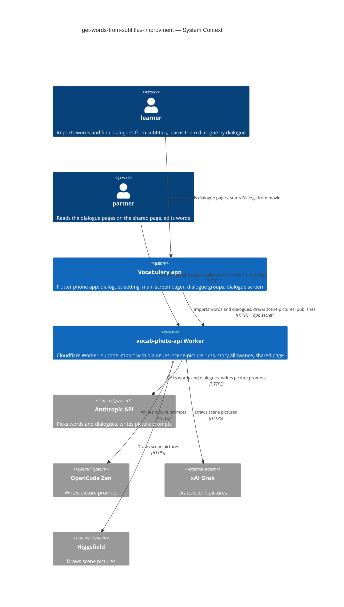
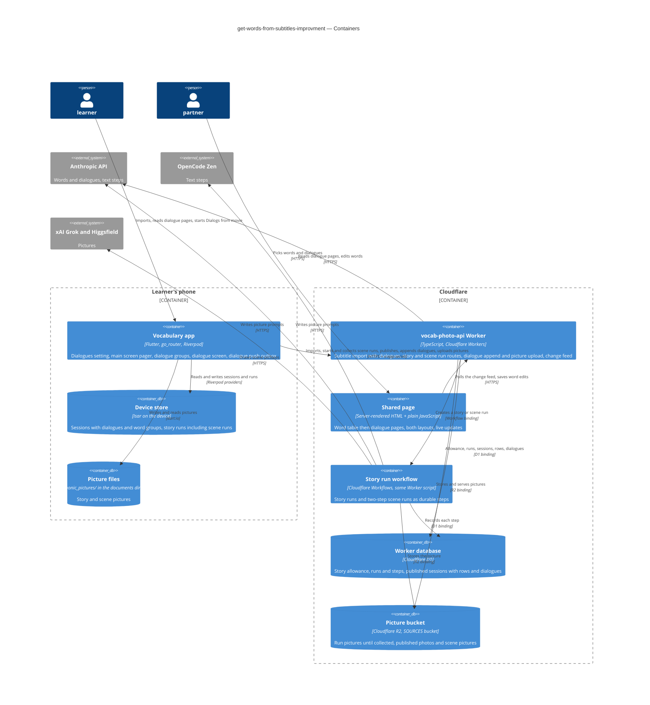
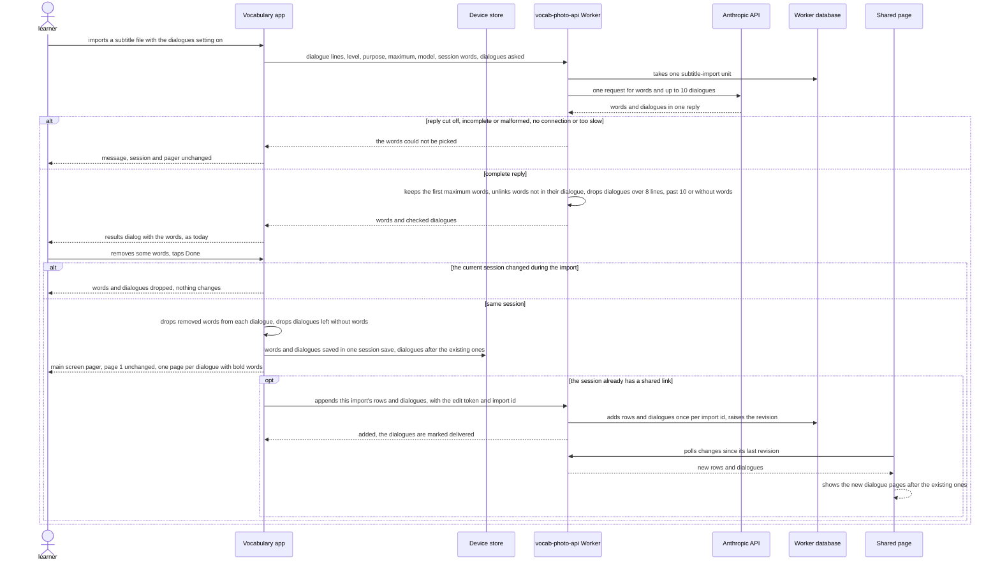
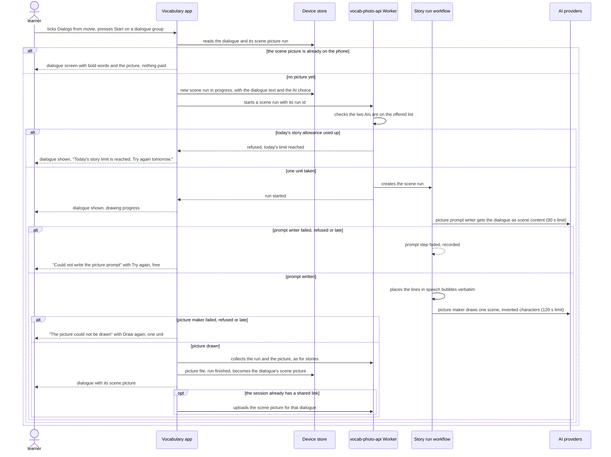

# Software Architecture Document — get-words-from-subtitles-improvment

<!-- 12 Arc42 sections. Empty section → <!-- N/A: <one-line reason> -->. -->
<!-- C4 Context (L1) lives inline in §3. C4 Container (L2) lives inline in §5. -->
<!-- Numbers in §10 come VERBATIM from spec.md §6 NFR — no inventing, no rounding. -->

## 1. Introduction and goals

**Intent.** Keep the film's best moments next to the words a subtitle import picks, and let the learner learn those words in the groups the film gave them (spec §1, §2). A new switch in the main screen's Settings, "Get dialogues from subtitles", off by default, makes a subtitle import also pick up to 10 **film dialogues**, each holding some of the proposed words. After Done, the main screen becomes a pager: page 1 is the main screen as today, and each next page is one **dialogue page** with its **dialogue words** in bold and listed with translation and definition. The shared page shows the same dialogue pages. On the learn page, a new Step 1 exercise, "Dialogs from movie", uses one **dialogue group** per dialogue that still has words of its own, plus "Other words". Its Start shows the dialogue with a **scene picture**, drawn by the learner's picture prompt writer and picture maker as a two-step story run under the shared story allowance. With the switch off, or in a session without dialogues, the app behaves exactly as before, apart from one greyed exercise.

**Top-3 quality goals (1-liners; full scenarios in §10):**

1. **Switch off changes nothing.** 0 differences in what the import sends and what it shows with the switch off, and 0 imports at maximum 20 that fail with the switch on where the same film succeeds with it off (spec §6 "Switch off is unchanged", "Extra failed imports caused by dialogues"; AC-01, AC-23).
2. **Every kept dialogue can be trusted.** ≤ 10 dialogues kept, each ≤ 8 lines, 100% of bold words appear in their dialogue's text, and a cut-off reply gives neither words nor dialogues (spec §6 "Dialogues per import", "Bold words really in the dialogue"; AC-04, AC-05, AC-08).
3. **Scene pictures keep spending bounded.** Scene pictures and mnemonic stories together ≤ 20 story runs per UTC day, a drawn picture is never drawn or paid again, nothing reachable from a shared link draws one, and each step stays inside picture prompt writer ≤ 90 s, picture maker ≤ 120 s (spec §6 "Story allowance shared", "Time to scene picture"; AC-14, AC-19, AC-22).

**Stakeholders.**

| Role | Interest | Sign-off owner? |
|---|---|---|
| learner | Turns the dialogues setting on, reads dialogue pages on the main screen, learns dialogue groups with their scene pictures | No |
| partner | Reads the dialogue pages and scene pictures on the shared page; edits words as before; cannot change dialogue text or draw (AC-20 – AC-22) | No |
| Tech Lead (Maksym) | SAD approval | Yes |
| Security Lead | Required by spec §6.1: film dialogue text now reaches a second AI (the picture prompt writer), and film content is published on the shared page | Yes |

<!-- Decision overrides (¶4) — populated by the critic resolution loop, empty otherwise. -->

## 2. Constraints

**Technical.**
- App: Flutter 3.35.1, Dart SDK `>=3.0.0 <4.0.0`, phone only. Typed routes in `lib/router/routes.dart` (`go_router` 17 + `go_router_builder`), state with `flutter_riverpod` / `riverpod_annotation` 2.6.x, storage in `isar_community` pinned to `3.3.0-dev.1` (architecture.md §2 rule 6), preferences in `shared_preferences`, files under the documents directory (`path_provider`).
- App storage today: `Session` (Isar collection) embeds `WordPair` (with the stable `rowId` from mnemonic-story), `SessionSource` and `WordGroup` (`id`, `name`, `rowIds`, `storyRunId`, `storyWords`). `StoryRun` with embedded `StoryStep`s is its own collection; pictures live under `mnemonic_pictures/`. Grouping rules are pure Dart in `lib/core/story/word_grouping.dart`; `StoryRunTracker` starts, polls (every 5 s while visible) and collects runs.
- Subtitle import today (`lib/features/word_input/subtitle_import_flow.dart` → `POST /subtitles/words`): the app strips the file to dialogue lines (words-from-subtitles ADR-0002) and makes **one** Anthropic call per import through the Worker, with an allow-listed model (`SUBTITLE_MODELS` in `src/subtitles/prompt.ts`), `max_tokens` 16000, a 225 s Worker limit and a 240 s app limit. The reply is checked complete-or-nothing (`stop_reason` `end_turn` and the exact JSON shape) before any word is returned. One unit of `all_subtitle_imports` is taken before the call.
- Story runs today (`src/story/`): a Cloudflare Workflow `StoryRunWorkflow` runs story writer → word check → picture prompt writer → picture maker as durable steps with no retry on paid steps. D1 `story_runs` holds `story_model`, `prompt_model`, `picture_model` as `NOT NULL`, and `story_run_steps.role` is checked against `('story', 'prompt', 'picture')`. The allowance `all_story_runs` takes one unit per new run and per Draw again. `buildPicturePrompt` assembles the final image prompt in code so captions reach the picture maker verbatim. The word check (`src/story/word-check.ts`) is the AC-08 rule this feature reuses.
- Shared page today (good-looking-web): server-rendered by the Worker and enhanced with one framework-free script (`src/session/client/page.js`, ADR-0002 there), two layouts by CSS media queries (wide with a source pager, phone with a sources dialog). Rows live in D1 with Worker-made random ids; the app publishes rows by position and links them to sources by id. A republish overwrites the same link and replaces the partner's edits (ADR-0008 there). The page polls a public change feed every ~5 s (ADR-0005 there). **The phone never reads the partner's edits back:** phone changes reach the link only by a republish from Share.
- Worker: TypeScript 5.6, `wrangler` 4, no runtime npm dependencies; D1 `DB` with numbered migrations up to `0004_story_runs.sql` (+ `down/`), R2 `SOURCES`, KV `SESSIONS`/`DEFINITIONS`, one daily cron. Every non-public route needs `x-app-secret` and passes the per-address rate limiter.
- Verification: `dart run build_runner build --delete-conflicting-outputs`, `flutter analyze`, `flutter test`, the CLAUDE.md greps; in `vocab-photo-api/`: `npm test` (wrangler dev with a SQLite D1 stand-in and stub providers) and `npm run typecheck`.

**Organisational.**
- One owner (Maksym) builds, reviews and deploys. No deadline. The Worker is deployed by hand (`wrangler deploy`, `wrangler d1 migrations apply`); the app ships through the usual store build.
- Size M (`.size`), route standard (`.route`).
- Must not disturb the mnemonic-story implement run in progress on the same branch (`feature/learn-part-step-1`); this feature builds on what that run ships.

**Conventions.**
- [`CLAUDE.md`](../../../CLAUDE.md) rules 1–6 and [`docs/architecture.md`](../../architecture.md) §2: typed routes only, services from `lib/core/providers.dart`, screen data in `@riverpod` notifiers, features don't import each other's screens (shared logic lives in `lib/core/`), one file ≈ one thing, Worker routes in the `RouteDefinition` table.
- Spec-approved overrides this feature carries out:
  - CLAUDE.md rule 3 ("do not change how anything looks"): the Settings switch, the main screen pager with its dialogue pages, the dialogue pages and scene pictures on the shared page, the "Dialogs from movie" exercise and its dialogue screen (spec §1).
  - CLAUDE.md rule 5 ("no new domain models"): film dialogues and their scene pictures as new session data (spec §1). The model names are fixed in §4 and written into CLAUDE.md with the §4 commit.
  - learn-part-step-1's invariant "the app and the web show the same available state" is narrowed for "Dialogs from movie" (greyed in the app without dialogues, coming soon on the web; AC-16, AC-22).
  - mnemonic-story's invariant "a word group holds 7 to 19 words" is narrowed for dialogue groups, and its AC-06 (a run starts on opening the learn page or selecting a group) is narrowed to topic groups and "Other words" (AC-15, AC-24).
- Precedents followed: one JSON list in the Worker as the source of truth for the exercises (learn-part-step-1 ADR-0003); app-owned grouping rules (mnemonic-story ADR-0005); story runs as Workflows (mnemonic-story ADR-0002).

**Regulatory / external.**
- Data classification (spec §6.1): internal on the device; public on the shared page. Film dialogues are short quotes from published films, not personal data; kept short (≤ 8 lines, ≤ 10 per import).
- Security review: required (spec §6.1). The Security Lead signs off the prompt-injection path (dialogue text → picture prompt writer) and the public dialogue pages before release (§11).
- Provider terms: scene pictures show invented characters, never a real actor's likeness; a refusal is a failed picture (AC-18), never retried with altered text.

## 3. Context and scope

The learner imports words from a film's subtitle file on the phone. With the dialogues setting on, the same import also brings back up to 10 film dialogues, which the app keeps with the session, shows as pages after the words, and uses as word groups on the learn page. A scene picture for a dialogue group is drawn through the Worker by the learner's chosen AIs, counted against the same story allowance as mnemonic stories. The partner reads the same dialogue pages, with their scene pictures, on the shared page, and can still only edit words; nothing on the shared page or the web learn page can draw a picture or change a dialogue.

<!-- brownfield: Flutter app (lib/, go_router + Riverpod, Isar on device, story runs and word groups from mnemonic-story) + Cloudflare Worker (vocab-photo-api/, TypeScript, D1 + KV + R2; /subtitles/words single Anthropic call, StoryRunWorkflow, server-rendered shared page with a change feed); read from docs/architecture.md, CLAUDE.md, the words-from-subtitles / mnemonic-story / good-looking-web SADs and the code directly — no docs/architecture-map.md exists (run /sdd:survey to persist one) -->

**External systems (in / out):**

| Actor or system | Type | Interaction |
|---|---|---|
| learner | Person | Turns the dialogues setting on, imports from subtitles, reads dialogue pages, starts "Dialogs from movie" in the app |
| partner | Person | Opens the shared link: reads dialogue pages and scene pictures, edits words as before |
| Vocabulary app | System (ours) | Keeps dialogues with the session, shows the pager, groups words by dialogue, starts and collects scene pictures |
| vocab-photo-api Worker | System (ours) | Picks words and dialogues in one subtitle import, runs scene-picture runs under the story allowance, serves the shared page with dialogue pages |
| Anthropic API | System (external) | Picks words and dialogues (subtitle import model); writes picture prompts when an Anthropic model is the picture prompt writer |
| OpenCode Zen | System (external) | Writes picture prompts when one of its models is the picture prompt writer |
| xAI (Grok) | System (external) | Draws scene pictures when a Grok model is the picture maker |
| Higgsfield | System (external) | Draws scene pictures when a Higgsfield model is the picture maker |

**C4 Context (L1):**



The context has two people and two of our own systems. The learner uses only the phone app, which talks only to our Worker with the app secret, so no provider key ships in the app. The Worker picks words and dialogues with Anthropic in the one subtitle import call, and draws scene pictures through the picture prompt writer and picture maker providers mnemonic-story already uses. The partner reaches only the Worker's shared page, which can show dialogues and pictures but has no route that draws one.

## 4. Solution strategy

**Top strategic choices (the seeds for ADRs):**

1. **Three surfaces: the app, the Worker and the shared page** ([ADR-0001](adr/0001-change-the-app-the-worker-and-the-shared-page-as-three-surfaces.md)). `target_surfaces: [mobile-app, backend-service, web-frontend]`. The app gains the dialogues setting, the main screen pager with dialogue pages, dialogue groups, the "Dialogs from movie" exercise and the dialogue screen, plus the storage behind them. The Worker gains dialogue picking inside the subtitle import, scene-picture runs, the route that adds an import's rows and dialogues to a published session, and dialogue storage in D1. The shared page gains dialogue pages with their scene pictures in both layouts. The web learn page only gains the twelfth exercise, which leads to coming soon. This serves quality goals 1–3.

2. **One AI request picks the words and the dialogues** ([ADR-0002](adr/0002-pick-words-and-dialogues-in-one-ai-request.md)). With the switch on, the app adds `dialogues: true` to `POST /subtitles/words`. The Worker then appends a dialogue block to the system prompt, asks for a `dialogues` array beside `words` in the same JSON object, and raises `max_tokens` from 16000 to 20000 for that request only. Each dialogue is up to 8 lines and names the proposed words it holds. Without the field, the prompt, the request body and the reply check are byte for byte today's, and a Worker test pins that. The reply stays complete or nothing: a reply that did not end normally, or whose `dialogues` array is missing or malformed, gives neither words nor dialogues (AC-08). The Worker then applies AC-04 and AC-05 to the parsed reply: it ignores links to words it is not returning, unlinks words that do not appear in their dialogue, and drops dialogues over 8 lines, beyond the first 10, or left with no word. One subtitle-import unit is taken, as today. This serves quality goals 1 and 2.

3. **Film dialogues live in the session; a dialogue group is an ordinary word group; a scene picture is a kind of story run** ([ADR-0003](adr/0003-keep-film-dialogues-in-the-session-and-link-their-words-by-row-id.md)). `Session` gains `dialogues`, a list of the new embedded `FilmDialogue` in pager order: `id`, `lines`, `wordRowIds` (the `WordPair.rowId`s linked at Done, which only shrink, AC-11), `scenePictureRunId` and the push state of ADR-0005. `WordGroup` gains `dialogueId`, set for a dialogue group, so "Mnemonic story" works on it unchanged (AC-24). `StoryRun` gains `kind` (`story` or `scene`) and `sceneText`, so a scene picture is listed in Story runs beside mnemonic stories (AC-14). Approved under CLAUDE.md rule 5 by spec §1 and recorded in CLAUDE.md with this section. This serves quality goals 2 and 3.

4. **A scene picture is a two-step run of the existing story run workflow** ([ADR-0004](adr/0004-draw-scene-pictures-as-two-step-runs-of-the-story-run-workflow.md)). A run of kind `scene` skips the story writer and the word check. The picture prompt writer receives the dialogue inside tags as scene content, never as instructions, and returns the same `{character, scenes[]}` JSON with exactly one scene of invented characters. The Worker assembles the final image prompt in code, putting the dialogue's lines into speech bubbles exactly as written (as `buildPicturePrompt` does with captions). The picture maker then draws it. Starting a scene run takes one unit of `all_story_runs`, the moment its picture prompt step starts (AC-19). "Try again" redoes the prompt step free, and "Draw again" takes one unit (AC-18). The status, redo and picture routes, the app's `StoryRunTracker`, the picture store and the story runs screens are reused, with `kind` carried through. Migration `0005` adds `kind` and `scene_text` to `story_runs`. A scene run stores an empty `story_model`, because SQLite cannot drop the `NOT NULL`. This serves quality goal 3.

5. **An import's rows and dialogues, and later scene pictures, are added to a published session automatically** ([ADR-0005](adr/0005-add-an-imports-rows-and-dialogues-to-the-published-session-automatically.md)). When the current session already has a shared link (`publishedId` and `editToken`), Done of an import that kept dialogues makes the app send that import's new word rows and its dialogues to a new app-secret route that also needs the edit token. The rows and dialogues are added after what the page holds, keyed by an app-made import id so a repeat adds nothing twice. Nothing on the page is overwritten, so the partner's edits stay. A scene picture is uploaded once the app has collected it. A dialogue or picture not yet delivered is marked on the `FilmDialogue` and retried with growing pauses while the app runs, and again on every app start, so closing the app loses nothing. A first publish or a republish sends the dialogues in the publish payload, with their words given by row position and their pictures declared like photos and uploaded after (good-looking-web ADR-0006). On the Worker, dialogues are stored in new D1 tables linked to `rows`, with a revision, so the page's change feed carries them (good-looking-web ADR-0005). Words typed by hand and edits made on the phone still reach the link only by a republish, as today. This serves AC-20 and quality goal 2.

**Decided inline (below the ADR gate, from the assumptions ledger the owner accepted on 2026-10-07):**

- **Mobile UI architecture: unchanged.** The app stays a Flutter phone app with typed routes. The main screen becomes a `PageView` only when the current session has dialogues: page 1 is today's screen, unchanged, with the speed dial, and each later page is a read-only dialogue page (AC-01, AC-02). The dialogue screen is a new typed route under `learn` (`DialogueRoute`: `groupId`, optional `sessionId`), opened with `push` as `StoryRoute` is. When both exercises are ticked, Start opens the dialogue screen and then the story screen, in list order (AC-13). The switch is a row on the existing `SettingsScreen`. Its value is a persisted preference provider in `shared_preferences`, like `wordDetailModeProvider`.
- **Web UI architecture: unchanged.** The shared page stays server-rendered and enhanced with plain JavaScript (good-looking-web ADR-0002). The Worker renders the dialogue pages after the table, in both existing layouts, with the bold places already marked. The page script applies dialogue changes from the change feed. There is no new build step, layout or package.
- **AC-21 read as "the same rules in both places"** (owner, 2026-10-07). A partner's edit or delete changes the dialogue page on the shared page. On the phone, a dialogue follows the learner's own edits (AC-11). The phone still never reads the partner's edits, as today.
- **Grouping stays app-owned and local** (extends mnemonic-story ADR-0005). The app forms dialogue groups itself, with no AI call. In pager order, each dialogue takes its dialogue words that are words to learn and in no group yet. Groups the session already has are kept (AC-06, AC-17). Dialogue groups are exempt from 7 to 19 (AC-15). Other words follow the existing rules, and "Other words" is an ordinary group (AC-25). With any dialogue group, the group pager is always shown. A dialogue group's card is named from the dialogue's first line without speaker marks, cut to 40 characters with "…", with "(2)" or "(3)" added when names repeat (AC-13). No story run starts on its own for a dialogue group (AC-24).
- **One matching rule, two languages.** The AC-05 rule (whole word, any letter case, phrase words in order and next to each other, endings -s/-es/-ed/-ing) is the existing `src/story/word-check.ts` rule, extended to return the places each word appears so they can be bold. It is ported to Dart in `lib/core/dialogues/`. Both are pinned by one shared case file in the Worker that both test suites read, the way `exercises.json` pins the exercise list. The Worker applies the rule to the reply and when rendering the page. The app applies it at Done (AC-03) and after every edit (AC-11).
- **Exercise list.** `dialogs-from-movie` ("Dialogs from movie", stage 1, available) goes into `vocab-photo-api/src/learn/exercises.json` right after `mnemonic-story`, making twelve, and the app's copy follows (learn-part-step-1 ADR-0003). In the app it can be ticked only in a session with dialogues and is greyed with "Needs dialogues from subtitles" otherwise. On the web it always leads to coming soon (AC-16, AC-22).
- **Results dialog unchanged.** The dialogues ride with the import result in memory. The results dialog lists only words, as today. At Done the app drops removed words from every dialogue, drops dialogues left with none, appends the rest after the session's existing dialogues and adds the words. All of this happens in one notifier change, so one save holds both (AC-03, AC-10). A result for another session is dropped whole (AC-12).
- **Prompt injection.** Subtitle lines stay data inside `<subtitle_lines>`, as today. The picture prompt writer receives the dialogue inside its own tags, with the instruction that it is scene content only. The speech-bubble text is placed by code, not by the AI. Each dialogue line is capped at 200 characters, the same bound as a subtitle line, and a longer one drops its dialogue.
- **CLAUDE.md** rules 3 and 5 are updated with this section to name the approved visible parts and models: `FilmDialogue`, `WordGroup.dialogueId`, `StoryRun.kind` and `StoryRun.sceneText`.

Each tactical decision in later sections should trace to one of these seeds. Tactical decisions that *contradict* a strategic choice are red flags — surface them in §11.

## 5. Building block view

The feature extends the repo's existing shapes and adds no new style. In the app, the dialogue rules more than one feature uses live in `lib/core/dialogues/`: the matching rule, the Done filter, the edit rule and the push outbox. The main screen, the learn page, the dialogue screen and the words table reach them only through providers, so features still don't import each other's screens (architecture.md §2 rule 3). Dialogues are stored inside `Session` through `SessionStore`, scene pictures through the existing `StoryRunStore` and `StoryPictureStore`, and grouping stays in `lib/core/story/word_grouping.dart`, which gains the dialogue-group pass. In the Worker, the reply check for dialogues sits beside the subtitle prompt in `src/subtitles/`. Scene runs are a branch of `src/story/`. The published session's dialogues are a new `src/session/dialogues.ts` beside `changes.ts` and `edit.ts`, all in the same route table. The page script `src/session/client/page.js` renders dialogue changes from the change feed. One new D1 migration covers both the story-run columns and the dialogue tables.

**Internal decomposition:**

```
lib/
├── router/routes.dart                          + DialogueRoute (under 'learn', groupId, sessionId?)
├── core/
│   ├── models/
│   │   ├── film_dialogue.dart                  NEW @embedded FilmDialogue: id, lines, wordRowIds, scenePictureRunId?, importId, pushState — ADR-0003
│   │   ├── session.dart                        + dialogues (pager order)
│   │   ├── word_group.dart                     + dialogueId?
│   │   └── story_run.dart                      + kind (story | scene), sceneText?
│   ├── dialogues/                              NEW shared by word_input, learn, dialogue, words_table (rule 3)
│   │   ├── dialogue_match.dart                 pure AC-05 rule: does a word appear, where (for bold); tested against the Worker's case file
│   │   ├── dialogue_rules.dart                 pure: Done filter (AC-03), edit rule (AC-11, AC-26), card names (AC-13)
│   │   └── dialogue_push.dart                  keepAlive outbox: append an import's rows + dialogues, upload scene pictures, retry with growing pauses and on app start — ADR-0005
│   ├── services/
│   │   ├── subtitle_words_service.dart         + dialogues flag in the request, dialogues in SubtitleWordsResult
│   │   ├── session_publish_service.dart        + dialogues in the publish payload (words by row position, pictures declared)
│   │   └── story_api_service.dart              + start a scene run (kind, dialogue text, prompt and picture AIs)
│   ├── story/
│   │   ├── word_grouping.dart                  + dialogue-group pass before the existing rules; dialogue groups exempt from 7..19
│   │   └── story_run_tracker.dart              + startScene(dialogue); a scene run's picture becomes FilmDialogue.scenePictureRunId
│   └── providers.dart                          + dialoguesSettingProvider (persisted), dialoguePushProvider
└── features/
    ├── settings/settings_screen.dart           + "Get dialogues from subtitles" switch (off by default)
    ├── word_input/
    │   ├── subtitle_import_flow.dart           + sends the flag, carries dialogues to Done, hands them to the notifier with the words
    │   ├── word_input_notifier.dart            + addWordsWithDialogues (one save), applies the edit rule on every word change
    │   ├── word_input_screen.dart              + PageView only when the session has dialogues; page 1 unchanged
    │   └── widgets/dialogue_page.dart          NEW read-only dialogue page: lines with bold words, word list, scene picture
    ├── learn/
    │   ├── exercises.dart                      + dialogs-from-movie (twelve), availability needs session dialogues in the app
    │   └── learn_screen.dart                   + the dialogue-groups line, Start → DialogueRoute then StoryRoute when both ticked
    └── dialogue/                               NEW feature folder
        └── dialogue_screen.dart                the dialogue with bold words and its scene picture: progress, failures, Try again, Draw again

vocab-photo-api/
├── migrations/0005_film_dialogues.sql          NEW story_runs + kind, scene_text; dialogues, dialogue_words (+ down/)
└── src/
    ├── subtitles/
    │   ├── prompt.ts                           + dialogue block and reply shape when asked; byte-identical prompt without it
    │   ├── dialogues.ts                        NEW reply check: AC-04/AC-05 links, ≤ 8 lines, ≤ 200 chars a line, first 10
    │   └── routes.ts                           + `dialogues` flag in, `dialogues` out
    ├── story/
    │   ├── word-check.ts                       + places of each match (for bold); shared case file match-cases.json
    │   ├── prompts.ts                          + scene prompt (dialogue as data) and buildScenePrompt (speech bubbles verbatim)
    │   ├── run-steps.ts / workflow.ts          + kind scene: prompt → picture, no story step, no word check
    │   └── routes.ts                           + start accepts kind scene; allowance taken at start as today
    └── session/
        ├── dialogues.ts                        NEW append route (app secret + edit token, import id), picture upload route, D1 reads/writes
        ├── handlers.ts / store.ts              + dialogues in publish and republish (replace with the rows)
        ├── changes.ts                          + dialogues and picture arrivals in the change feed
        ├── page.ts                             + dialogue pages after the table, bold places marked, both layouts
        └── client/page.js                      + dialogue pages follow row edits, deletes and new dialogues from the feed

test/dialogue_*_test.dart, test/word_grouping_test.dart                  rules (against match-cases.json), Done filter, grouping, outbox
vocab-photo-api/test/dialogues-*.test.mjs, story-scene.test.mjs          reply check, switch-off identity, append idempotency, page, scene runs
```

**C4 Container (L2):**



There is one container per declared surface. The **Vocabulary app** (mobile-app) keeps sessions with their dialogues, and story runs including scene runs, in the **Device store**, and pictures as **Picture files**. It talks only to the **Worker** (backend-service). The Worker picks words and dialogues with Anthropic in one call, and hands scene runs to the **Story run workflow**, which writes the prompt with the chosen text AI and draws with the chosen picture AI. When a session already has a link, the app also appends an import's rows and dialogues, and uploads scene pictures, to the Worker, which keeps them in **D1** and **R2**. The **Shared page** (web-frontend) is served by the Worker and polls its change feed, so new dialogues, pictures and word edits appear there. It can save word edits but has no route that draws or changes a dialogue.

## 6. Runtime view

Two seed flows: the import with dialogues, from Start to the shared page, and drawing a scene picture. The `sequences` stage then covers every §5 AC.

**Critical flow 1: an import with dialogues, to the pager and the shared link (US-02, US-03, US-05; AC-02 – AC-05, AC-08, AC-12, AC-20)**



With the setting on, the app asks the Worker for words and dialogues in the same request. The Worker takes one import unit and makes one AI call. If the reply is cut off, malformed or late, the learner gets the existing "couldn't be picked" message and nothing changes. Otherwise the Worker keeps the words as today and checks the dialogues: links only to returned words that really appear in the text, no more than 8 lines, the first 10, each with at least one word. The results dialog lists only the words. At Done, if the session is still the one the import started in, the app removes the learner's removed words from the dialogues, drops any dialogue left empty, and saves words and dialogues together. The main screen becomes a pager. If the session was already shared, the app appends this import's rows and dialogues to the link, once per import id, and the partner's page shows them on its next poll. A failed append stays pending and is retried.

**Critical flow 2: Start on a dialogue group draws its scene picture (US-04; AC-13, AC-14, AC-18, AC-19, AC-22)**



Start on a dialogue group opens the dialogue screen. If the dialogue already has its scene picture, it is shown from the phone and nothing is paid. Otherwise the app records a scene run and starts it on the Worker. The Worker checks both AIs and takes one unit of the shared story allowance, or answers with the daily-limit message. The workflow has the picture prompt written from the dialogue, treated as scene content only. Code then puts the lines into speech bubbles, and the picture maker draws one scene with invented characters. A failed prompt offers a free Try again; a failed picture offers Draw again for one unit. The app follows and collects the run as it does stories, and keeps the picture as the dialogue's scene picture. When the session is shared, it uploads the picture to the link.

## 7. Deployment view

Nothing new to run. The app ships in its usual store build. The Worker stays one script (`vocab-photo-api`), with the same `STORY_RUN` Workflow binding, D1 `DB` and R2 `SOURCES` bucket. The deploy order is: apply D1 migration `0005_film_dialogues.sql` (`wrangler d1 migrations apply`; down script in `migrations/down/`), then `wrangler deploy`, then the app build. An app on the old build never sends `dialogues: true`, and the Worker answers it exactly as today. A new app against an old Worker gets no `dialogues` field back and shows words only. That counts as no dialogue qualifying (AC-07), not as a failure. Scene pictures for published sessions are kept in R2 under the session's prefix, and are deleted with the session by the existing daily clean-up after its 30 days. Run pictures under `story-runs/` keep their 7-day clean-up.

**Monitoring:**
- `logEvent("subtitle import", …)` gains `dialogues` (asked, returned, kept) and keeps `aiMs`, words and tokens, so time per model with dialogues on can be compared (spec §6). Lines and dialogue text are never logged.
- Story run logs gain `kind`, so scene runs and stories are counted apart within the shared 20.
- Append and picture-upload routes log the outcome (added, repeat, expired link, refused), never the content.
- No alerting exists in this repo. The owner reads Worker logs (`wrangler tail`) during the device pass.

**Scaling thresholds:**
- ≤ 10 dialogues × 8 lines per import, ≤ 200 characters a line: about 16 KB of dialogue text per import at most. This fits inside the existing 2 MB request body. The Worker's publish limits (500 entries, 256 KB) now count the dialogues too, so a session near those limits could fail to publish (§11).
- At most 20 story runs a day, scene and story together, so R2 and Workflow use stay at today's scale.

## 8. Crosscutting concepts

<!-- 🎯 Why: CROSS-CUTTING PATTERNS spanning several modules: logging, errors, authorization, ID
     strategy, events, caching. ⭐ The second-densest section. A pattern inside one module is NOT
     here; a project-wide convention belongs in the convention file.
     📋 Write: a table — concept / convention / where defined. One row per concept.
     📌 e.g. «sortable time-based IDs generated in the app layer» as a default from the convention file. -->

| Concept | Convention | Where defined |
|---|---|---|
| Logging | <e.g. structured, fields `module=<name>`> | <convention file §X or here> |
| Authentication | <e.g. token-based via middleware> | <convention file §X> |
| Error handling | <e.g. domain sentinel → ports error mapping → JSON> | <convention file §X> |
| ID strategy | <e.g. sortable time-based ID in the app layer> | <convention file §X> |
| Internationalisation | <e.g. N/A, single language> | — |
| Observability | <e.g. tracing on the request boundary> | — |
| Events | <module-specific patterns, if any> | <here> |

## 9. Architecture decisions

<!-- 🎯 Why: the REVERSE INDEX onto the adr/ folder. `ls adr/` gives the files; §9 gives the
     semantics — why they exist, which SAD section they attach to, what status.
     📋 Write: a 4-column table, one row per ADR. Mixed status is fine.
     📌 e.g. «0001 | Store content as a table of typed blocks | Accepted | §4». -->

| # | Title | Status | Section |
|---|---|---|---|
| <NNNN> | <imperative — e.g. "Use a sliding-window counter for rate limiting"> | Accepted | §<N> |
| <NNNN> | <imperative — e.g. "Co-locate the worker in the API process"> | Accepted | §<N> |

ADR files live under `docs/features/<slug>/adr/NNNN-<title>.md`.

## 10. Quality requirements

<!-- 🎯 Why: the QUALITY TREE — take a goal from §1 and break it into concrete leaves: tests,
     metrics, configs, drills. ⭐ Without §10, §1 is a manifesto. With §10 each declaration maps
     to something PROVABLE.
     📋 Write: per §1 goal — When / Then / How-verify. Numbers from spec §6 NFR VERBATIM (don't
     round ≤250ms to ≤300ms — that's a critic F6 hit).
     📌 e.g. «p95 ≤ 500 ms on a block update, verified by a 100 req/s load test». -->

Each top-3 goal from §1 expanded into a full scenario:

**QG-1. <quality attribute>**
- **When:** <trigger condition>
- **Then:** <expected behaviour with numbers from spec §6 NFR>
- **How verify:** <test / chaos drill / load test / metric>

**QG-2. <quality attribute>**
- **When:** <trigger>
- **Then:** <expected>
- **How verify:** <how>

**QG-3. <quality attribute>**
- **When:** <trigger>
- **Then:** <expected>
- **How verify:** <how>

## 11. Risks and technical debt

<!-- 🎯 Why: ⭐ collects EVERYTHING that can break — not only the technical. Without §11 risks get
     discussed at standups and lost; debt lives only in the head of whoever accepted it.
     📋 Write: a risk/debt table — severity — mitigation — owner. Accepted debt in its own block.
     📌 The first risk is often a product risk, not a technical one. That's normal. -->

<!-- Severity literals: Low / Medium / High for regular risks; "Open question" for rows created by
     a Save-as-OQ resolution during the Socratic walk (see references/socratic.md). -->

| Risk / debt | Severity | Mitigation | Owner |
|---|---|---|---|
| <e.g. Worker lag may reach hours during a downstream outage> | Medium | <alert >10 min, on-call playbook, retry backoff> | <DevOps> |
| <e.g. No event-schema versioning in v1> | Medium | <ADR-NNNN planned for v2, tolerate unknown fields> | <Backend> |
| Open architectural decision: <decision-headline> | Open question | Resolve before <stage trigger or YYYY-MM-DD>; <inline rationale from the Save-as-OQ> | <owner> |

**Accepted debt (acceptable in v1, plan to fix later):**
- <e.g. the entity is immutable / unversioned — OK for v1, may need audit versioning in v2>

## 12. Glossary

<!-- 🎯 Why: ⭐ the DOMAIN GLOSSARY that ends arguments a year later («checkpoint — weekly or
     biweekly? quarter — calendar or fiscal?»).
     📋 Write: a term / meaning table. Business + technical terms mixed.
     📌 e.g. «Lesson | a unit inside a course made of blocks (text, video)». -->

| Term | Meaning |
|---|---|
| <e.g. domain object A> | <its meaning in this domain> |
| <e.g. domain object B> | <its meaning> |
| <e.g. domain invariant name> | <the rule, in plain language> |
