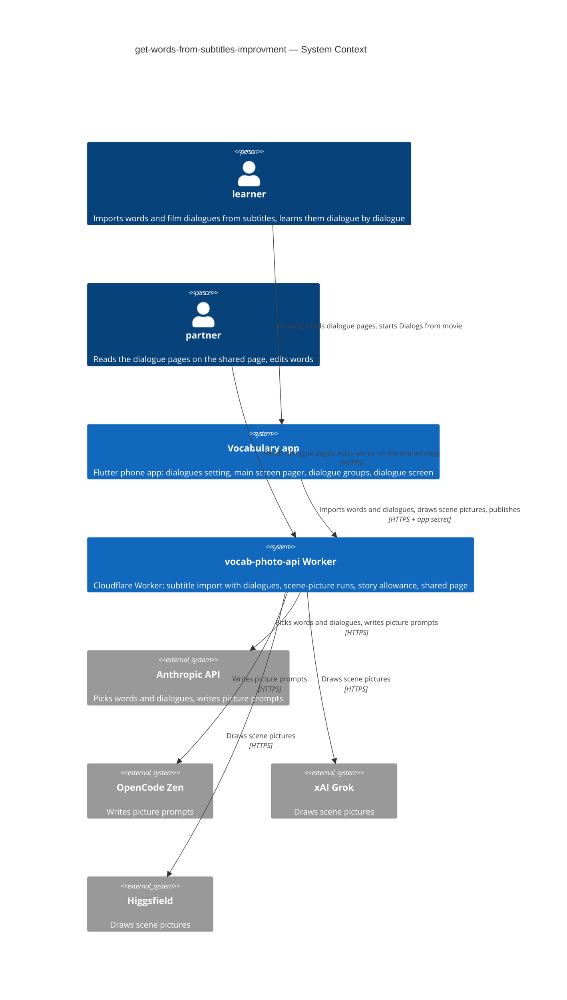
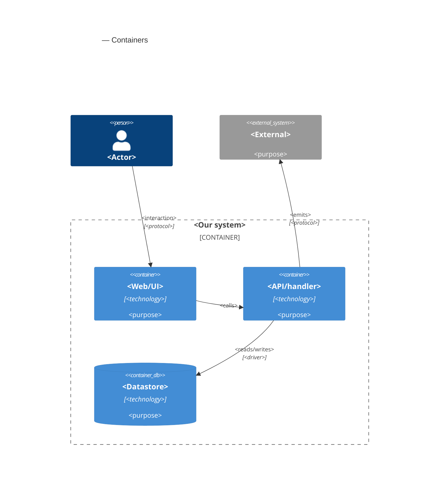

# Software Architecture Document — get-words-from-subtitles-improvment

<!-- 12 Arc42 sections. Empty section → <!-- N/A: <one-line reason> -->. -->
<!-- C4 Context (L1) lives inline in §3. C4 Container (L2) lives inline in §5. -->
<!-- Numbers in §10 come VERBATIM from spec.md §6 NFR — no inventing, no rounding. -->

## 1. Introduction and goals

**Intent.** Keep the film's best moments next to the words a subtitle import picks, and let the learner learn those words in the groups the film gave them (spec §1, §2). A new switch in the main screen's Settings, "Get dialogues from subtitles", off by default, makes a subtitle import also pick up to 10 **film dialogues**, each holding some of the proposed words. After Done, the main screen becomes a pager: page 1 is the main screen as today, and each next page is one **dialogue page** with its **dialogue words** in bold and listed with translation and definition. The shared page shows the same dialogue pages. On the learn page, a new Step 1 exercise, "Dialogs from movie", uses one **dialogue group** per dialogue that still has words of its own, plus "Other words". Its Start shows the dialogue with a **scene picture**, drawn by the learner's picture prompt writer and picture maker as a two-step story run under the shared story allowance. With the switch off, or in a session without dialogues, the app behaves exactly as before, apart from one greyed exercise.

**Top-3 quality goals (1-liners; full scenarios in §10):**

1. **Switch off changes nothing.** 0 differences in what the import sends and what it shows with the switch off, and 0 imports at maximum 20 that fail with the switch on where the same film succeeds with it off (spec §6 "Switch off is unchanged", "Extra failed imports caused by dialogues"; AC-01, AC-23).
2. **Every kept dialogue can be trusted.** ≤ 10 dialogues kept, each ≤ 8 lines, 100% of bold words appear in their dialogue's text, and a cut-off reply gives neither words nor dialogues (spec §6 "Dialogues per import", "Bold words really in the dialogue"; AC-04, AC-05, AC-08).
3. **Scene pictures keep spending bounded.** Scene pictures and mnemonic stories together ≤ 20 story runs per UTC day, a drawn picture is never drawn or paid again, nothing reachable from a shared link draws one, and each step stays inside picture prompt writer ≤ 90 s, picture maker ≤ 120 s (spec §6 "Story allowance shared", "Time to scene picture"; AC-14, AC-19, AC-22).

**Stakeholders.**

| Role | Interest | Sign-off owner? |
|---|---|---|
| learner | Turns the dialogues setting on, reads dialogue pages on the main screen, learns dialogue groups with their scene pictures | No |
| partner | Reads the dialogue pages and scene pictures on the shared page; edits words as before; cannot change dialogue text or draw (AC-20 – AC-22) | No |
| Tech Lead (Maksym) | SAD approval | Yes |
| Security Lead | Required by spec §6.1: film dialogue text now reaches a second AI (the picture prompt writer), and film content is published on the shared page | Yes |

<!-- Decision overrides (¶4) — populated by the critic resolution loop, empty otherwise. -->

## 2. Constraints

**Technical.**
- App: Flutter 3.35.1, Dart SDK `>=3.0.0 <4.0.0`, phone only. Typed routes in `lib/router/routes.dart` (`go_router` 17 + `go_router_builder`), state with `flutter_riverpod` / `riverpod_annotation` 2.6.x, storage in `isar_community` pinned to `3.3.0-dev.1` (architecture.md §2 rule 6), preferences in `shared_preferences`, files under the documents directory (`path_provider`).
- App storage today: `Session` (Isar collection) embeds `WordPair` (with the stable `rowId` from mnemonic-story), `SessionSource` and `WordGroup` (`id`, `name`, `rowIds`, `storyRunId`, `storyWords`). `StoryRun` with embedded `StoryStep`s is its own collection; pictures live under `mnemonic_pictures/`. Grouping rules are pure Dart in `lib/core/story/word_grouping.dart`; `StoryRunTracker` starts, polls (every 5 s while visible) and collects runs.
- Subtitle import today (`lib/features/word_input/subtitle_import_flow.dart` → `POST /subtitles/words`): the app strips the file to dialogue lines (words-from-subtitles ADR-0002) and makes **one** Anthropic call per import through the Worker, with an allow-listed model (`SUBTITLE_MODELS` in `src/subtitles/prompt.ts`), `max_tokens` 16000, a 225 s Worker limit and a 240 s app limit. The reply is checked complete-or-nothing (`stop_reason` `end_turn` and the exact JSON shape) before any word is returned. One unit of `all_subtitle_imports` is taken before the call.
- Story runs today (`src/story/`): a Cloudflare Workflow `StoryRunWorkflow` runs story writer → word check → picture prompt writer → picture maker as durable steps with no retry on paid steps. D1 `story_runs` holds `story_model`, `prompt_model`, `picture_model` as `NOT NULL`, and `story_run_steps.role` is checked against `('story', 'prompt', 'picture')`. The allowance `all_story_runs` takes one unit per new run and per Draw again. `buildPicturePrompt` assembles the final image prompt in code so captions reach the picture maker verbatim. The word check (`src/story/word-check.ts`) is the AC-08 rule this feature reuses.
- Shared page today (good-looking-web): server-rendered by the Worker and enhanced with one framework-free script (`src/session/client/page.js`, ADR-0002 there), two layouts by CSS media queries (wide with a source pager, phone with a sources dialog). Rows live in D1 with Worker-made random ids; the app publishes rows by position and links them to sources by id. A republish overwrites the same link and replaces the partner's edits (ADR-0008 there). The page polls a public change feed every ~5 s (ADR-0005 there). **The phone never reads the partner's edits back:** phone changes reach the link only by a republish from Share.
- Worker: TypeScript 5.6, `wrangler` 4, no runtime npm dependencies; D1 `DB` with numbered migrations up to `0004_story_runs.sql` (+ `down/`), R2 `SOURCES`, KV `SESSIONS`/`DEFINITIONS`, one daily cron. Every non-public route needs `x-app-secret` and passes the per-address rate limiter.
- Verification: `dart run build_runner build --delete-conflicting-outputs`, `flutter analyze`, `flutter test`, the CLAUDE.md greps; in `vocab-photo-api/`: `npm test` (wrangler dev with a SQLite D1 stand-in and stub providers) and `npm run typecheck`.

**Organisational.**
- One owner (Maksym) builds, reviews and deploys. No deadline. The Worker is deployed by hand (`wrangler deploy`, `wrangler d1 migrations apply`); the app ships through the usual store build.
- Size M (`.size`), route standard (`.route`).
- Must not disturb the mnemonic-story implement run in progress on the same branch (`feature/learn-part-step-1`); this feature builds on what that run ships.

**Conventions.**
- [`CLAUDE.md`](../../../CLAUDE.md) rules 1–6 and [`docs/architecture.md`](../../architecture.md) §2: typed routes only, services from `lib/core/providers.dart`, screen data in `@riverpod` notifiers, features don't import each other's screens (shared logic lives in `lib/core/`), one file ≈ one thing, Worker routes in the `RouteDefinition` table.
- Spec-approved overrides this feature carries out:
  - CLAUDE.md rule 3 ("do not change how anything looks"): the Settings switch, the main screen pager with its dialogue pages, the dialogue pages and scene pictures on the shared page, the "Dialogs from movie" exercise and its dialogue screen (spec §1).
  - CLAUDE.md rule 5 ("no new domain models"): film dialogues and their scene pictures as new session data (spec §1). The model names are fixed in §4 and written into CLAUDE.md with the §4 commit.
  - learn-part-step-1's invariant "the app and the web show the same available state" is narrowed for "Dialogs from movie" (greyed in the app without dialogues, coming soon on the web; AC-16, AC-22).
  - mnemonic-story's invariant "a word group holds 7 to 19 words" is narrowed for dialogue groups, and its AC-06 (a run starts on opening the learn page or selecting a group) is narrowed to topic groups and "Other words" (AC-15, AC-24).
- Precedents followed: one JSON list in the Worker as the source of truth for the exercises (learn-part-step-1 ADR-0003); app-owned grouping rules (mnemonic-story ADR-0005); story runs as Workflows (mnemonic-story ADR-0002).

**Regulatory / external.**
- Data classification (spec §6.1): internal on the device; public on the shared page. Film dialogues are short quotes from published films, not personal data; kept short (≤ 8 lines, ≤ 10 per import).
- Security review: required (spec §6.1). The Security Lead signs off the prompt-injection path (dialogue text → picture prompt writer) and the public dialogue pages before release (§11).
- Provider terms: scene pictures show invented characters, never a real actor's likeness; a refusal is a failed picture (AC-18), never retried with altered text.

## 3. Context and scope

The learner imports words from a film's subtitle file on the phone. With the dialogues setting on, the same import also brings back up to 10 film dialogues, which the app keeps with the session, shows as pages after the words, and uses as word groups on the learn page. A scene picture for a dialogue group is drawn through the Worker by the learner's chosen AIs, counted against the same story allowance as mnemonic stories. The partner reads the same dialogue pages, with their scene pictures, on the shared page, and can still only edit words; nothing on the shared page or the web learn page can draw a picture or change a dialogue.

<!-- brownfield: Flutter app (lib/, go_router + Riverpod, Isar on device, story runs and word groups from mnemonic-story) + Cloudflare Worker (vocab-photo-api/, TypeScript, D1 + KV + R2; /subtitles/words single Anthropic call, StoryRunWorkflow, server-rendered shared page with a change feed); read from docs/architecture.md, CLAUDE.md, the words-from-subtitles / mnemonic-story / good-looking-web SADs and the code directly — no docs/architecture-map.md exists (run /sdd:survey to persist one) -->

**External systems (in / out):**

| Actor or system | Type | Interaction |
|---|---|---|
| learner | Person | Turns the dialogues setting on, imports from subtitles, reads dialogue pages, starts "Dialogs from movie" in the app |
| partner | Person | Opens the shared link: reads dialogue pages and scene pictures, edits words as before |
| Vocabulary app | System (ours) | Keeps dialogues with the session, shows the pager, groups words by dialogue, starts and collects scene pictures |
| vocab-photo-api Worker | System (ours) | Picks words and dialogues in one subtitle import, runs scene-picture runs under the story allowance, serves the shared page with dialogue pages |
| Anthropic API | System (external) | Picks words and dialogues (subtitle import model); writes picture prompts when an Anthropic model is the picture prompt writer |
| OpenCode Zen | System (external) | Writes picture prompts when one of its models is the picture prompt writer |
| xAI (Grok) | System (external) | Draws scene pictures when a Grok model is the picture maker |
| Higgsfield | System (external) | Draws scene pictures when a Higgsfield model is the picture maker |

**C4 Context (L1):**



The context has two people and two of our own systems. The learner uses only the phone app, which talks only to our Worker with the app secret, so no provider key ships in the app. The Worker picks words and dialogues with Anthropic in the one subtitle import call, and draws scene pictures through the picture prompt writer and picture maker providers mnemonic-story already uses. The partner reaches only the Worker's shared page, which can show dialogues and pictures but has no route that draws one.

## 4. Solution strategy

<!-- 🎯 Why: the 3–4 STRATEGIC PILLARS every ADR grows from. Without §4 each ADR looks random —
     there's no umbrella. ⭐ The densest section — the blast-radius gate fires almost always here
     (decisions are irreversible + multi-module).
     📋 Write: 3–4 choices; each a heading + 2–3 sentences of rationale.
     📌 «Store content as a table of typed blocks» is a pillar — ADR-0001 grows from it. -->

**Top strategic choices (the seeds for ADRs):**

1. **<e.g. Module isolation through events>** — <2–3 sentences citing quality goals + constraints>.
2. **<e.g. Single-store persistence>** — <2–3 sentences>.
3. **<e.g. Server-rendered read side>** — <2–3 sentences>.

Each tactical decision in later sections should trace to one of these seeds. Tactical decisions that *contradict* a strategic choice are red flags — surface them in §11.

## 5. Building block view

<!-- 🎯 Why: INTERNAL DECOMPOSITION — modules, containers, datastores. The static topology: who
     may talk to whom. Without §5, §6 (the flows) has no vocabulary of participants.
     📋 Write: 1 ¶ on the style (layered / hexagonal / clean / event-driven) + a folder tree + a
     C4Container block.
     📌 Draw ONE Container per declared `target_surface` (frontmatter): a fullstack
     [backend-service, web-frontend] = a backend-API container + a web/SPA container; a
     [backend-service, mobile-app] = the API + the mobile app. The Container(web, …) line below is
     just one surface's container — swap/add per what was declared in §4. → _shared/surfaces.md
     📌 e.g. «web app, content API, media worker, datastore, object store, CDN». -->

<One paragraph: layered / hexagonal / clean / event-driven, and why.>

**Internal decomposition:**

```
<e.g. modules/<feature>/>
├── domain/       <entities + sentinel errors>
├── app/          <use cases / services>
├── infra/        <repository + integration impl>
├── ports/        <handlers, DTOs, error mapping>
└── wiring        <self-wiring entry point>
```

**C4 Container (L2):** <!-- syntax → references/c4-mermaid-syntax.md. Real names, no <placeholder> stubs. ONE Container per declared target_surface (frontmatter); the web container below is one example surface. -->



## 6. Runtime view

<!-- 🎯 Why: the RUNTIME FLOW of 1–2 critical scenarios — who talks to whom, when, in what order.
     Without §6, §5 is just boxes with no life.
     📋 Write: a Mermaid sequenceDiagram. Participants are names from §5 (don't invent new ones).
     Messages are semantic («saves a draft»), NO HTTP verbs / paths / status codes — endpoint-level
     sequences arrive at the `api` stage.
     📌 e.g. «author → web: composes draft → web → content API: save». Seed the primary flow(s) here;
     the `sequences` stage then covers every §5 AC (no cap). Never N/A for M+; XS/S keeps ≥1 happy-path flow. -->

**Critical flow 1: <flow name>**

```mermaid
sequenceDiagram
    actor Actor
    participant Web
    participant Service
    participant Store
    Actor->>Web: <action>
    Web->>Service: <call>
    Service->>Store: <write>
    Store-->>Service: ok
    Service-->>Web: result
    Web-->>Actor: confirmation
```

**Critical flow 2: <e.g. async event propagation>** — <if applicable, otherwise N/A>.

## 7. Deployment view

<!-- 🎯 Why: the TOPOLOGY DevOps must know without reading the deploy charts — how many replicas,
     where the background worker lives, AT WHAT NUMBERS we scale.
     📋 Write: 2–3 sentences on topology + monitoring + concrete threshold numbers.
     📌 e.g. «500 authors → partition by quarter» (not «we'll think about scale later»).
     🎯 N/A allowed for XS/S that reuses an existing deployment unit with no change.
     Deployment-diagram scaffold → templates/deployment.md. -->

<Topology in 2–3 sentences. Where it runs, replicas, scaling thresholds.>

**Monitoring:**
- <Metrics — e.g. `<metric_name>`>
- <Alerts — e.g. «worker lag > 10 min → page on-call»>
- <Tracing — e.g. spans on the request boundary>

**Scaling thresholds:**
- <e.g. comfortable in one table up to N rows/year>
- <e.g. partition by quarter above N rows/year>

<!-- For XS/S with no deployment change: <!-- N/A: reuses existing deployment unit, no infra change --> -->

## 8. Crosscutting concepts

<!-- 🎯 Why: CROSS-CUTTING PATTERNS spanning several modules: logging, errors, authorization, ID
     strategy, events, caching. ⭐ The second-densest section. A pattern inside one module is NOT
     here; a project-wide convention belongs in the convention file.
     📋 Write: a table — concept / convention / where defined. One row per concept.
     📌 e.g. «sortable time-based IDs generated in the app layer» as a default from the convention file. -->

| Concept | Convention | Where defined |
|---|---|---|
| Logging | <e.g. structured, fields `module=<name>`> | <convention file §X or here> |
| Authentication | <e.g. token-based via middleware> | <convention file §X> |
| Error handling | <e.g. domain sentinel → ports error mapping → JSON> | <convention file §X> |
| ID strategy | <e.g. sortable time-based ID in the app layer> | <convention file §X> |
| Internationalisation | <e.g. N/A, single language> | — |
| Observability | <e.g. tracing on the request boundary> | — |
| Events | <module-specific patterns, if any> | <here> |

## 9. Architecture decisions

<!-- 🎯 Why: the REVERSE INDEX onto the adr/ folder. `ls adr/` gives the files; §9 gives the
     semantics — why they exist, which SAD section they attach to, what status.
     📋 Write: a 4-column table, one row per ADR. Mixed status is fine.
     📌 e.g. «0001 | Store content as a table of typed blocks | Accepted | §4». -->

| # | Title | Status | Section |
|---|---|---|---|
| <NNNN> | <imperative — e.g. "Use a sliding-window counter for rate limiting"> | Accepted | §<N> |
| <NNNN> | <imperative — e.g. "Co-locate the worker in the API process"> | Accepted | §<N> |

ADR files live under `docs/features/<slug>/adr/NNNN-<title>.md`.

## 10. Quality requirements

<!-- 🎯 Why: the QUALITY TREE — take a goal from §1 and break it into concrete leaves: tests,
     metrics, configs, drills. ⭐ Without §10, §1 is a manifesto. With §10 each declaration maps
     to something PROVABLE.
     📋 Write: per §1 goal — When / Then / How-verify. Numbers from spec §6 NFR VERBATIM (don't
     round ≤250ms to ≤300ms — that's a critic F6 hit).
     📌 e.g. «p95 ≤ 500 ms on a block update, verified by a 100 req/s load test». -->

Each top-3 goal from §1 expanded into a full scenario:

**QG-1. <quality attribute>**
- **When:** <trigger condition>
- **Then:** <expected behaviour with numbers from spec §6 NFR>
- **How verify:** <test / chaos drill / load test / metric>

**QG-2. <quality attribute>**
- **When:** <trigger>
- **Then:** <expected>
- **How verify:** <how>

**QG-3. <quality attribute>**
- **When:** <trigger>
- **Then:** <expected>
- **How verify:** <how>

## 11. Risks and technical debt

<!-- 🎯 Why: ⭐ collects EVERYTHING that can break — not only the technical. Without §11 risks get
     discussed at standups and lost; debt lives only in the head of whoever accepted it.
     📋 Write: a risk/debt table — severity — mitigation — owner. Accepted debt in its own block.
     📌 The first risk is often a product risk, not a technical one. That's normal. -->

<!-- Severity literals: Low / Medium / High for regular risks; "Open question" for rows created by
     a Save-as-OQ resolution during the Socratic walk (see references/socratic.md). -->

| Risk / debt | Severity | Mitigation | Owner |
|---|---|---|---|
| <e.g. Worker lag may reach hours during a downstream outage> | Medium | <alert >10 min, on-call playbook, retry backoff> | <DevOps> |
| <e.g. No event-schema versioning in v1> | Medium | <ADR-NNNN planned for v2, tolerate unknown fields> | <Backend> |
| Open architectural decision: <decision-headline> | Open question | Resolve before <stage trigger or YYYY-MM-DD>; <inline rationale from the Save-as-OQ> | <owner> |

**Accepted debt (acceptable in v1, plan to fix later):**
- <e.g. the entity is immutable / unversioned — OK for v1, may need audit versioning in v2>

## 12. Glossary

<!-- 🎯 Why: ⭐ the DOMAIN GLOSSARY that ends arguments a year later («checkpoint — weekly or
     biweekly? quarter — calendar or fiscal?»).
     📋 Write: a term / meaning table. Business + technical terms mixed.
     📌 e.g. «Lesson | a unit inside a course made of blocks (text, video)». -->

| Term | Meaning |
|---|---|
| <e.g. domain object A> | <its meaning in this domain> |
| <e.g. domain object B> | <its meaning> |
| <e.g. domain invariant name> | <the rule, in plain language> |
