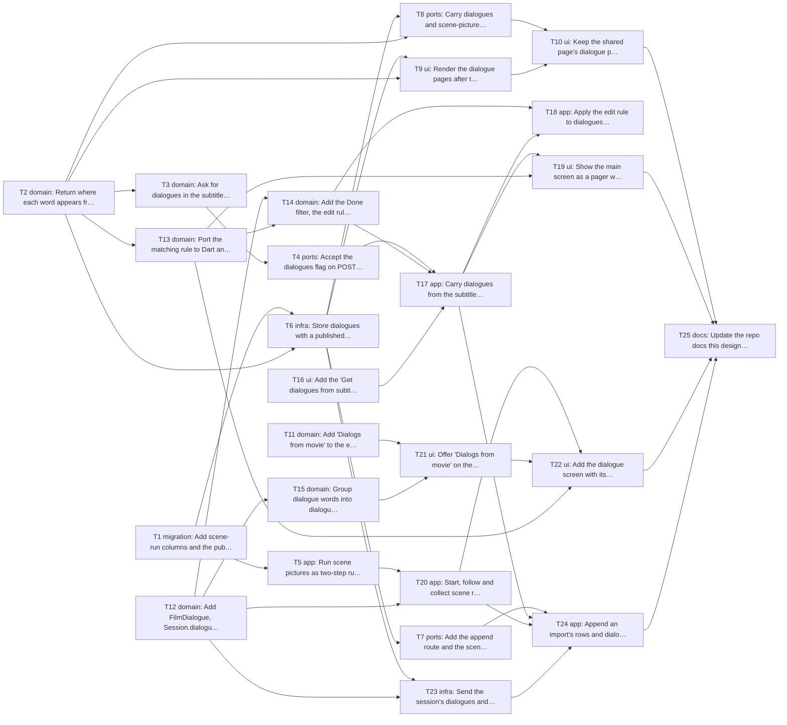

# Epic — get-words-from-subtitles-improvment

> **Spec:** [spec.md](../spec.md) · **Design:** [sad.md](../sad.md) · **UX flows:** [ux-flows.md](../ux-flows.md) · **ADRs:** [adr/](../adr/) · **Data model / API:** none yet (the stages were skipped), so the schema and contracts come from sad §4–§6.

## Goal

A subtitle import with the dialogues setting on also keeps up to 10 film dialogues. They are reread as pages after the words, learned as dialogue groups with a scene picture in the new "Dialogs from movie" exercise, and shown on the shared page, which an import updates on its own (spec §2; sad §1, ADR-0005).

## Scope

- **In:** Worker (subtitle prompt and reply check, scene runs, published dialogues, append and picture routes, change feed), shared page (dialogue pages, live updates), app (models, matching rule, rules, grouping, setting, import flow, main screen pager, learn page, dialogue screen, scene runs, publish and push outbox), docs and release checks.
- **Out (spec §3):** a film-name hint; checking dialogues word for word against the file; dialogues in the AnkiDroid or file exports; drawing or any AI work from the shared page or the web learn page; editing a dialogue's text. Also out (sad §11 accepted debt): automatic sync of typed words and phone edits, and the phone reading the partner's edits.

## Task map

Parallel starts: T1, T2, T11, T12 and T16 have no dependencies; the Worker branch (T1–T10) and the app's model and rule branch (T12–T15) run side by side until T17, T20 and T23 join them.

## Tasks

See [tracker.md](./tracker.md) for status. Machine contract: [tasks.json](../tasks.json).

| # | Task | Layer | Blocked by | DoD (short) |
|---|---|---|---|---|
| T1 | Add scene-run columns and the published-dialogue tables to D1 | migration | — | `0005_film_dialogues.sql` adds the two `story_runs` columns and the three dialogue tables, applies on the `npm |
| T2 | Return where each word appears from the word check, and pin the rule with a shared case file | domain | — | `matchPlaces` returns the expected ranges for every case in `match-cases.json` |
| T3 | Ask for dialogues in the subtitle prompt and check them in the reply | domain | T2 | With `dialogues: false` the request equals a snapshot of today's `buildSubtitleRequest` |
| T4 | Accept the dialogues flag on POST /subtitles/words and return the checked dialogues | ports | T3 | Through the Anthropic stub: with the flag, the reply carries checked dialogues |
| T5 | Run scene pictures as two-step runs of the story run workflow | app | T1 | A scene run records a prompt step and a picture step and no story step, takes one allowance unit at start and  |
| T6 | Store dialogues with a published session and carry them in publish and republish | infra | T1, T2 | Publishing with dialogues stores them linked to the right rows |
| T7 | Add the append route and the scene-picture upload route for a published session | ports | T6 | An append adds rows and dialogues once per import id without touching existing rows |
| T8 | Carry dialogues and scene-picture arrivals in the shared page's change feed | ports | T6, T2 | After a partner edits a dialogue word's translation, deletes its row, or edits its word so it no longer appear |
| T9 | Render the dialogue pages after the word table on the shared page | ui | T6, T2 | A published session with dialogues renders one dialogue page each, in order, with correct bold places and the  |
| T10 | Keep the shared page's dialogue pages in step with the change feed | ui | T8, T9 | With the page open, a dialogue appended by the app, a picture arriving |
| T11 | Add "Dialogs from movie" to the exercise list for the app and the web | domain | — | Both lists hold twelve exercises in the same order |
| T12 | Add FilmDialogue, Session.dialogues, WordGroup.dialogueId and StoryRun kind to the app | domain | — | The new fields round-trip through Isar and JSON |
| T13 | Port the matching rule to Dart and test it against the Worker's case file | domain | T2 | Every case in `match-cases.json` gives the same places in Dart as in TypeScript. |
| T14 | Add the Done filter, the edit rule and the card names for dialogues | domain | T12, T13 | The AC-03, AC-11, AC-13 and AC-26 examples from the spec pass as unit tests, including a pending dialogue that |
| T15 | Group dialogue words into dialogue groups before the existing grouping rules | domain | T12 | The AC-06, AC-15, AC-17, AC-24 and AC-25 examples pass as unit tests |
| T16 | Add the "Get dialogues from subtitles" switch to Settings | ui | — | The switch shows off on first launch, keeps its value across restarts |
| T17 | Carry dialogues from the subtitle import to Done and save them with the words | app | T4, T14, T16 | With the setting off the request has no `dialogues` key and Done adds only words |
| T18 | Apply the edit rule to dialogues whenever a word changes or is deleted | app | T14, T17 | Deleting a dialogue word, editing it out of the text, editing its translation |
| T19 | Show the main screen as a pager with one read-only dialogue page per dialogue | ui | T17, T13 | A session without dialogues renders exactly as before with no pager |
| T20 | Start, follow and collect scene runs in the app, and show them in Story runs | app | T5, T12 | A scene run started by the tracker is collected into Isar with its two steps and picture, sets the dialogue's  |
| T21 | Offer "Dialogs from movie" on the learn page with dialogue groups | ui | T11, T15 | In a session with dialogues the learn page shows the dialogue cards and the line, starts nothing on selection |
| T22 | Add the dialogue screen with its scene picture and open it from Start | ui | T20, T21, T13 | Start on a dialogue group without a picture starts one scene run and shows its progress and outcome |
| T23 | Send the session's dialogues and scene-picture declarations when publishing | infra | T6, T12 | A publish of a session with dialogues sends them with correct entry positions |
| T24 | Append an import's rows and dialogues, and upload scene pictures, to the shared link automatically | app | T7, T17, T20, T23 | A pending import is delivered once even across an app restart, a picture is uploaded after collection |
| T25 | Update the repo docs this design outdates and run the release checks | docs | T10, T19, T22, T24 | The docs describe what shipped |

## Risks / Hard rules

- **Start only after the mnemonic-story run is finished and reviewed** (sad §11): T5, T15, T20 change its files.
- Switch off changes nothing: T3, T4, T9, T17 and T23 each keep a byte-for-byte check of today's behaviour (sad §10 QG-1).
- Spending: no public route starts a run; a scene run takes one unit at start and per Draw again (sad §10 QG-3).
- CLAUDE.md: typed routes only (T22), services from providers, no new package, models only as approved in rule 5 (T12).
- Deploy, D1 migrations and secrets are done by the owner (T25), never by an agent.
