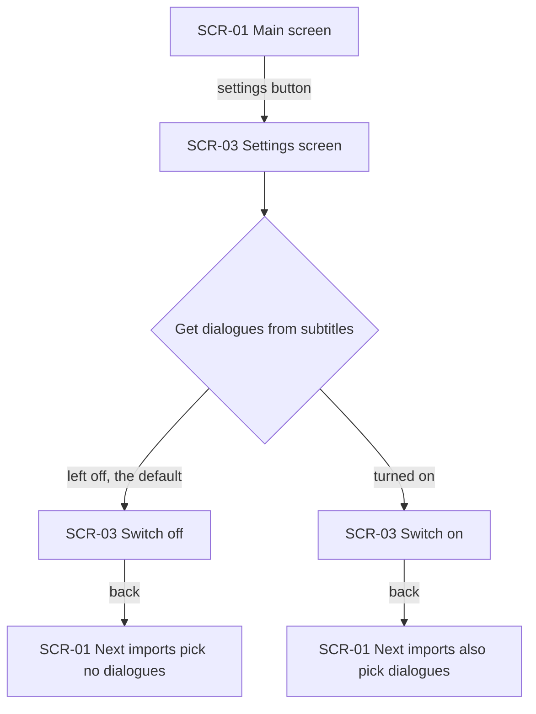
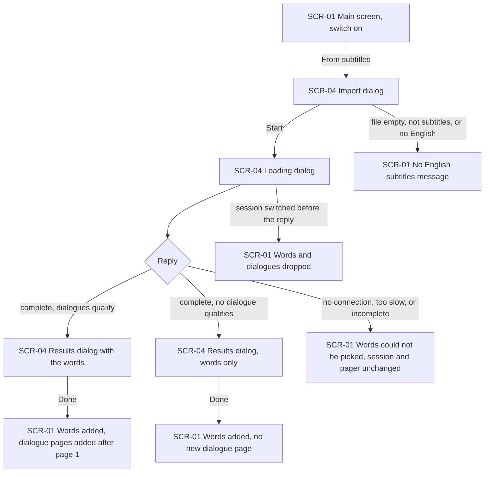
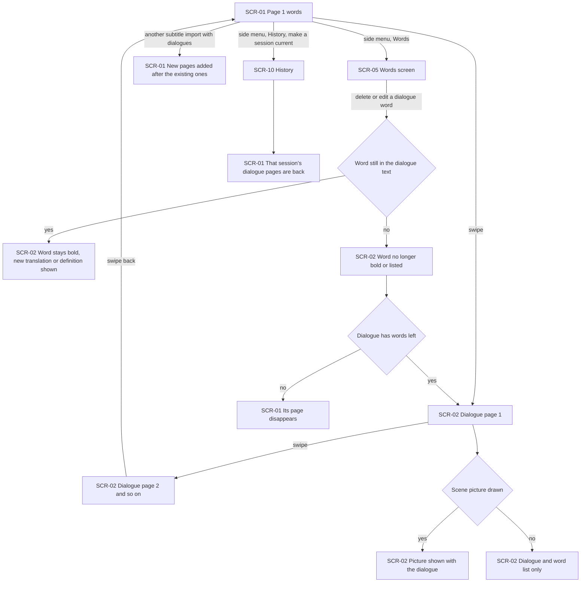
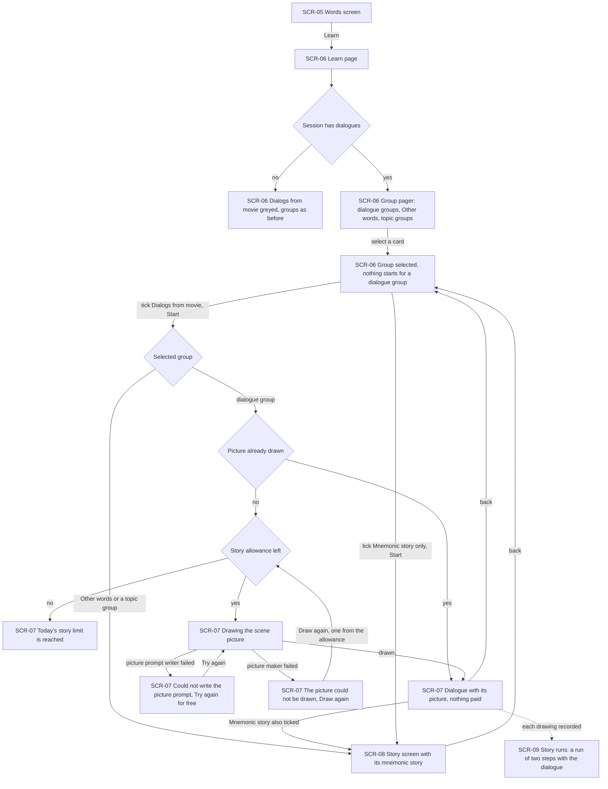
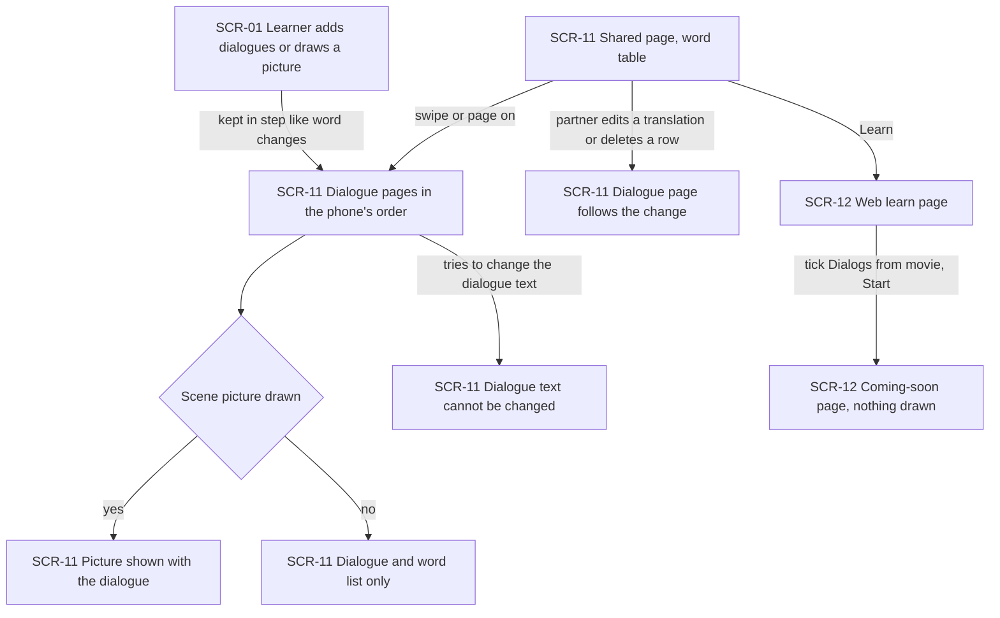
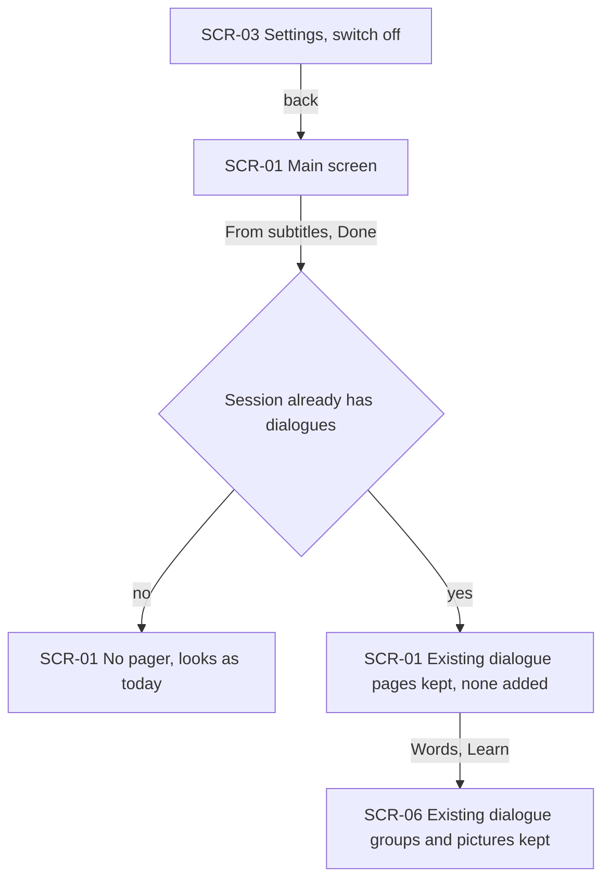

# UX flows — get-words-from-subtitles-improvment

> User flows for every UI-touching §4 user story of [spec.md](./spec.md), produced by `ux-flows` (after `clarify`, before `design`) and read by `design` (evidence for the target-surface + UI-architecture decisions), `sequences` (UI-driven flows align on SCR ids), `screens` (details every inventory row) and `plan-tests` (the e2e-through-UI paths). **Always markdown + mermaid `flowchart`**, whatever the design tool — this artifact is flow-altitude, not visual design.

## Platform decisions

- **Posture:** mobile-only in the app, as in words-from-subtitles and mnemonic-story. The shared page keeps its two existing layouts (wide and phone, from good-looking-web), and its dialogue pages fit into both without a new layout (owner, 2026-10-07). There is no `docs/design-system.md` yet.
- **The import itself does not change shape.** The speed dial's "From subtitles" item still leads through the import dialog, the loading dialog and the results dialog of words-from-subtitles. With the switch on, the only difference is what Done leaves behind: dialogue pages after the main screen's first page.
- **The main screen becomes a pager only when the current session has dialogues.** Page 1 is the main screen exactly as today, with the speed dial. Each later page is one dialogue page. With no dialogues there is no pager and nothing to swipe (AC-01).
- **The shared page gets the same order:** the word table first, then one dialogue page per dialogue.
- **"Dialogs from movie" is a separate exercise screen** opened by Start on the learn page. Like the story screen, it shows progress and errors in place and returns to the learn page with Back.
- **Design input flagged, not decided here:** where the dialogues and scene pictures are kept so the shared link stays in step (AC-20); whether words and dialogues come from one AI request or two; how a two-step story run is recorded beside three-step ones.

### Assumptions ledger (easy depth)

- Assumed: the dialogues setting is a plain on/off row on the existing Settings screen (SCR-03), under the subtitle import controls, with no confirmation when it is turned on or off.
- Assumed: after Done the main screen stays on page 1 (the words), and the new dialogue pages are reached by swiping. Done does not jump to the first new dialogue.
- Assumed: the pager shows a small page indicator so the learner can tell dialogue pages exist. Its look is left to `screens`.
- Assumed: a dialogue page is for reading only. Words are edited on the Words screen (SCR-05) or the shared page, as today, and the dialogue page follows the change (AC-11).
- Assumed: after Back from the dialogue screen (SCR-07) or the story screen (SCR-08), the learn page keeps the group selected and the ticks of this visit, as learn-part-step-1 does.
- Assumed: on the web, a dialogue page on the phone layout is reached the same way as on the wide layout, by swiping or paging after the table. No extra button is added.

## Screen inventory

| ID | Screen | Purpose | Entry | Exit |
|---|---|---|---|---|
| SCR-01 | Main screen (app) | Page 1: the current session's words and the speed dial, as today. Becomes a pager when the session has dialogues | App launch; a session made current from History; any import dialog closing | SCR-02 by swiping; SCR-04 from the speed dial; SCR-03 from the settings button; SCR-05 and SCR-10 from the side menu |
| SCR-02 | Dialogue page (app) | One film dialogue with its dialogue words in bold, the list of those words (word, translation, definition) and the scene picture once drawn. Read only | Swiping from SCR-01 or from another dialogue page | Swiping to the next or previous page; back to page 1 |
| SCR-03 | Settings screen (app) | Existing settings plus the switch "Get dialogues from subtitles" (off by default) | The settings button on SCR-01 | Back to SCR-01 |
| SCR-04 | Subtitle import dialogs (app) | Unchanged from words-from-subtitles: import dialog, loading dialog, results dialog. Error messages after Start appear on SCR-01 | "From subtitles" in the SCR-01 speed dial | Done or close → SCR-01; an error → SCR-01 with its message |
| SCR-05 | Words screen (app) | The session's words table, where words are edited or deleted; Learn opens SCR-06 | Side menu or a History session | SCR-06 by Learn; back |
| SCR-06 | Learn page (app) | Exercise list with "Dialogs from movie" in Step 1 right after "Mnemonic story" (greyed with "Needs dialogues from subtitles" in a session without dialogues). Group pager with one card per dialogue group plus "Other words" and any topic groups, with the line "Your words are grouped by the dialogues from the film. Please select one group to learn." | Learn on SCR-05 | SCR-07 or SCR-08 by Start; back to SCR-05 |
| SCR-07 | Dialogue screen (app) | The selected dialogue group's dialogue with all dialogue words in bold, and its scene picture: drawing progress, the picture, "Could not write the picture prompt" with "Try again", "The picture could not be drawn" with "Draw again", or "Today's story limit is reached. Try again tomorrow." | Start on SCR-06 with "Dialogs from movie" ticked and a dialogue group selected | Back to SCR-06; SCR-08 next when "Mnemonic story" is ticked too |
| SCR-08 | Story screen (app) | Existing mnemonic-story screen: the group's mnemonic story. Used for "Other words" and topic groups under "Dialogs from movie", and for any group under "Mnemonic story" | Start on SCR-06; after SCR-07 when both exercises are ticked | Back to SCR-06 |
| SCR-09 | Story runs and run details (app) | Existing mnemonic-story screens; a scene picture shows as a run of two steps, with the dialogue in place of a story | "Story runs" in Words settings | Back |
| SCR-10 | History (app) | Existing list of sessions. Opening one shows its Words screen; making it current brings its dialogue pages to SCR-01 | Side menu on SCR-01 | SCR-05; SCR-01 when a session is made current |
| SCR-11 | Shared page (web) | The existing word table (wide or phone layout), then one dialogue page per dialogue in the phone's order, with bold words, the word list and the scene picture once drawn. Words stay editable in the table; dialogue text is not editable | Opening the shared link | SCR-12 by Learn; closing the tab |
| SCR-12 | Learn page and coming-soon page (web) | Existing web learn page with "Dialogs from movie" always tickable right after "Mnemonic story"; Start leads to the coming-soon page | Learn on SCR-11; the learn link | Back to SCR-11 |

## Flows

### Flow: US-01 — Turn dialogues on or off

The learner opens Settings from the main screen and finds the switch "Get dialogues from subtitles", off unless they have turned it on (AC-01). Leaving it off means the next subtitle imports work exactly as before. Turning it on means the next imports also pick film dialogues. Either way the change applies only to imports that start afterwards (AC-23 for turning it off).

### Flow: US-02 — Get dialogues with the words

With the switch on, the learner imports from subtitles as before: import dialog, Start, loading dialog. When a complete reply arrives, the results dialog lists the words exactly as it does today. The dialogues are checked behind it: only dialogues holding at least one proposed word that really appears in them are kept, never more than 10, and never with extra words (AC-04, AC-05). Done adds the kept words and puts the dialogue pages after page 1 (AC-02). If no dialogue qualifies, Done adds only the words (AC-07). If the connection fails, the AI is too slow, or the reply is incomplete, even if only the dialogues are cut off, nothing is shown and the main screen says the words couldn't be picked, with the session and its pager unchanged (AC-08). A bad file gets the existing "no English subtitles" message (AC-09). If the session changed while the import ran, both words and dialogues are dropped (AC-12).

### Flow: US-03 — Read the dialogues on the main screen

From page 1 the learner swipes to each dialogue page in turn. Each shows the dialogue with its words in bold wherever they appear, the list of those words with translation and definition, and the scene picture once it has been drawn (AC-02, AC-05). A word that appears in two dialogues is bold and listed on both pages (AC-06). Words the learner removed in the results dialog appear on no page, and a dialogue left without words has no page (AC-03). When the learner edits or deletes a dialogue word on the Words screen, the page follows. A new translation or definition shows at once. A word deleted, or edited so it no longer appears in the text, stops being bold and listed, and a dialogue with no words left disappears from the pager (AC-11). A later import adds its dialogues after the existing pages. The pages survive a restart and come back when the session is made current again from History (AC-10).

### Flow: US-04 — Learn words dialogue by dialogue

The learner opens the learn page from the Words screen. In a session without dialogues, "Dialogs from movie" sits greyed in Step 1 with "Needs dialogues from subtitles", and everything else works as before (AC-16). In a session with dialogues, the group pager always shows, whatever the word count. It has one card per dialogue group, named after its first line, then "Other words" and any topic groups (AC-13, AC-15, AC-25). Selecting a dialogue group starts nothing and pays nothing (AC-24). With "Dialogs from movie" ticked, Start on a dialogue group opens the dialogue screen. If the scene picture already exists it is shown again without paying (AC-14). Otherwise drawing starts if the day's story allowance is not used up (AC-19). If the picture prompt writer fails, "Try again" redoes only that step for free. If the picture maker fails, "Draw again" redraws from the same prompt and takes one from the allowance (AC-18). Start on "Other words" or a topic group opens the existing story screen (AC-13). When both exercises are ticked, the story screen follows the dialogue screen (AC-13). Ticking only "Mnemonic story" opens the story screen for any group, and for a dialogue group its story is made only then (AC-24). Earlier groups keep their words when dialogues arrive (AC-17). A dialogue whose words are all gone loses its card, and its picture stays only in story runs (AC-26).

### Flow: US-05 — Share dialogues with my partner

The partner opens the shared link and sees the word table, as today. After it come the dialogue pages, in the same order as on the phone. Each has its words in bold and listed, and the scene picture where one has been drawn (AC-20). Dialogues and pictures the learner adds later reach the same link without sharing again (AC-20). When the partner edits a dialogue word's translation or deletes its row in the table, the dialogue page follows, on the shared page and on the phone (AC-21). The dialogue text itself can't be changed. On the web learn page "Dialogs from movie" can be ticked, but Start leads to the coming-soon page and nothing is drawn (AC-22).

### Flow: US-06 — Keep the app as it was when dialogues are off

With the switch off, a subtitle import works as before. In a session without dialogues, the main screen keeps no pager and looks exactly as today (AC-01). In a session that already has dialogues, the existing pages, groups and scene pictures stay. The new import adds no dialogue pages (AC-23).

## AC coverage

| AC | Shown by | Notes |
|---|---|---|
| AC-01 | Flow US-01 → switch off; Flow US-06 → no pager | |
| AC-02 | Flow US-02 → Done adds dialogue pages; Flow US-03 → picture shown | |
| AC-03 | Flow US-03 → prose (removed words, empty dialogue not kept) | Decided at Done; no separate node |
| AC-04 | Flow US-02 → complete reply, dialogues checked | Rule applied before the results dialog; no screen of its own |
| AC-05 | Flow US-02 → dialogues checked; Flow US-03 → bold words | Matching rule; no screen of its own |
| AC-06 | Flow US-03 → prose (word on two pages); Flow US-04 → one group | |
| AC-07 | Flow US-02 → no dialogue qualifies → words only | |
| AC-08 | Flow US-02 → no connection, too slow, or incomplete | |
| AC-09 | Flow US-02 → bad file message | |
| AC-10 | Flow US-03 → another import adds pages; History brings them back | |
| AC-11 | Flow US-03 → edit or delete branch | |
| AC-12 | Flow US-02 → session switched before the reply | |
| AC-13 | Flow US-04 → group pager, dialogue screen, Other words → story screen, both ticked | |
| AC-14 | Flow US-04 → picture already drawn, nothing paid | Story runs record on SCR-09 |
| AC-15 | Flow US-04 → group pager with any-size dialogue groups | |
| AC-16 | Flow US-04 → session without dialogues → greyed | Web part in Flow US-05 → web learn page |
| AC-17 | Flow US-04 → prose (earlier groups keep their words) | Grouping rule; no screen of its own |
| AC-18 | Flow US-04 → prompt writer failed / picture maker failed | |
| AC-19 | Flow US-04 → story allowance left: no | |
| AC-20 | Flow US-05 → dialogue pages, picture, kept in step | |
| AC-21 | Flow US-05 → partner edits or deletes | |
| AC-22 | Flow US-05 → text cannot be changed; web learn page → coming soon | |
| AC-23 | Flow US-06 → existing dialogue pages kept, none added | |
| AC-24 | Flow US-04 → select a card starts nothing; Mnemonic story only | |
| AC-25 | Flow US-04 → group pager always shown; prose | Regrouping rule for "Other words"; no screen of its own |
| AC-26 | Flow US-04 → prose (card gone, picture in story runs) | |
