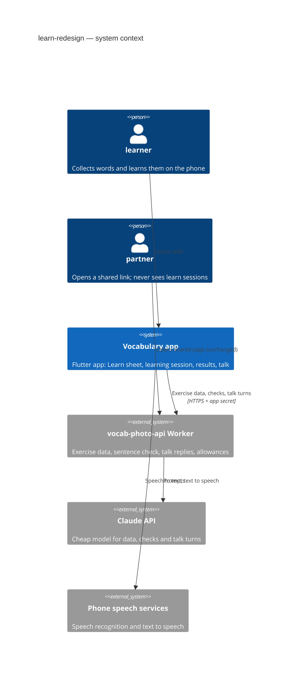
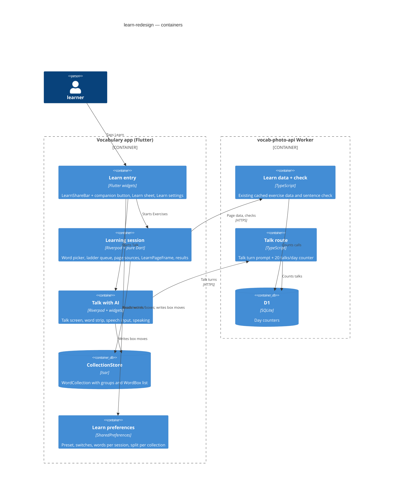
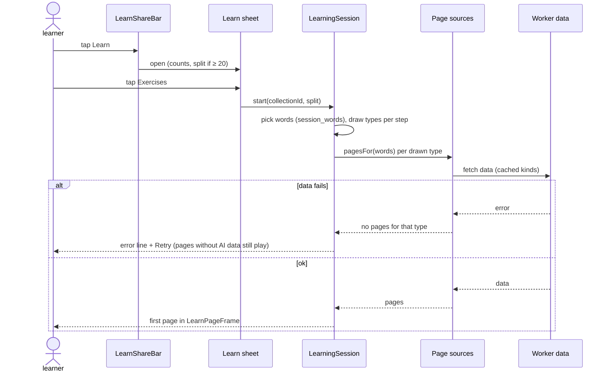
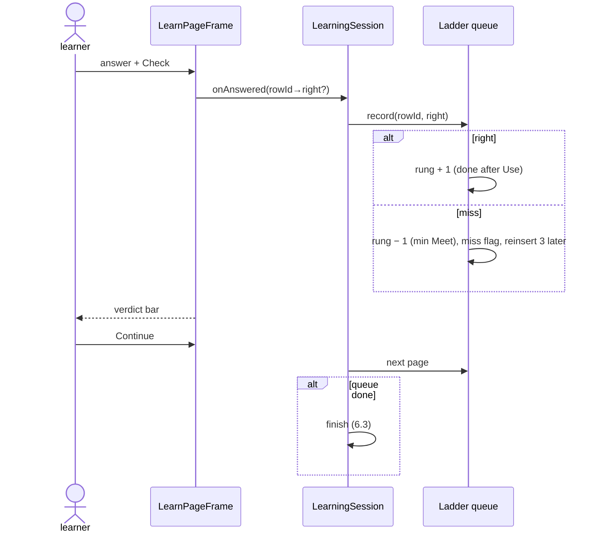
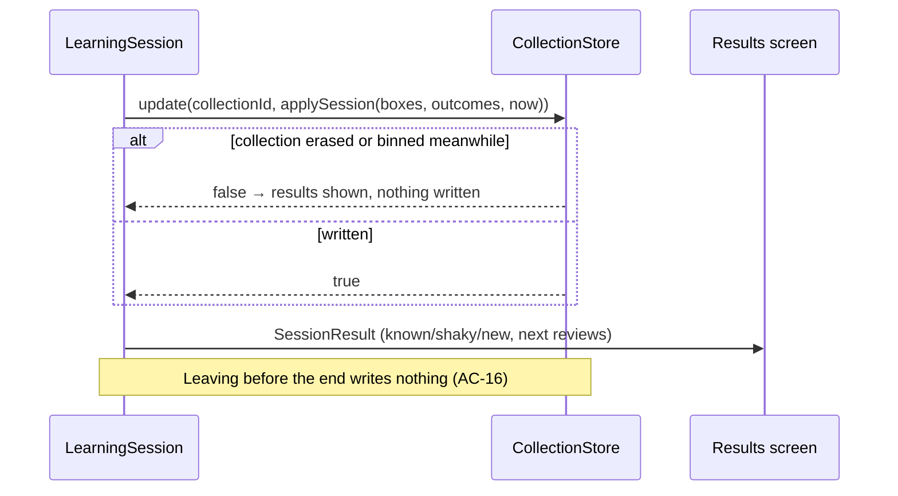
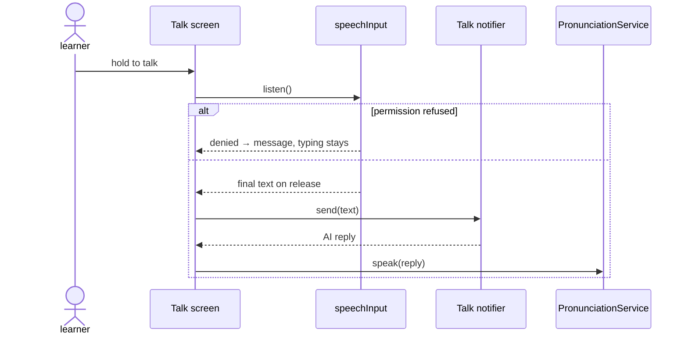

# Software Architecture Document — learn-redesign

> Spec: [spec.md](./spec.md) · Brief: [owner-brief.md](./owner-brief.md) · Glossary: [CONTEXT](../../../CONTEXT.md) · Architecture: [docs/architecture.md](../../architecture.md)
> Interview depth: easy (convention defaults decided by the architect; product calls by the owner proxy).

## 1. Introduction and goals

The learn part changes from "tick exercises, then Start" to "Learn → Exercises or Talk with AI → learning session → results". Exercises are cut into exercise pages played in word-ladder order in one card-and-check frame; each finished session moves Leitner boxes; Talk with AI is a typed (later spoken) conversation scored the same way.

**Top quality goals**

1. **Correct box moves** — a word's Leitner box moves exactly by AC-13 (once per session, up at most once a day, all-or-nothing per session).
2. **No rewrite** — every exercise keeps its question building, its AI data and its old screen; the session reuses them (CLAUDE.md rule 3: "move code, do not rewrite it").
3. **Bounded AI cost** — talk: 1 cheap-model call per reply, ≤ 20 talks a day; exercise data stays on the existing cached data service.

**Stakeholders**

| Role | Concern |
|---|---|
| learner | starts in two taps, sees per-word results, practises by talking |
| partner | the shared page stays as it is (AC-27) |
| owner (via proxy) | AI spend bounded; look changes only as approved |

## 2. Constraints

- Flutter app, one `lib/`, go_router typed routes only, Riverpod services from `lib/core/providers.dart` (CLAUDE.md rules 1–2).
- Persistence is Isar (`isar_community` 3.3.0-dev.1) through `CollectionStore`; background writers use `CollectionStore.update` (one write transaction).
- Preferences live in `SharedPreferences` behind `@riverpod` notifiers in `providers.dart` (as `wordDetailMode`, `appTheme`).
- Colours and fonts come from `AppDecor` (`lib/core/theme/app_decor.dart`); a new hard-coded colour goes there as a slot.
- Worker: Cloudflare Worker `vocab-photo-api/` with D1 day counters (`learn/allowance.ts`), app-only secret header, cheap model `GROUPING_MODEL`.
- New package allowed: `speech_to_text`, pinned (owner approval in the brief; rule 5). New model allowed: the per-word Leitner record (`WordBox`).
- Tests: `tool/test.sh smoke|changed`; Worker tests under `vocab-photo-api/test`.

## 3. Context and scope



The app talks to the Worker for exercise data (existing), sentence checks (existing) and talk turns (new). Speech recognition and speaking run on the phone. The partner's shared page is out of scope and unchanged. Brownfield context: `docs/architecture.md` (no architecture-map.md; the architect read the code directly — learn feature, kit, store, Worker learn routes).

## 4. Solution strategy

| # | Decision | Choice | ADR |
|---|---|---|---|
| D1 | Target surfaces | mobile-app (Flutter, existing) + worker (existing Cloudflare Worker) | — (no new surface) |
| D2 | Where boxes live | embedded `WordBox` list on `WordCollection` | [0001](./adr/0001-store-leitner-boxes-as-an-embedded-list-on-the-collection.md) |
| D3 | How a session's box moves are written | one `CollectionStore.update` at the end, pure `applySession` | [0002](./adr/0002-move-a-sessions-boxes-in-one-store-transaction-at-the-end.md) |
| D4 | How exercises become pages | each exercise's question building moves into a page source used by both its screen and the session | [0003](./adr/0003-move-each-exercises-question-building-into-a-page-source-shared-with-its-screen.md) |
| D5 | Session engine | pure ladder queue + one `LearningSession` notifier | [0004](./adr/0004-play-sessions-from-a-pure-ladder-queue-in-one-session-notifier.md) |
| D6 | Groups for split | existing AI grouping with the split range 7–12 | [0005](./adr/0005-split-with-the-existing-word-grouping-capped-at-twelve-words.md) |
| D7 | Learn settings + split choice storage | SharedPreferences notifiers | [0006](./adr/0006-keep-learn-settings-and-the-split-choice-in-shared-preferences.md) |
| D8 | Talk service | new Worker route, cheap model, 20 talks/day counter | [0007](./adr/0007-serve-talk-turns-from-a-worker-route-with-a-daily-talk-counter.md) |
| D9 | Who decides a word was used | the app, with `matchPlaces` | [0008](./adr/0008-decide-used-words-in-the-app-with-the-shared-word-match.md) |
| D10 | Speech to text | `speech_to_text` package behind `speechInputProvider` | [0009](./adr/0009-use-the-speech-to-text-package-behind-a-speech-input-provider.md) |
| D11 | Learn button target | the Learn sheet; the old Learn page only behind "Try it" | [0010](./adr/0010-open-the-learn-sheet-from-learn-and-keep-the-old-learn-page-behind-try-it.md) |
| D12 | Page look | one `LearnPageFrame` (C1) styled through `AppDecor` | [0011](./adr/0011-draw-every-exercise-page-in-one-learn-page-frame-styled-by-app-decor.md) |

UI architecture of the mobile-app surface: unchanged (Flutter, go_router typed routes, Riverpod) — no ADR.

## 5. Building block view



### 5.1 New and changed building blocks (app)

| Block | Path | Responsibility |
|---|---|---|
| `WordBox` (new model) | `lib/core/models/word_box.dart` | Isar `@embedded`: `rowId`, `word` (English, trimmed lower), `box` 1–5, `dueAt`, `lastUpDay` (yyyy-mm-dd). `WordCollection.boxes` list; JSON round-trip like `results`. |
| Leitner rules (pure) | `lib/features/learn/session/leitner.dart` | `boxOf(collection, row)` (match by rowId + word, else new), `isDue`, `applySession(boxes, outcomes, now)` per AC-13, `intervalFor(box)` 1/2/4/8/16 days. |
| Word picker (pure) | `lib/features/learn/session/session_words.dart` | AC-06/07/14: under 20 → all; split on → group by the due/new/next rule; split off → due, new, others capped by Words per session. Also `nextGroup(skip:)`. |
| Ladder queue (pure) | `lib/features/learn/session/ladder_queue.dart` | Words × rungs; picks next page (due first, miss reinserted 3 later), `isDone`, per-word miss flag. Seeded `Random` via `exerciseRandomProvider`. |
| Page sources | `lib/features/learn/<exercise>/<exercise>_pages.dart` (11) | Moved question building from each notifier's `build` (ADR-0003): `Future<List<ExercisePage>> pagesFor(words, others, deps)`; the notifier calls the same function. |
| `ExercisePage` | `lib/features/learn/session/exercise_page.dart` | `exerciseId`, `step`, `rowIds` (1, or 4 for a board), `body` builder `(context, onAnswered(Map<rowId,bool>))`. |
| Page bodies | moved widgets from each `*_screen.dart` into `*_page_body.dart` | One question's UI; the old screen and the frame both use it. |
| `LearningSession` notifier | `lib/features/learn/session/learning_session_notifier.dart` | Loads words, draws types per step (min(3, on)), asks page sources, runs the queue, records outcomes, at the end calls `applySession` via store, returns `SessionResult`. |
| `LearnPageFrame` (C1) | `lib/features/learn/session/learn_page_frame.dart` | Close ✕, 3-segment step bar, "page N of M", exercise chip, card, answers slot, Check, verdict bar (right/wrong, word — translation, Continue). Colours via `AppDecor` slots `learnRight`, `learnWrong`. |
| Session screen | `lib/features/learn/session/learning_session_screen.dart` | Hosts the frame; leave confirm (AC-16); error line + Retry (AC-11). |
| Results screen | `lib/features/learn/session/session_results_screen.dart` | AC-12/22: counts, per-word next review, Practise N shaky, Next group, Done; "N words not used — unchanged" for talks. |
| Learn sheet | `lib/features/learn/entry/learn_sheet.dart` | AC-01/05: two cards, counts, gear, split checkbox (≥ 20 words). |
| Companion button | `lib/features/learn/entry/companion_button.dart` | AC-04: popup beside Learn in `LearnShareBar`; alone ticked, teacher/friend disabled "Soon". |
| Learn settings | `lib/features/learn/entry/learn_settings_screen.dart` | AC-17/18/19: presets, switches, Words per session, Try it. |
| Learn prefs | `lib/core/providers.dart` (`learnSettingsNotifier`, `learnSplitNotifier(collectionId)`) | SharedPreferences, ADR-0006. |
| Talk | `lib/features/learn/talk/` (`talk_notifier.dart`, `talk_screen.dart`, `talk_rules.dart`) | AC-20–26: scene pick, turns, word strip, hint after 2, end rules, scoring into `applySession`. |
| Talk API | `lib/core/services/talk_api_service.dart` + `talkApiServiceProvider` | Talk turn calls; maps day limit. |
| Speech input | `lib/core/services/speech_input.dart` + `speechInputProvider` | Wraps `speech_to_text`; fake in tests. Speaking reuses `PronunciationService`. |
| Routes | `lib/router/routes.dart` | `LearningSessionRoute`, `SessionResultsRoute` (extra-free: results read from the session provider), `LearnSettingsRoute`, `TalkRoute` under `WordsTableRoute`. `LearnRoute` stays (Try it, with `exercise` query). |

### 5.2 Worker

| Block | Path | Responsibility |
|---|---|---|
| Talk route | `vocab-photo-api/src/learn/talk.ts`, registered in `learn/routes.ts` | Validates turn body; start → takes a talk unit; builds prompt (scene, words, target, history ≤ 24 messages); returns `{reply, target}`. |
| Talk counter | `learn/allowance.ts` `takeLearnTalk`, migration `0008_talk_allowance.sql` | 20 talks per UTC day app-wide. |

## 6. Runtime view

### 6.1 Start a learning session (AC-01, AC-02, AC-06, AC-08, AC-14)



### 6.2 Answer a page and climb the ladder (AC-08, AC-09, AC-10)



### 6.3 Finish and move boxes (AC-12, AC-13, AC-15, AC-16)



### 6.4 Talk turn (AC-20 – AC-24)

```mermaid
sequenceDiagram
  actor L as learner
  participant T as Talk notifier
  participant A as TalkApiService
  participant W as Worker talk route
  participant C as Claude
  T->>A: start(scene, words, target)
  A->>W: turn start
  W->>W: take talk unit (20/day)
  alt limit reached
    W-->>A: day limit
    A-->>L: "Today's talk limit is reached. Try again tomorrow."
  else
    W->>C: prompt
    C-->>W: opening
    W-->>T: reply + target
  end
  L->>T: reply text
  T->>T: tick used words (matchPlaces on learner text only)
  T->>A: reply turn (history, next target)
  A->>W: turn reply (never refused for the limit)
  W-->>T: AI reply
  Note over T: ends after 12 replies or all words used; Done → applySession
```

### 6.5 Voice (AC-25, AC-26)



## 7. Deployment view

- App: ships in the next build; Isar schema gains `WordCollection.boxes` (additive; old records read an empty list). iOS `Info.plist`: `NSMicrophoneUsageDescription`, `NSSpeechRecognitionUsageDescription`; Android manifest: `RECORD_AUDIO` + `<queries>` for `android.speech.RecognitionService`.
- Worker: deploy after D1 migration `0008_talk_allowance.sql` (`wrangler d1 migrations apply vocab-sessions --remote`). The owner deploys the Worker personally.

## 8. Crosscutting concepts

- **Randomness**: every random draw uses `exerciseRandomProvider` so tests seed it.
- **Errors**: services never throw into widgets; screens show one error line + Retry (learn-kit pattern).
- **Theming**: the frame and sheet use theme + `AppDecor` slots; new slots `learnRight`, `learnWrong` added in every theme file.
- **Word match**: `matchPlaces` (core/dialogues/dialogue_match.dart) is the only "word used" rule (ADR-0008).
- **Time**: box dates use the device's local calendar day; a `clock` parameter is injected for tests.

## 9. Architecture decisions

| ADR | Title | Status |
|---|---|---|
| [0001](./adr/0001-store-leitner-boxes-as-an-embedded-list-on-the-collection.md) | Store Leitner boxes as an embedded list on the collection | Accepted |
| [0002](./adr/0002-move-a-sessions-boxes-in-one-store-transaction-at-the-end.md) | Move a session's boxes in one store transaction at the end | Accepted |
| [0003](./adr/0003-move-each-exercises-question-building-into-a-page-source-shared-with-its-screen.md) | Move each exercise's question building into a page source shared with its screen | Accepted |
| [0004](./adr/0004-play-sessions-from-a-pure-ladder-queue-in-one-session-notifier.md) | Play sessions from a pure ladder queue in one session notifier | Accepted |
| [0005](./adr/0005-split-with-the-existing-word-grouping-capped-at-twelve-words.md) | Split with the existing word grouping capped at twelve words | Accepted |
| [0006](./adr/0006-keep-learn-settings-and-the-split-choice-in-shared-preferences.md) | Keep learn settings and the split choice in shared preferences | Accepted |
| [0007](./adr/0007-serve-talk-turns-from-a-worker-route-with-a-daily-talk-counter.md) | Serve talk turns from a Worker route with a daily talk counter | Accepted |
| [0008](./adr/0008-decide-used-words-in-the-app-with-the-shared-word-match.md) | Decide used words in the app with the shared word match | Accepted |
| [0009](./adr/0009-use-the-speech-to-text-package-behind-a-speech-input-provider.md) | Use the speech_to_text package behind a speech input provider | Accepted |
| [0010](./adr/0010-open-the-learn-sheet-from-learn-and-keep-the-old-learn-page-behind-try-it.md) | Open the Learn sheet from Learn and keep the old Learn page behind Try it | Accepted |
| [0011](./adr/0011-draw-every-exercise-page-in-one-learn-page-frame-styled-by-app-decor.md) | Draw every exercise page in one learn page frame styled by AppDecor | Accepted |

## 10. Quality requirements

| Scenario | When | Then | How verify |
|---|---|---|---|
| Box correctness | a session ends with words clean, missed, new, at box 5, already moved up today | moves per AC-13 | unit tests of `applySession` |
| All-or-nothing | the store update fails or the collection was erased | no box changes | store test with a failing/erased collection |
| First page, cached | tap Exercises | "≤ 1 s, worst of 20 taps" | debug-build stopwatch log on iPhone 15, 20 sessions |
| First page, not cached | tap Exercises, cache cleared | "≤ 6 s, worst of 10 taps" | same log, 10 sessions |
| Talk typed | send a reply | "≤ 4 s, 19 of 20 replies" | debug-build log, 20 replies |
| Talk spoken | release the talk button | "≤ 6 s, 9 of 10 replies" | manual stopwatch, iPhone 15 + one Android |
| Talk cost | 21st talk start in a UTC day | refused; replies in started talks never refused | Worker unit test of the counter and route |
| Frame | every theme at 393 pt and text scale 1.3 | no overflow | widget test per theme |

## 11. Risks and technical debt

| Risk | Severity | Mitigation | Owner | Due |
|---|---|---|---|---|
| Capping groups at 12 regroups collections whose stored groups hold 13–19 words; old story runs keep pointing at removed group ids | Medium | regroup only when a stored group exceeds 12 and split is on; story runs already tolerate a missing group (shown by name); test it | Architect | T-grouping task |
| Moving 11 exercises' code risks regressions in the old screens | Medium | each move keeps the old screen's widget tests green before the page source is used | Implementer | per page-source task |
| `speech_to_text` platform setup differs per OS version | Low | voice is the last milestone; typing always works (AC-26) | Implementer | voice task |
| Worker not deployed when the app ships Talk | Medium | Talk shows the plain error line + Retry; owner deploys with migration 0008 | Owner | before release |

## 12. Glossary

See [CONTEXT.md](../../../CONTEXT.md): learning session, exercise page, word ladder, Leitner box, due word, learning companion, learn preset, Talk with AI (added 2026-10-23).
