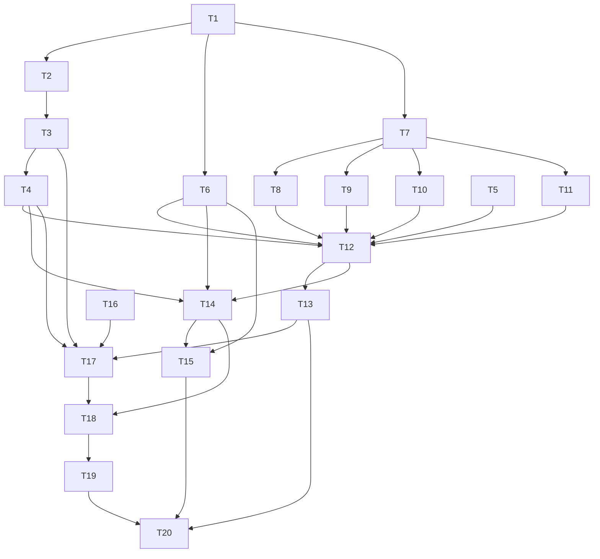

# Epic — learn-redesign

[spec](../spec.md) · [sad](../sad.md) · [screens](../screens.md) · [tasks.json](../tasks.json)

Milestones: M1 entry (T6, T14, T15) · M2 pages + session (T5, T7–T12) · M3 boxes + results (T2–T4, T13) · M4 talk (T16–T18) · M5 voice (T19).

