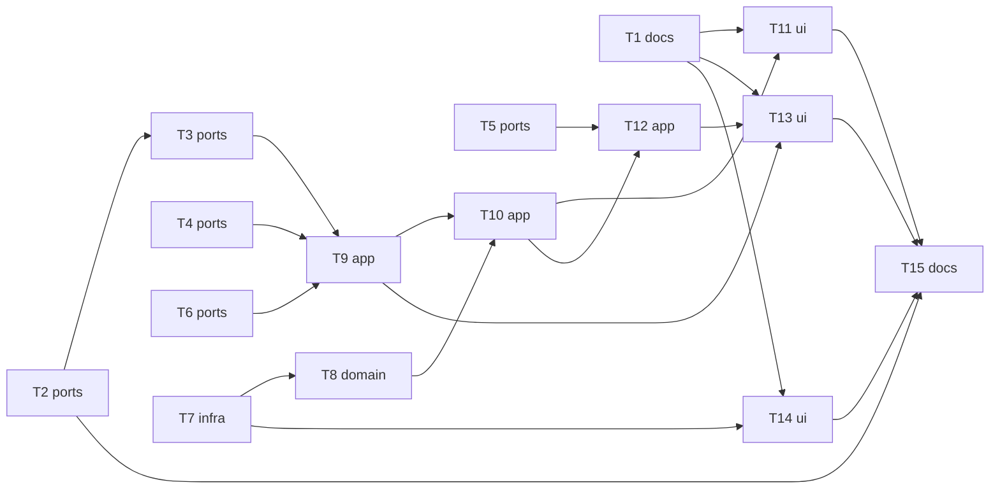

# Epic — learn-warm-up-v2

> **Spec:** [spec.md](../spec.md) · **Design:** [sad.md](../sad.md) · **ADRs:** [adr/](../adr/) · **Flows:** [ux-flows.md](../ux-flows.md) · **Brief:** [improvements.md](../improvements.md)

## Goal

The warm-up becomes a short dialog (intro, main question, sometimes a grammar question, topic, Hard/Easy) that fills a
learner profile kept on the phone; topics fit the words first and the learner a little; a chosen grammar rule steers
the main dialog and gets a results line; fixed counts and an occasional 👍/👎 measure it ([spec §2](../spec.md)).

## Scope

- **In:** the warm-up view and plan, the profile store and settings section, the Worker's topics, reaction, talk and
  events calls, the results page's grammar line and 👍/👎, the revised catalog.
- **Out:** the talk mission's turns, words and microphone (owner D1–D3); dashboards ([spec §3](../spec.md)).

## Order

Worker tasks T2–T6 and the store T7 have no app dependencies and can run first (max 2 agents at a time). Deploy the
Worker before the app release (ADR-0006, G9).

## Task map

