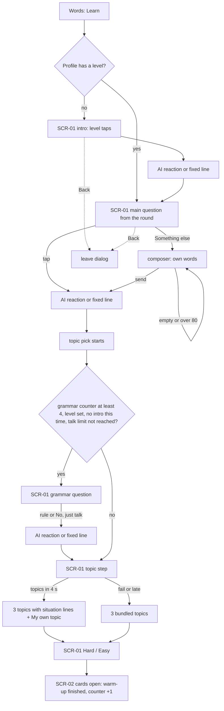
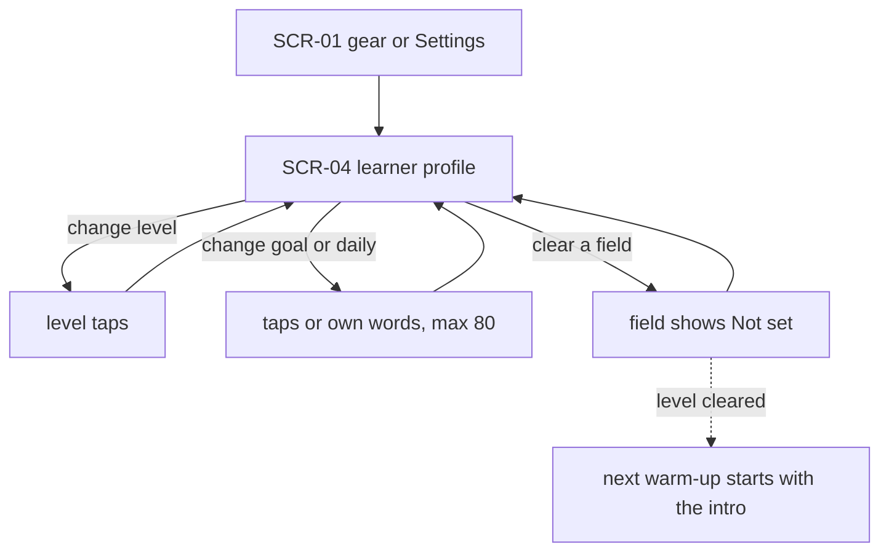
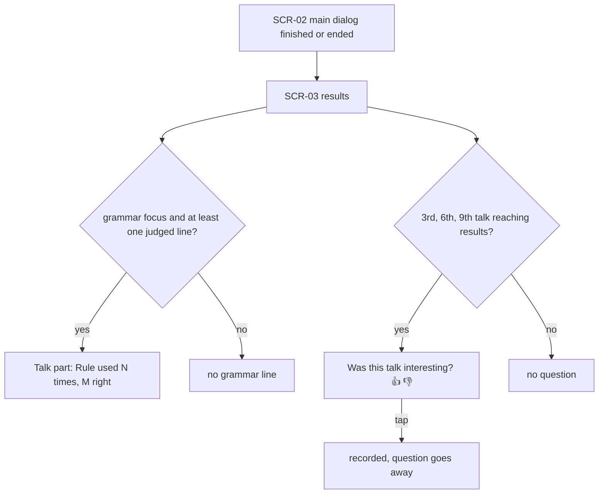

# UX flows — learn-warm-up-v2

> Approved by the owner proxy's route pick (O4: one short pass; screens skipped, so the wireframes are here).
> Builds on the existing Learn flow pager (learn-welcome ADR-0001): no new route, no new screen class.

## Platform decisions

- **Posture:** mobile-first, portrait (per learn-welcome AC-11).
- The warm-up stays a phase of the Learn flow page, drawn with the Talk with AI dialog look (bubbles, tap choices,
  composer). It is not a separate route.
- The learner profile is a section of the existing Learn settings page, not a new page.
- The grammar line and 👍/👎 are parts of the existing results page.

## Screen inventory

| ID | Screen | Purpose | Entry | Exit |
|---|---|---|---|---|
| SCR-01 | Learn flow · warm-up phase | Intro, main question, grammar question, topic, Hard/Easy | Learn on the Words screen | SCR-02 cards; leave dialog → Words; gear → SCR-04 |
| SCR-02 | Learn flow · cards, stories, main dialog | Unchanged, except the talk receives the grammar focus | SCR-01 finished | SCR-03 |
| SCR-03 | Learn flow · results | Grammar line, 👍/👎 question | SCR-02 | Exercises, Talk with AI, Done |
| SCR-04 | Learn settings · learner profile section | See, change and clear the level, goal, daily context | gear on SCR-01, or Settings → Learn settings | back |

### Wireframes (markdown, replacing `screens`)

```
SCR-01 warm-up (first time)                 SCR-01 warm-up (5th finished, grammar due)
┌──────────────────────────────┐            ┌──────────────────────────────┐
│ ▬▬▬▬ ▭▭▭▭ ▭▭▭▭  1/4      ⚙  │            │ ▬▬▬▬ ▬▬▬▬ ▭▭▭▭ ▭▭▭▭ 2/4  ⚙ │
│ (AI) What's your English     │            │ (AI) Would you like to focus │
│      level?                  │            │      on a grammar rule in    │
│ [Beginner] [Elementary]      │            │      this talk?              │
│ [Intermediate] [Upper-int.]  │            │ [Present Perfect]            │
│ [Advanced] [Not sure]        │            │ [Past Continuous]            │
│                 (me) Interm. │            │ [First conditional]          │
│ (AI) Nice, good to know.     │            │ [Modal verbs for advice]     │
│ (AI) What do you spend most  │            │ [No, just talk]              │
│      of your day doing…?     │            └──────────────────────────────┘
│ [Working] [Studying] …       │
│ [Something else]  → composer │            SCR-01 topic step
└──────────────────────────────┘            ┌──────────────────────────────┐
                                            │ (AI) Pick a topic:           │
SCR-04 Learn settings · learner profile     │ [Hotel stay                ] │
┌──────────────────────────────┐            │  Your room is not ready; get │
│ Learner profile              │            │  a fair deal from reception. │
│ Used only to pick talk topics│            │ [Lost and found] …           │
│ English level  Intermediate ›│            │ [My own topic…]              │
│ Goal       Travel confid.  ✕ │            └──────────────────────────────┘
│ Daily      Working         ✕ │
└──────────────────────────────┘            SCR-03 results (Talk part)
                                            │ Present Perfect: used 4 times, 3 right │
                                            │ Was this talk interesting?  👍  👎      │
```

## Flows

### Flow: US-01, US-02, US-03, US-05 — the warm-up



Learn opens the warm-up. A learner with no level gets the intro first, taps a level and gets a short reaction. Then
the main question comes, the next one from the current round of three in random order. It is answered with a tap or,
through "Something else", in the learner's own words. Send stays disabled while the text is empty or over 80
characters. After the reaction, the topic pick starts in the background. If the grammar question is due (counter at 4
or more, a level is set, no intro this time, and the daily talk limit not reached), it comes next and gets a reaction.
The topic step shows 3 topics with one-line situations, or the bundled 3 when the pick fails or is late, then Hard or
Easy. Opening the cards finishes the warm-up and adds one to the grammar counter. Back at any step opens the existing
leave dialog; answers already saved to the profile stay.

### Flow: US-04 — the learner profile



The section shows the three fields, or "Not set", under "Used only to pick talk topics". Each field can be changed
with the same taps as in the warm-up (goal and daily context also take own words up to 80 characters) or cleared. A
cleared level brings the intro back on the next warm-up.

### Flow: US-03, US-07 — the results page



The results page adds the grammar line only when the talk had a grammar focus and at least one judged line. On every
3rd talk that reaches the results page, finished or ended early, it asks "Was this talk interesting?". One tap records
it and the question goes away.

## AC coverage

| AC | Shown by | Notes |
|---|---|---|
| AC-01 | Flow warm-up → B no → C → R1 | |
| AC-02 | Flow warm-up → B yes; G condition "no intro this time" | Level changes only in SCR-04 |
| AC-03 | Flow warm-up → M | Round of three, random order |
| AC-04 | Flow warm-up → O loop | Also SCR-04 → D |
| AC-05 | R1, R2, R3 | 2 s cutoff, fixed line |
| AC-06 | Flow warm-up, bar in wireframe; L | 3 or 4 steps |
| AC-07 | G → GQ | |
| AC-08 | G condition "talk limit not reached" | |
| AC-09 | N/A here | Inside the main dialog (SCR-02); no new screen |
| AC-10 | Flow results → D | |
| AC-11 | Flow profile | |
| AC-12 | N/A here | No UI; a rule on where data goes (design) |
| AC-13 | T → T1 / T2 | |
| AC-14 | T1 | Catalog content |
| AC-15 | N/A here | Older app versions; server rule |
| AC-16 | Flow results → G | |
| AC-17 | N/A here | Server counts, no UI |
