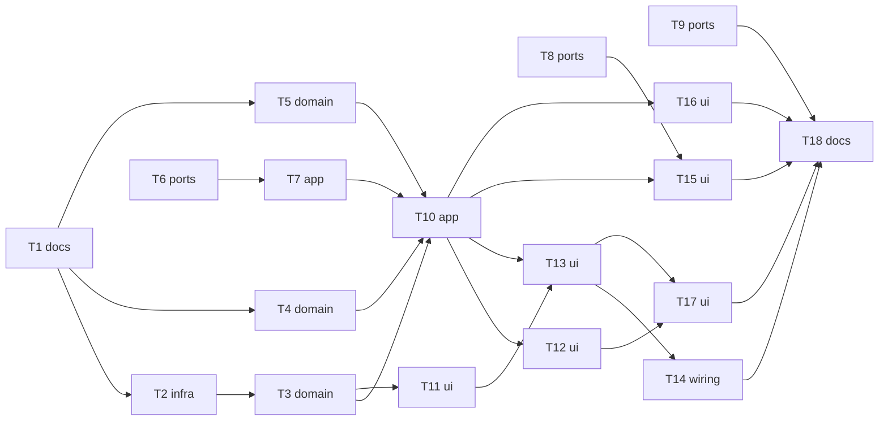

# Epic — learn-welcome

> **Spec:** [spec.md](../spec.md) · **Design:** [sad.md](../sad.md) · **ADRs:** [adr/](../adr/) · **Brief:** [owner-brief.md](../owner-brief.md) · **Related:** [word-context](../../word-context/spec.md), [self-check-cards](../../self-check-cards/spec.md)

## Goal

Learn starts with a two-question warm-up, then flip cards the learner rates, with up to three story pictures between them, then a main AI dialog on the chosen topic and length, then results ([spec §2](../spec.md)).

## Scope

- **In:** Learn entry and routes, a new flow notifier and screens, the shared self-check card and rules, orientation, the Talk screen's learn-flow mode, the results screen, Worker topics, talk and story routes.
- **Out:** exercise sessions themselves, AI word grouping, editing stories ([spec §3](../spec.md)); the after-mistake cards in exercises stay in [self-check-cards](../../self-check-cards/spec.md).

## Task map

## Tasks

See [tracker.md](./tracker.md) for status. Machine contract: [tasks.json](../tasks.json).

| # | Task | Layer | Blocked by | DoD (short) |
|---|---|---|---|---|
| T1 | Record learn-welcome approvals in CLAUDE.md rules 3 and 5 | docs | — | rule 3 lists the flow's visible changes and removals and the portrait lock; rule 5 lists WordBox.lastCheckSide |
| T2 | Add WordBox.lastCheckSide and keep it through copy, JSON and the store | infra | T1 | build_runner regenerates; '' default for old data; copy/JSON keep it; put() of a stale copy keeps the stored side |
| T3 | Add the pure self-check rules: SelfRating, rateBox, nextSide, box labels | domain | T2 | unit tests: each rating from new/1/3/5, once-a-day up, due dates, side switch, labels |
| T4 | Add the pure flow word rules: card words, the source-tail split, dialog words | domain | T1 | unit tests: first due-or-new start, 36 cap, nothing-due fallback, 10 film + 2 typed → 10 | 2+, 6 + 6 kept, 4–7 words one group, 3-story cap, Easy/Hard counts and order |
| T5 | Add the pure story slot scheduler | domain | T1 | unit tests: ready on time → after its last card; ready late → as soon as ready within 5 cards; not ready → wait page; skip → next slot, else before the dialog, else Story runs; last group → wait page |
| T6 | Add the 50 topics and POST /learn/topics to the Worker | ports | — | vitest: 3 valid ids for a word list; invalid AI ids filled by keyword overlap; not counted toward talks; auth as the other learn routes |
| T7 | Add the topics service with a 4 s timeout and the bundled fallback | app | T6 | service tests: answer → 3 topics; error or > 4 s → Daily routine, Food and cooking, Travel |
| T8 | Let the talk mission take a topic, a reply limit and chosen words | ports | — | vitest: the mission prompt uses the topic (id title or own text ≤ 80 chars) and the given words; the talk ends after maxReplies 6 or 12; counted as one talk |
| T9 | Let story runs send each word's context, source and edited translation to the story writer | ports | — | vitest: story start accepts per-word extras and the writer prompt lists them; old requests unchanged |
| T10 | Add the LearnFlowNotifier: phases, per-card save, story start and reuse, leave | app | T3, T4, T5, T7 | notifier tests with fakes: < 4 words refused, warm-up answers, each rating saved at once, story reuse by row-id set, slots followed, dialog setup built, leave keeps ratings |
| T11 | Add the self-check card widget with flip, four ratings, box captions and the context line | ui | T3 | widget tests: buttons disabled before flip, rating callback, side by nextSide, captions, context with source / AI mark, nothing when empty |
| T12 | Add the warm-up view on the Talk screen: 2-step bar, topic and mode choices, own topic | ui | T10 | widget tests: 2-step bar, 3 topics + My own topic…, Send disabled while empty, ≤ 80 chars, Hard/Easy, no Skip, gear opens Learn settings |
| T13 | Add the flow pager: cards, story picture pages, the wait page and the card counter | ui | T10, T11 | widget tests: card counter, story page after its card when ready, wait page with progress and Skip, story opens itself when ready |
| T14 | Lock the app to portrait and turn the story page to landscape | wiring | T13 | the app starts portrait-only on phones and tablets; the story page sets landscape on show and portrait on leave without losing the pager index (widget test with a fake orientation channel; device check) |
| T15 | Run the main dialog in learn-flow mode and record its results without moving boxes | ui | T8, T10 | tests: the Talk screen opens with the flow's topic, maxReplies and words; results go to WordResult only; limit reached → skipped with the note |
| T16 | Show the flow's results: cards, stories, talk, due tomorrow, three buttons | ui | T10 | widget test: counts per rating, moved words, story thumbnails, talk counts, "N words due tomorrow", Exercises · Talk with AI · Done; notes for a skipped story or talk |
| T17 | Open the flow from Learn and remove the Learn sheet, the split checkbox and the group line | ui | T12, T13 | widget tests: Learn opens the flow route, < 4 words shows the snackbar, no sheet or checkbox remains; routes typed; grep check clean |
| T18 | Finish learn-welcome: generated code, analyze, changed tests, grep check, device check list, self-check tasks updated | docs | T9, T14, T15, T16, T17 | CLAUDE.md before-finishing commands pass; a device check list; self-check-cards tasks point at T2, T3, T11 |

## Risks / Hard rules

- rule 3/5: only what T1 records.
- rule 2: flow data in `LearnFlowNotifier`; controllers and flags in widget State.
- rule 1: typed routes only.
- Worker tasks (T6, T8, T9): deploy only when the owner says so.
- Needs word-context T2 for the context line (T11) and story extras (T9); both degrade to empty until then.
