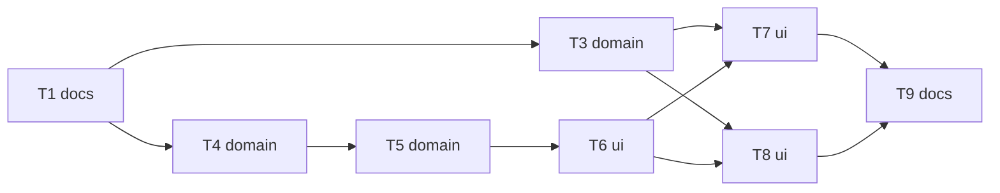

# Epic — self-check-cards

> **Spec:** [spec.md](../spec.md) · **Merged with:** [learn-welcome](../../learn-welcome/spec.md) (owner A15, 2026-10-30)

## Goal

Ask the learner, a few pages after a mistake or hint in an exercise session and in the talk quick check, how well they knew the word; the rating moves the box ([spec](../spec.md)).

## Scope

- **In:** exercise-session scheduling, hint reporting, applySession with ratings, the results line, the talk quick check.
- **Out:** the card widget, the rating rules and `WordBox.lastCheckSide`: built by learn-welcome (merged 2026-10-30, owner A15).

## Task map

## Tasks

See [tracker.md](./tracker.md) for status. Machine contract: [tasks.json](../tasks.json).

| # | Task | Layer | Blocked by | DoD (short) |
|---|---|---|---|---|
| T1 | Record the self-check-cards approvals in CLAUDE.md rule 3 | docs | — | rule 3 lists self-check cards in exercise sessions, the rating on the results screen and the self-check step in the talk quick check (owner, 2026-10-27); lastCheckSide is recorded by learn-welcome T1 |
| T3 | Move boxes from ratings in applySession: flagged words wait for their card, unrated flagged words keep their box | domain | T1 | applySession takes each word's outcome plus an optional rating; a mistake alone no longer sends a word to box 1; clean words as before; flagged + no rating → box and dueAt unchanged; SessionMove carries the rating; existing leitner tests updated to the new rules, talk 'unused' unchanged; uses rateBox from learn-welcome's self_check.dart with afterMistake for the guard |
| T4 | Let exercise pages report a hint: right after a hint is its own result, not a clean right | domain | T1 | inventory of exercises with a hint written in this task file; PageAnswer results carry right / wrong / hinted per row id (old bool callers still compile); the typed answer field's second-try right after the 'Starts with' line reports hinted; tests for the typed field and one board page; 'Show answer' reports wrong |
| T5 | Schedule self-check cards in the session queue: 3 pages after a flag, no limit, re-flag gets a new card | domain | T4 | pure queue tests with a seeded Random: card 3 pages after the flag; fewer pages left → right after the last exercise page; never next to the same word's page while another page is pending; every flag gets one card; a word flagged after its card gets another; the last rating wins; page counter totals include cards |
| T6 | Show the shared self-check card as an exercise-session page | ui | T5 | the session plays a due check card as a page in the learn page frame (no Check, no verdict bar) using learn-welcome's SelfCheckCard; its rating reaches the session notifier; widget test |
| T7 | Show the rating on the session results screen | ui | T3, T6 | each rated word's row shows its rating beside the box move ('Hard · box 3 → 2'); unrated flagged word says 'not checked, box kept'; widget test |
| T8 | Talk with AI: a self-check step in the quick check for missed and hinted words; talk scoring through the ratings | ui | T3, T6 | scoreTalk returns flags (mistake / hint / clean / unused) instead of missed; the quick check adds a self-check card per flagged word (same widget as T6, chat-card size); ratings go to applySession; talk ended before the check → flagged words keep their box; tests in talk_quiz_test and learn_session_talk tests |
| T9 | Finish: build_runner, analyze, changed tests, grep check, device check list for the owner | docs | T7, T8 | the Before-finishing commands of CLAUDE.md pass; a short owner check list (miss 'saline', see its card 3 pages later, rate Hard, results show box move) added to this feature's folder |

## Risks / Hard rules

- needs [learn-welcome](../../learn-welcome/tasks.json) T2 (`lastCheckSide`), T3 (`self_check.dart`) and T11 (`self_check_card.dart`) first (ADR-0006 there).
- Exercise sessions keep their end-of-session box write (learn-redesign ADR-0002); the Learn flow saves per card (learn-welcome ADR-0004).
