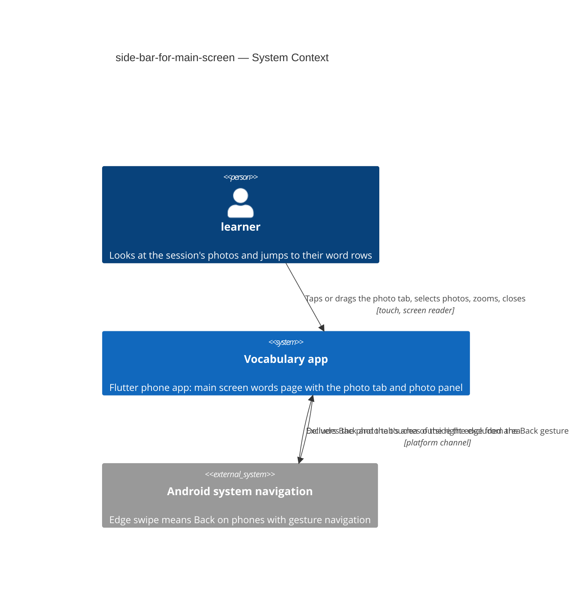
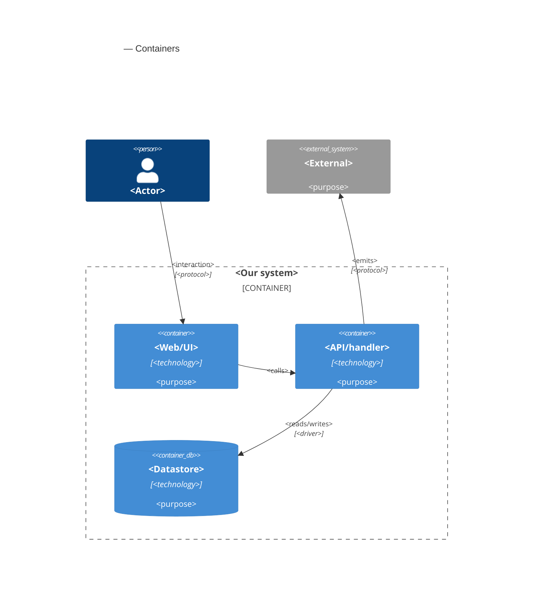

# Software Architecture Document — side-bar-for-main-screen

<!-- 12 Arc42 sections. Empty section → <!-- N/A: <one-line reason> -->. -->
<!-- C4 Context (L1) lives inline in §3. C4 Container (L2) lives inline in §5. -->
<!-- Numbers in §10 come VERBATIM from spec.md §6 NFR — no inventing, no rounding. -->

## 1. Introduction and goals

**Intent.** Let the learner see the photos behind the current session without leaving the main screen, and go from a photo to the word rows that came from it in one tap (spec §1, §2). On the main screen's words page, while the current session has at least one **photo with words**, a **photo tab** sits on the right side with mini previews of those photos. A tap or a short drag to the left opens the **photo panel** **half-open**: a column of small photos beside the still-visible word rows, where tapping a photo makes it the **selected photo**, scrolls the list to its first row and highlights all its rows. A longer drag, or the panel's expand control, opens it **full-open**: the photos large, starting at the selected photo, which can be zoomed with two fingers. Back, a drag back or a tap on the word list close it one step at a time. Two or three **design variants** share all this behaviour and differ only in look, in how full-open browses the large photos, and in whether the tab hides while the list scrolls. The owner picks one on a phone behind a temporary Settings switch, and the rest are removed before release (AC-19, AC-20). Without a photo with words, the main screen is exactly as today (AC-02).

**Top-3 quality goals (1-liners; full scenarios in §10):**

1. **The tab is gesture-safe.** A drag that starts on the photo tab never sends the app to the background and never changes the page, and a tap opens the panel just as a drag does: 0 Back or page changes out of 20 drags started on the tab (spec §6 "Gesture safety"; AC-12, AC-13, AC-14).
2. **Opening and jumping feel immediate and smooth.** Half-open is fully settled ≤ 300 ms after the tap, drags and settles drop ≤ 5 % of frames, and the first highlighted row is in view ≤ 500 ms after the tap in a session of 200 word rows (spec §6 "Opening from a tap", "Animation smoothness", "Jump to a photo's words"; AC-03, AC-04, AC-08).
3. **The main screen stays as it is, and light.** With no photo with words nothing changes; with 50 photos with words the start grows by ≤ 100 ms and the tab and half-open panel use ≤ 30 MB of picture memory (spec §6 "Main screen start with many photos", "Memory for previews"; AC-02, AC-15).

**Stakeholders.**

| Role | Interest | Sign-off owner? |
|---|---|---|
| learner | Sees the session's photos on the main screen, finds a photo's word rows, reads the photographed page large | No |
| learner (the owner choosing the look) | Switches between the design variants on a phone, picks one, has the others removed (US-06) | No |
| Tech Lead (Maksym) | SAD approval | Yes |

Security review is N/A (spec §6.1): nothing new is stored beyond the tab's height and, during the review, the chosen variant, and nothing is sent.

<!-- Decision overrides (¶4) — populated by the critic resolution loop, empty otherwise. -->

## 2. Constraints

**Technical.**
- App: Flutter 3.35.1, Dart SDK `>=3.0.0 <4.0.0`, phone only (Android and iOS, held upright). Typed routes in `lib/router/routes.dart` (`go_router` ^17.2.3 + `go_router_builder`), state with `flutter_riverpod` / `riverpod_annotation` ^2.6.1, preferences in `shared_preferences` ^2.5.5, storage in `isar_community` pinned to `3.3.0-dev.1` (architecture.md §2 rule 6). There is no gesture, sheet or drawer package beyond Material, and none may be added (CLAUDE.md rule 5).
- Main screen today (`lib/features/word_input/word_input_screen.dart`, 1693 lines): the `Scaffold` body is a `Stack` of the word list (`ListView.builder`, or `ReorderableListView.builder` in drag mode, both with 16 px padding and **no `ScrollController`**) and the "Analyzing photo..." overlay shown while `_isAnalyzingPhoto`. Rows (`WordRowItem`, `widgets/word_row_item.dart`) have **variable height**, and their right edge carries the delete button, the lightning buttons and the translation / definition dots. The left drawer exists only when other sessions exist. The Settings button and the speed dial share the floating-button slot at the bottom, and rise above a SnackBar (the 7-second RESTORE offer). There is no `PopScope` on the screen.
- Photos: `Session.sources` holds `SessionSource`s (`kind` photo or set, `id`, `fileName`, `takenAt`) in the order they were added; `WordPair.sourceId` links a row to its source. `SourcePhotoStore.read(source)` returns the bytes of the kept 1600 px file under `source_photos/`, or `null`, and never throws. No thumbnails are stored anywhere; the closest precedent is the words table's `_PhotoStack`, which decodes the kept file with `cacheWidth: 120`.
- Zoom precedent: `InteractiveViewer` on the story picture (`mnemonic_story/story_screen.dart`) and the words table's `PhotoViewer` dialog (a `PageView` with pinch zoom). Neither may be imported across features (architecture.md §2 rule 3).
- Android: `MainActivity` is a bare `FlutterActivity` (Kotlin, `com.unique.androidvocabularyapp2`). The app has no `MethodChannel` and no native code of its own yet. `minSdk` follows Flutter's default.
- **Builds on the main screen pager of get-words-from-subtitles-improvment** (roadmap #22, task T19, still `todo` on 2026-10-13). As T19 is designed, the body becomes a `PageView` only when the current session has dialogues: page 1 is today's words page, then one read-only dialogue page per dialogue. Building this feature starts after #22 is merged (spec §1).
- Verification: `dart run build_runner build --delete-conflicting-outputs`, `flutter analyze`, `tool/test.sh smoke` while developing, `tool/test.sh changed` before each commit, the CLAUDE.md greps. App tests are `flutter_test` widget and unit tests in the flat `test/` folder, with no golden tests. The §6 NFRs are measured by hand on the owner's phone.

**Organisational.**
- One owner (Maksym) builds, reviews and releases. No deadline. The app ships through the usual store build; there is no Worker change.
- Size M (`.size`), route standard (`.route`).
- The design pick is a step of this feature: the variants are built, the owner compares them on a phone, and the feature is released only after the others are removed (AC-20).

**Conventions.**
- [`CLAUDE.md`](../../../CLAUDE.md) rules 1–7 and [`docs/architecture.md`](../../architecture.md) §2: typed routes only (the panel opens no route), services and shared preferences from `lib/core/providers.dart`, screen data in `@riverpod` notifiers, transient state (animation controllers, the selected photo, drag offsets) in widget `State`, features share data only through `lib/core/`, one file ≈ one thing.
- Spec-approved override of CLAUDE.md rule 3 ("do not change how anything looks"): the photo tab, the photo panel in its three states, the highlighted word rows, and the temporary design-variant switch in Settings (spec §1, AC-19). Recorded in CLAUDE.md rule 3 with the §4 commit. With no photo with words, the main screen must look and behave exactly as today (AC-02).
- No new domain model (CLAUDE.md rule 5): the feature only reads `Session`, `SessionSource` and `WordPair`. The two new preference values are not domain models.
- Logging follows the screen's existing `debugPrint('VOCAB: …')` lines.

**Regulatory / external.**
- Data classification (spec §6.1): internal. The photos are the learner's own pictures, already kept on the phone; nothing new is sent.
- Security review: N/A (spec §6.1). The panel shows only the current session's photos with words and closes when the session changes (AC-15b, AC-16).
- Platform rule: on Android with gesture navigation, the system takes inward swipes from the screen edges as Back unless the app excludes an area; Android honours at most 200 dp of excluded height per edge (ADR-0002).

## 3. Context and scope

The learner takes photos, for example of a book page, and the app turns them into word rows of the current session; every such row remembers its photo. This feature lets the learner look at those photos again from the main screen's words page and jump from a photo to its rows. Everything happens on the phone, with photos the app already keeps: no server, no shared page and no other screen is touched (spec §3). The one outside party is the phone's own system navigation, whose edge swipe means Back.

<!-- brownfield: Flutter phone app (lib/, go_router typed routes + Riverpod, Isar session store, source photos as 1600 px files under source_photos/, main screen = word_input_screen.dart with a Stack-hosted ListView and no ScrollController); the main screen pager of get-words-from-subtitles-improvment is designed (T19) but not built yet; Android MainActivity is a bare FlutterActivity. Read from docs/architecture.md, CLAUDE.md, the #22 SAD and task T19, and an explorer scan of the code — no docs/architecture-map.md exists (run /sdd:survey to persist one) -->

**External systems (in / out):**

| Actor or system | Type | Interaction |
|---|---|---|
| learner | Person | Opens the photo tab and panel on the main screen's words page, selects photos, reads them large, closes the panel; as the owner, switches design variants in Settings |
| Vocabulary app | System (ours) | Shows the photo tab and panel over the words page, reads the current session's photos with words, highlights a photo's rows, keeps the tab's height |
| Android system navigation | System (external) | Takes inward edge swipes as Back on phones with gesture navigation; told by the app which area of the right edge the photo tab covers (ADR-0002) |
| vocab-photo-api Worker, shared page | System (ours) | Not touched by this feature (spec §3); listed only to state the boundary |

**C4 Context (L1):**



The context is deliberately small: one person, the app, and the phone's system navigation. The learner touches only the app. The app tells Android which part of the right edge the photo tab covers, so a drag that starts there stays in the app, while Android keeps delivering Back for every other edge swipe and for the Back button. No network system is involved.

## 4. Solution strategy

<!-- 🎯 Why: the 3–4 STRATEGIC PILLARS every ADR grows from. Without §4 each ADR looks random —
     there's no umbrella. ⭐ The densest section — the blast-radius gate fires almost always here
     (decisions are irreversible + multi-module).
     📋 Write: 3–4 choices; each a heading + 2–3 sentences of rationale.
     📌 «Store content as a table of typed blocks» is a pillar — ADR-0001 grows from it. -->

**Top strategic choices (the seeds for ADRs):**

1. **<e.g. Module isolation through events>** — <2–3 sentences citing quality goals + constraints>.
2. **<e.g. Single-store persistence>** — <2–3 sentences>.
3. **<e.g. Server-rendered read side>** — <2–3 sentences>.

Each tactical decision in later sections should trace to one of these seeds. Tactical decisions that *contradict* a strategic choice are red flags — surface them in §11.

## 5. Building block view

<!-- 🎯 Why: INTERNAL DECOMPOSITION — modules, containers, datastores. The static topology: who
     may talk to whom. Without §5, §6 (the flows) has no vocabulary of participants.
     📋 Write: 1 ¶ on the style (layered / hexagonal / clean / event-driven) + a folder tree + a
     C4Container block.
     📌 Draw ONE Container per declared `target_surface` (frontmatter): a fullstack
     [backend-service, web-frontend] = a backend-API container + a web/SPA container; a
     [backend-service, mobile-app] = the API + the mobile app. The Container(web, …) line below is
     just one surface's container — swap/add per what was declared in §4. → _shared/surfaces.md
     📌 e.g. «web app, content API, media worker, datastore, object store, CDN». -->

<One paragraph: layered / hexagonal / clean / event-driven, and why.>

**Internal decomposition:**

```
<e.g. modules/<feature>/>
├── domain/       <entities + sentinel errors>
├── app/          <use cases / services>
├── infra/        <repository + integration impl>
├── ports/        <handlers, DTOs, error mapping>
└── wiring        <self-wiring entry point>
```

**C4 Container (L2):** <!-- syntax → references/c4-mermaid-syntax.md. Real names, no <placeholder> stubs. ONE Container per declared target_surface (frontmatter); the web container below is one example surface. -->



## 6. Runtime view

<!-- 🎯 Why: the RUNTIME FLOW of 1–2 critical scenarios — who talks to whom, when, in what order.
     Without §6, §5 is just boxes with no life.
     📋 Write: a Mermaid sequenceDiagram. Participants are names from §5 (don't invent new ones).
     Messages are semantic («saves a draft»), NO HTTP verbs / paths / status codes — endpoint-level
     sequences arrive at the `api` stage.
     📌 e.g. «author → web: composes draft → web → content API: save». Seed the primary flow(s) here;
     the `sequences` stage then covers every §5 AC (no cap). Never N/A for M+; XS/S keeps ≥1 happy-path flow. -->

**Critical flow 1: <flow name>**

```mermaid
sequenceDiagram
    actor Actor
    participant Web
    participant Service
    participant Store
    Actor->>Web: <action>
    Web->>Service: <call>
    Service->>Store: <write>
    Store-->>Service: ok
    Service-->>Web: result
    Web-->>Actor: confirmation
```

**Critical flow 2: <e.g. async event propagation>** — <if applicable, otherwise N/A>.

## 7. Deployment view

<!-- 🎯 Why: the TOPOLOGY DevOps must know without reading the deploy charts — how many replicas,
     where the background worker lives, AT WHAT NUMBERS we scale.
     📋 Write: 2–3 sentences on topology + monitoring + concrete threshold numbers.
     📌 e.g. «500 authors → partition by quarter» (not «we'll think about scale later»).
     🎯 N/A allowed for XS/S that reuses an existing deployment unit with no change.
     Deployment-diagram scaffold → templates/deployment.md. -->

<Topology in 2–3 sentences. Where it runs, replicas, scaling thresholds.>

**Monitoring:**
- <Metrics — e.g. `<metric_name>`>
- <Alerts — e.g. «worker lag > 10 min → page on-call»>
- <Tracing — e.g. spans on the request boundary>

**Scaling thresholds:**
- <e.g. comfortable in one table up to N rows/year>
- <e.g. partition by quarter above N rows/year>

<!-- For XS/S with no deployment change: <!-- N/A: reuses existing deployment unit, no infra change --> -->

## 8. Crosscutting concepts

<!-- 🎯 Why: CROSS-CUTTING PATTERNS spanning several modules: logging, errors, authorization, ID
     strategy, events, caching. ⭐ The second-densest section. A pattern inside one module is NOT
     here; a project-wide convention belongs in the convention file.
     📋 Write: a table — concept / convention / where defined. One row per concept.
     📌 e.g. «sortable time-based IDs generated in the app layer» as a default from the convention file. -->

| Concept | Convention | Where defined |
|---|---|---|
| Logging | <e.g. structured, fields `module=<name>`> | <convention file §X or here> |
| Authentication | <e.g. token-based via middleware> | <convention file §X> |
| Error handling | <e.g. domain sentinel → ports error mapping → JSON> | <convention file §X> |
| ID strategy | <e.g. sortable time-based ID in the app layer> | <convention file §X> |
| Internationalisation | <e.g. N/A, single language> | — |
| Observability | <e.g. tracing on the request boundary> | — |
| Events | <module-specific patterns, if any> | <here> |

## 9. Architecture decisions

<!-- 🎯 Why: the REVERSE INDEX onto the adr/ folder. `ls adr/` gives the files; §9 gives the
     semantics — why they exist, which SAD section they attach to, what status.
     📋 Write: a 4-column table, one row per ADR. Mixed status is fine.
     📌 e.g. «0001 | Store content as a table of typed blocks | Accepted | §4». -->

| # | Title | Status | Section |
|---|---|---|---|
| <NNNN> | <imperative — e.g. "Use a sliding-window counter for rate limiting"> | Accepted | §<N> |
| <NNNN> | <imperative — e.g. "Co-locate the worker in the API process"> | Accepted | §<N> |

ADR files live under `docs/features/<slug>/adr/NNNN-<title>.md`.

## 10. Quality requirements

<!-- 🎯 Why: the QUALITY TREE — take a goal from §1 and break it into concrete leaves: tests,
     metrics, configs, drills. ⭐ Without §10, §1 is a manifesto. With §10 each declaration maps
     to something PROVABLE.
     📋 Write: per §1 goal — When / Then / How-verify. Numbers from spec §6 NFR VERBATIM (don't
     round ≤250ms to ≤300ms — that's a critic F6 hit).
     📌 e.g. «p95 ≤ 500 ms on a block update, verified by a 100 req/s load test». -->

Each top-3 goal from §1 expanded into a full scenario:

**QG-1. <quality attribute>**
- **When:** <trigger condition>
- **Then:** <expected behaviour with numbers from spec §6 NFR>
- **How verify:** <test / chaos drill / load test / metric>

**QG-2. <quality attribute>**
- **When:** <trigger>
- **Then:** <expected>
- **How verify:** <how>

**QG-3. <quality attribute>**
- **When:** <trigger>
- **Then:** <expected>
- **How verify:** <how>

## 11. Risks and technical debt

<!-- 🎯 Why: ⭐ collects EVERYTHING that can break — not only the technical. Without §11 risks get
     discussed at standups and lost; debt lives only in the head of whoever accepted it.
     📋 Write: a risk/debt table — severity — mitigation — owner. Accepted debt in its own block.
     📌 The first risk is often a product risk, not a technical one. That's normal. -->

<!-- Severity literals: Low / Medium / High for regular risks; "Open question" for rows created by
     a Save-as-OQ resolution during the Socratic walk (see references/socratic.md). -->

| Risk / debt | Severity | Mitigation | Owner |
|---|---|---|---|
| <e.g. Worker lag may reach hours during a downstream outage> | Medium | <alert >10 min, on-call playbook, retry backoff> | <DevOps> |
| <e.g. No event-schema versioning in v1> | Medium | <ADR-NNNN planned for v2, tolerate unknown fields> | <Backend> |
| Open architectural decision: <decision-headline> | Open question | Resolve before <stage trigger or YYYY-MM-DD>; <inline rationale from the Save-as-OQ> | <owner> |

**Accepted debt (acceptable in v1, plan to fix later):**
- <e.g. the entity is immutable / unversioned — OK for v1, may need audit versioning in v2>

## 12. Glossary

<!-- 🎯 Why: ⭐ the DOMAIN GLOSSARY that ends arguments a year later («checkpoint — weekly or
     biweekly? quarter — calendar or fiscal?»).
     📋 Write: a term / meaning table. Business + technical terms mixed.
     📌 e.g. «Lesson | a unit inside a course made of blocks (text, video)». -->

| Term | Meaning |
|---|---|
| <e.g. domain object A> | <its meaning in this domain> |
| <e.g. domain object B> | <its meaning> |
| <e.g. domain invariant name> | <the rule, in plain language> |
