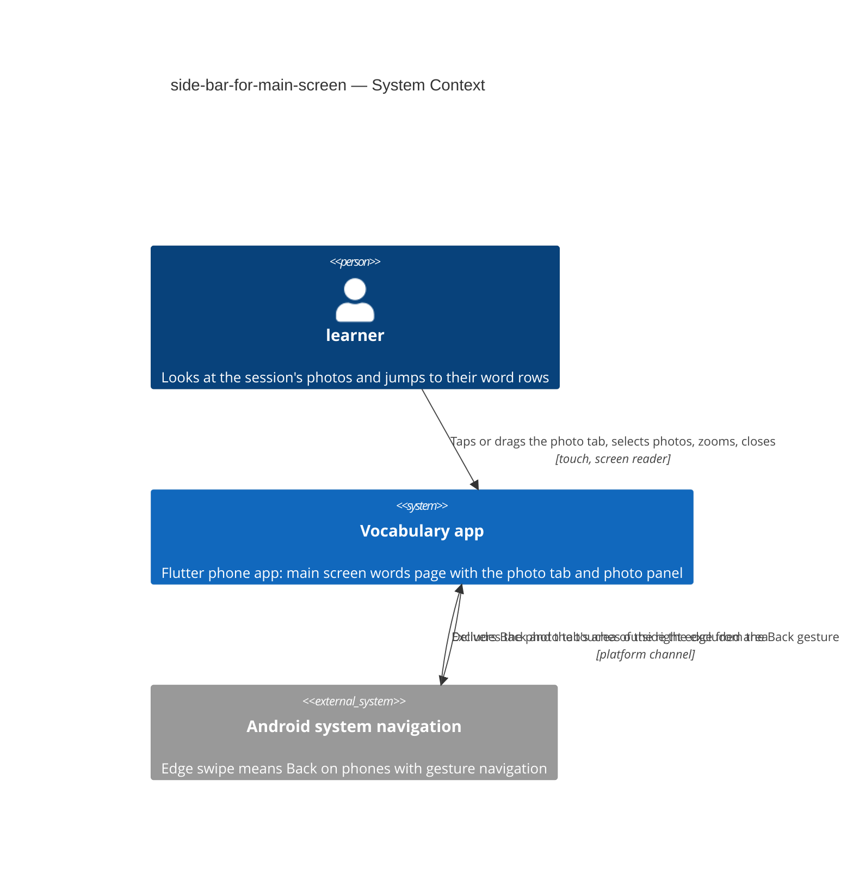
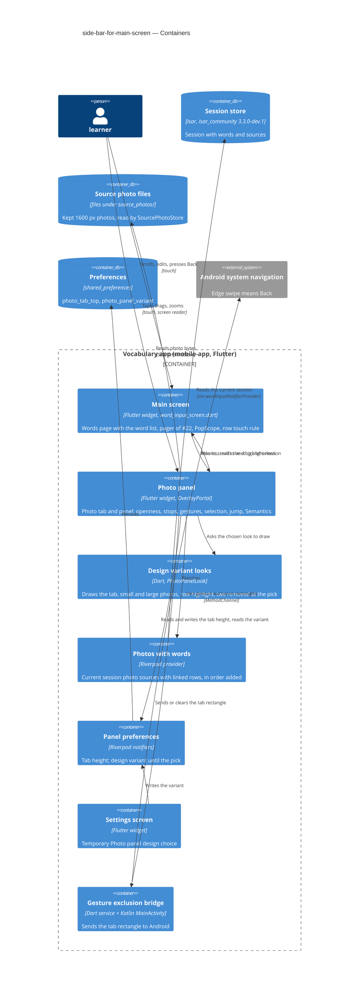
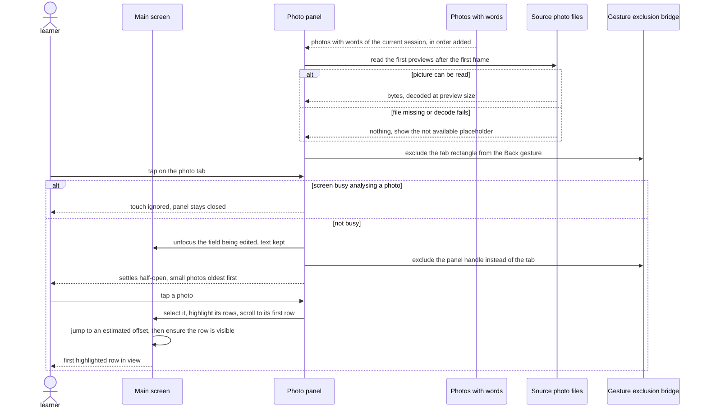
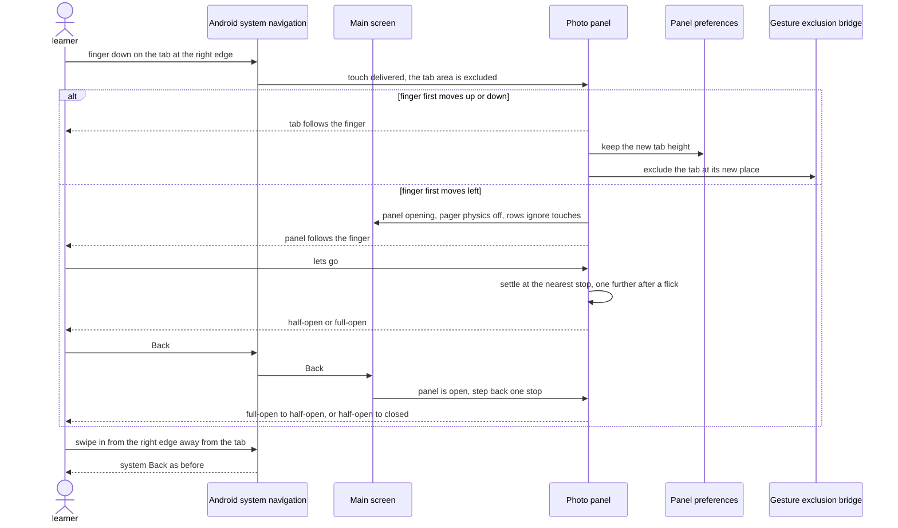

# Software Architecture Document — side-bar-for-main-screen

<!-- 12 Arc42 sections. Empty section → <!-- N/A: <one-line reason> -->. -->
<!-- C4 Context (L1) lives inline in §3. C4 Container (L2) lives inline in §5. -->
<!-- Numbers in §10 come VERBATIM from spec.md §6 NFR — no inventing, no rounding. -->

## 1. Introduction and goals

**Intent.** Let the learner see the photos behind the current session without leaving the main screen, and go from a photo to the word rows that came from it in one tap (spec §1, §2). On the main screen's words page, while the current session has at least one **photo with words**, a **photo tab** sits on the right side with mini previews of those photos. A tap or a short drag to the left opens the **photo panel** **half-open**: a column of small photos beside the still-visible word rows, where tapping a photo makes it the **selected photo**, scrolls the list to its first row and highlights all its rows. A longer drag, or the panel's expand control, opens it **full-open**: the photos large, starting at the selected photo, which can be zoomed with two fingers. Back, a drag back or a tap on the word list close it one step at a time. Two or three **design variants** share all this behaviour and differ only in look, in how full-open browses the large photos, and in whether the tab hides while the list scrolls. The owner picks one on a phone behind a temporary Settings switch, and the rest are removed before release (AC-19, AC-20). Without a photo with words, the main screen is exactly as today (AC-02).

**Top-3 quality goals (1-liners; full scenarios in §10):**

1. **The tab is gesture-safe.** A drag that starts on the photo tab never sends the app to the background and never changes the page, and a tap opens the panel just as a drag does: 0 Back or page changes out of 20 drags started on the tab (spec §6 "Gesture safety"; AC-12, AC-13, AC-14).
2. **Opening and jumping feel immediate and smooth.** Half-open is fully settled ≤ 300 ms after the tap, drags and settles drop ≤ 5 % of frames, and the first highlighted row is in view ≤ 500 ms after the tap in a session of 200 word rows (spec §6 "Opening from a tap", "Animation smoothness", "Jump to a photo's words"; AC-03, AC-04, AC-08).
3. **The main screen stays as it is, and light.** With no photo with words nothing changes; with 50 photos with words the start grows by ≤ 100 ms and the tab and half-open panel use ≤ 30 MB of picture memory (spec §6 "Main screen start with many photos", "Memory for previews"; AC-02, AC-15).

**Stakeholders.**

| Role | Interest | Sign-off owner? |
|---|---|---|
| learner | Sees the session's photos on the main screen, finds a photo's word rows, reads the photographed page large | No |
| learner (the owner choosing the look) | Switches between the design variants on a phone, picks one, has the others removed (US-06) | No |
| Tech Lead (Maksym) | SAD approval | Yes |

Security review is N/A (spec §6.1): nothing new is stored beyond the tab's height and, during the review, the chosen variant, and nothing is sent.

<!-- Decision overrides (¶4) — populated by the critic resolution loop, empty otherwise. -->

## 2. Constraints

**Technical.**
- App: Flutter 3.35.1, Dart SDK `>=3.0.0 <4.0.0`, phone only (Android and iOS, held upright). Typed routes in `lib/router/routes.dart` (`go_router` ^17.2.3 + `go_router_builder`), state with `flutter_riverpod` / `riverpod_annotation` ^2.6.1, preferences in `shared_preferences` ^2.5.5, storage in `isar_community` pinned to `3.3.0-dev.1` (architecture.md §2 rule 6). There is no gesture, sheet or drawer package beyond Material, and none may be added (CLAUDE.md rule 5).
- Main screen today (`lib/features/word_input/word_input_screen.dart`, 1693 lines): the `Scaffold` body is a `Stack` of the word list (`ListView.builder`, or `ReorderableListView.builder` in drag mode, both with 16 px padding and **no `ScrollController`**) and the "Analyzing photo..." overlay shown while `_isAnalyzingPhoto`. Rows (`WordRowItem`, `widgets/word_row_item.dart`) have **variable height**, and their right edge carries the delete button, the lightning buttons and the translation / definition dots. The left drawer exists only when other sessions exist. The Settings button and the speed dial share the floating-button slot at the bottom, and rise above a SnackBar (the 7-second RESTORE offer). There is no `PopScope` on the screen.
- Photos: `Session.sources` holds `SessionSource`s (`kind` photo or set, `id`, `fileName`, `takenAt`) in the order they were added; `WordPair.sourceId` links a row to its source. `SourcePhotoStore.read(source)` returns the bytes of the kept 1600 px file under `source_photos/`, or `null`, and never throws. No thumbnails are stored anywhere; the closest precedent is the words table's `_PhotoStack`, which decodes the kept file with `cacheWidth: 120`.
- Zoom precedent: `InteractiveViewer` on the story picture (`mnemonic_story/story_screen.dart`) and the words table's `PhotoViewer` dialog (a `PageView` with pinch zoom). Neither may be imported across features (architecture.md §2 rule 3).
- Android: `MainActivity` is a bare `FlutterActivity` (Kotlin, `com.unique.androidvocabularyapp2`). The app has no `MethodChannel` and no native code of its own yet. `minSdk` follows Flutter's default.
- **Builds on the main screen pager of get-words-from-subtitles-improvment** (roadmap #22, task T19, still `todo` on 2026-10-13). As T19 is designed, the body becomes a `PageView` only when the current session has dialogues: page 1 is today's words page, then one read-only dialogue page per dialogue. Building this feature starts after #22 is merged (spec §1).
- Verification: `dart run build_runner build --delete-conflicting-outputs`, `flutter analyze`, `tool/test.sh smoke` while developing, `tool/test.sh changed` before each commit, the CLAUDE.md greps. App tests are `flutter_test` widget and unit tests in the flat `test/` folder, with no golden tests. The §6 NFRs are measured by hand on the owner's phone.

**Organisational.**
- One owner (Maksym) builds, reviews and releases. No deadline. The app ships through the usual store build; there is no Worker change.
- Size M (`.size`), route standard (`.route`).
- The design pick is a step of this feature: the variants are built, the owner compares them on a phone, and the feature is released only after the others are removed (AC-20).

**Conventions.**
- [`CLAUDE.md`](../../../CLAUDE.md) rules 1–7 and [`docs/architecture.md`](../../architecture.md) §2: typed routes only (the panel opens no route), services and shared preferences from `lib/core/providers.dart`, screen data in `@riverpod` notifiers, transient state (animation controllers, the selected photo, drag offsets) in widget `State`, features share data only through `lib/core/`, one file ≈ one thing.
- Spec-approved override of CLAUDE.md rule 3 ("do not change how anything looks"): the photo tab, the photo panel in its three states, the highlighted word rows, and the temporary design-variant switch in Settings (spec §1, AC-19). Recorded in CLAUDE.md rule 3 with the §4 commit. With no photo with words, the main screen must look and behave exactly as today (AC-02).
- No new domain model (CLAUDE.md rule 5): the feature only reads `Session`, `SessionSource` and `WordPair`. The two new preference values are not domain models.
- Logging follows the screen's existing `debugPrint('VOCAB: …')` lines.

**Regulatory / external.**
- Data classification (spec §6.1): internal. The photos are the learner's own pictures, already kept on the phone; nothing new is sent.
- Security review: N/A (spec §6.1). The panel shows only the current session's photos with words and closes when the session changes (AC-15b, AC-16).
- Platform rule: on Android with gesture navigation, the system takes inward swipes from the screen edges as Back unless the app excludes an area; Android honours at most 200 dp of excluded height per edge (ADR-0002).

## 3. Context and scope

The learner takes photos, for example of a book page, and the app turns them into word rows of the current session; every such row remembers its photo. This feature lets the learner look at those photos again from the main screen's words page and jump from a photo to its rows. Everything happens on the phone, with photos the app already keeps: no server, no shared page and no other screen is touched (spec §3). The one outside party is the phone's own system navigation, whose edge swipe means Back.

<!-- brownfield: Flutter phone app (lib/, go_router typed routes + Riverpod, Isar session store, source photos as 1600 px files under source_photos/, main screen = word_input_screen.dart with a Stack-hosted ListView and no ScrollController); the main screen pager of get-words-from-subtitles-improvment is designed (T19) but not built yet; Android MainActivity is a bare FlutterActivity. Read from docs/architecture.md, CLAUDE.md, the #22 SAD and task T19, and an explorer scan of the code — no docs/architecture-map.md exists (run /sdd:survey to persist one) -->

**External systems (in / out):**

| Actor or system | Type | Interaction |
|---|---|---|
| learner | Person | Opens the photo tab and panel on the main screen's words page, selects photos, reads them large, closes the panel; as the owner, switches design variants in Settings |
| Vocabulary app | System (ours) | Shows the photo tab and panel over the words page, reads the current session's photos with words, highlights a photo's rows, keeps the tab's height |
| Android system navigation | System (external) | Takes inward edge swipes as Back on phones with gesture navigation; told by the app which area of the right edge the photo tab covers (ADR-0002) |
| vocab-photo-api Worker, shared page | System (ours) | Not touched by this feature (spec §3); listed only to state the boundary |

**C4 Context (L1):**



The context is deliberately small: one person, the app, and the phone's system navigation. The learner touches only the app. The app tells Android which part of the right edge the photo tab covers, so a drag that starts there stays in the app, while Android keeps delivering Back for every other edge swipe and for the Back button. No network system is involved.

## 4. Solution strategy

**Top strategic choices (the seeds for ADRs):**

1. **One surface: the phone app** (decided inline, below the ADR gate: one surface, and the alternatives are excluded by spec §3). `target_surfaces: [mobile-app]`. The feature lives entirely in the Flutter app, on the main screen's words page, plus one temporary Settings entry and one small Android channel handler. The Worker, the shared page, the words table, History and the dialogue pages are not touched (spec §3). This serves all three quality goals.

2. **The photo tab and panel are an overlay above the pager, driven by one openness value** ([ADR-0001](adr/0001-draw-the-photo-tab-and-panel-in-an-overlay-above-the-pager-driven-by-one-openness-value.md)).
   - `PhotoPanel` paints through an `OverlayPortal` just above the main screen's route. Its state is one 0→1 value in one `AnimationController`, with a stop at half-open (0.5).
   - A drag moves the value directly. On release, a pure rule settles at the nearest stop, or one further after a flick, and any drag to the left from closed opens at least half-open (AC-08). Each photo's rectangle is interpolated between its small and its large place, so the photos grow into full-open (AC-07).
   - Because the overlay is hit-tested first, a touch on the tab never reaches the pager or the rows (AC-13, AC-14). In half-open only the panel is hit-testable, so the list beside it scrolls (AC-06).
   - The overlay also paints above the main screen's drawer, SnackBar and "Analyzing photo..." overlay, so the panel handles each explicitly: it is hidden while the drawer is open, ignores touches while busy (AC-17), keeps its lowest position clear of the floating buttons and a SnackBar, and closes before another route is pushed.
   - This serves quality goals 1 and 2.

3. **The tab is excluded from the Android Back gesture through a platform channel** ([ADR-0002](adr/0002-exclude-the-photo-tab-from-the-android-back-gesture-through-a-platform-channel.md)).
   - The tab may touch the right edge. `systemGestureExclusionProvider` sends the tab's rectangle to `MainActivity` over `MethodChannel('vocab/system_gesture_exclusion')`, which sets the window's gesture exclusion rectangles on Android 10 and later. While half-open, it sends the panel's handle rectangle instead.
   - The rectangle is resent after every move and layout change, and cleared whenever no tab is shown. Every tab is at most 200 dp tall, Android's limit per edge.
   - Swipes from the rest of the right edge stay Back (AC-12). With the panel open, an unexcluded system Back only steps the panel back through `PopScope` (AC-10).
   - This serves quality goal 1.

4. **One shared behaviour, one pluggable look per design variant** ([ADR-0003](adr/0003-share-one-panel-behaviour-and-plug-in-each-design-variants-look.md)).
   - `PhotoPanel` owns all of AC-01 to AC-18. Each variant implements `PhotoPanelLook`, which covers only what AC-19 allows: the tab, the small and large photos and their places, how full-open browses, the row highlight, and whether the tab hides while scrolling.
   - Three looks by default (spec §8). The choice is `photoPanelVariantProvider` (`shared_preferences`), set from a temporary Settings entry.
   - The pick removes the losing looks, the provider and the entry (AC-20).
   - This serves quality goals 1–3, because every variant runs the same tested behaviour.

**Decided inline (below the ADR gate, from the assumptions ledger the owner accepted on 2026-10-13):**

- **Mobile UI architecture: unchanged.** The app stays a cross-platform Flutter phone app with typed routes. The panel opens no route: closed, half-open and full-open are three states of one overlay over the words page (ux-flows "Platform decisions"). No new package.
- **State placement (CLAUDE.md rule 2).**
  - The screen's `State` owns a `PhotoPanelController` (a `ChangeNotifier`): the current stop and the selected photo. Both are transient and never saved (CONTEXT "selected photo").
  - `PhotoPanel`'s own `State` owns the `AnimationController`, the drag in progress, and the preview futures.
  - The screen reads the controller for `PopScope`, the rows' touch rule and the pager's physics.
- **Photos with words** are derived, not stored. `photosWithWordsProvider` (in `photo_panel/photos_with_words.dart`) watches `wordInputNotifierProvider` and returns the current session's sources of kind photo that at least one word row links to by `sourceId`, each with those rows' ids, in the order of `Session.sources`, which is the order they were added (oldest first, AC-03). It updates on every session change, so the tab follows deletes and new photos at once (AC-15) and only ever shows the current session (AC-16).
- **The tab's height is a persisted preference.** `photoTabTopProvider`, a keepAlive notifier in `lib/core/providers.dart` like `wordDetailModeProvider`, stores the tab's top in logical pixels from the top of the words page under `shared_preferences` key `photo_tab_top`. The first default puts the tab beside the first word rows (AC-01). A stored value is clamped on use so the tab stays fully on screen, below the AppBar and above the floating-button row (AC-14).
- **The design variant is a persisted preference during the review only.** `photoPanelVariantProvider` (key `photo_panel_variant`) is written from a temporary "Photo panel design" choice in Settings, styled like the existing word detail mode choice. There is no build flag (CLAUDE.md rule 4): the choice exists on the branch until the pick task removes it (AC-20).
- **Previews are decoded from the kept 1600 px files at preview size, with no stored thumbnails.**
  - The tab and the half-open column decode with `cacheWidth` at the look's preview width times the device pixel ratio, as the words table's `_PhotoStack` does.
  - Files are read lazily after the first frame. The tab draws at most three mini previews plus the count, and the half-open column is a lazy builder.
  - Full-open decodes at screen size and keeps only the shown photo and its neighbours.
  - An unreadable file (`SourcePhotoStore.read` returns `null`, or decoding fails) shows the "not available" placeholder, which still selects its rows (AC-09).
- **Jump to a photo's rows.** The word list (both `ListView.builder` and the drag-mode `ReorderableListView.builder`) gets a `ScrollController`, and each row a key. A tap on a photo first jumps to an estimated offset (row index × the average height of the rows built so far), then calls `Scrollable.ensureVisible` on the first linked row in the list's current order, repeating for a bounded number of frames until that row is built and in view (AC-04). No package.
- **Highlight.** `WordRowItem` gets an optional `highlight` decoration from the look. `null`, which is every row when nothing is selected, draws exactly today's row (CLAUDE.md rule 3). The highlight follows the selected photo's rows and survives scrolling and full-open browsing (AC-05, AC-06, AC-07b).
- **Session change and keyboard.** When the current session's id changes (History, the drawer, RESTORE, a new session), the panel closes and the selection clears (AC-15b). Opening the panel unfocuses the focused field, and its text stays in its controller (AC-03).
- **Zoom.** Full-open zooms with `InteractiveViewer`, as the story picture does. While a photo is zoomed, a drag pans it, and the drag back starts only on the panel's edge or handle (AC-07b, AC-10). Nothing is imported from the words table feature.
- **Code home.** New code goes in `lib/features/word_input/photo_panel/`. Shared pieces the Settings screen also needs (the variant provider) and the gesture exclusion service go in `lib/core/`.

Each tactical decision in later sections traces to one of these seeds. A decision that contradicts one is surfaced in §11.

## 5. Building block view

The app keeps its simplified structure (architecture.md §1): one package, feature folders, typed routes, Riverpod for state and services. The photo panel is a sub-folder of the `word_input` feature, because only the main screen's words page shows it (spec §3). The two things another feature also needs live in `lib/core/`: the variant choice, which Settings writes, and the gesture exclusion service, which wraps a platform channel like any other service. Behaviour and look are split as ADR-0003 decides: the behaviour files know nothing of a variant's drawing, and a look file holds drawing only.

**Internal decomposition:**

```
lib/
  core/
    providers.dart (+.g)          + photoTabTopProvider (key photo_tab_top), photoPanelVariantProvider
                                    (key photo_panel_variant, until the pick), systemGestureExclusionProvider
    services/
      system_gesture_exclusion.dart   setRects(List<Rect>) → MethodChannel('vocab/system_gesture_exclusion');
                                      never throws; no-op off Android 10+
  features/
    word_input/
      word_input_screen.dart      mounts PhotoPanel; owns PhotoPanelController, the list's ScrollController
                                  and row keys; PopScope (Back steps the panel back); rows IgnorePointer and
                                  tap-to-close while open; pager physics off while open (T19's PageView)
      widgets/word_row_item.dart  + optional highlight decoration (null = today's row)
      photo_panel/
        photos_with_words.dart    photosWithWordsProvider: the current session's photo sources with ≥1 linked
                                  row, in Session.sources order, with their row ids
        photo_panel_controller.dart   PhotoPanelController (ChangeNotifier): stop, selected photo
        photo_panel.dart          PhotoPanel: OverlayPortal, the openness AnimationController, drags and their
                                  direction, Back step, busy / drawer / session-change rules, gesture exclusion
                                  calls, Semantics labels and actions
        photo_panel_stops.dart    pure: settle(openness, velocity) → closed | half-open | full-open (AC-08)
        photo_preview.dart        reads a source through SourcePhotoStore, decodes at a given width, shows the
                                  "not available" placeholder on null or a decode error
        row_jump.dart             scroll to the first linked row: estimated offset, then ensureVisible
        looks/
          photo_panel_look.dart   the PhotoPanelLook interface (ADR-0003); asserts tab height ≤ 200 dp
          look_a.dart, look_b.dart, look_c.dart   the design variants (two removed at the pick)
    settings/settings_screen.dart + the temporary "Photo panel design" choice (removed at the pick)
android/app/src/main/kotlin/com/unique/androidvocabularyapp2/MainActivity.kt
                                  + the vocab/system_gesture_exclusion channel handler
test/
  photo_panel_stops_test.dart, photos_with_words_test.dart, photo_panel_test.dart (every look),
  photo_tab_position_test.dart, system_gesture_exclusion_test.dart, + cases in settings_screen_test.dart
```

**C4 Container (L2):**



The container view has one surface, the phone app, drawn as its logical modules.
- The learner touches the main screen and the photo panel, which the main screen mounts.
- The panel watches the derived "photos with words" (which reads the current session from the Isar store), reads photo bytes from the kept files, and keeps the tab's height in the preferences.
- It asks the chosen look to draw, asks the main screen to scroll to and highlight rows, and tells Android the tab's rectangle through the gesture exclusion bridge.
- The Settings screen writes the variant choice until the pick.
- Nothing leaves the phone.

## 6. Runtime view

Participants are the §5 containers. The `sequences` stage adds the flows for every remaining AC.

**Critical flow 1: open half-open from the tab and jump to a photo's rows** (AC-01, AC-03, AC-04, AC-09, AC-17)



**Critical flow 2: drag on the tab with gesture navigation, then step back** (AC-08, AC-10, AC-12, AC-13, AC-14)



Flow 1: once the main screen shows, the photo panel gets the current session's photos with words and reads the first previews from the kept files. A photo it cannot read shows the "not available" placeholder. It then tells Android to exclude the tab's area from the Back gesture. A tap on the tab is ignored while the screen is analysing a photo. Otherwise the panel closes the keyboard (keeping the text), moves the excluded area to its handle, and settles half-open. A tap on a photo selects it, highlights its rows, and has the main screen scroll to the first of them.

Flow 2: a touch on the tab reaches the app because its area is excluded. If the finger first moves up or down, the tab moves, its new height is kept, and the excluded area follows. If it first moves left, the panel turns off the pager's swipe and the rows' touches, follows the finger, and settles at the nearest stop (or one further after a flick). Back then steps the panel back one stop. A swipe from the edge away from the tab is still system Back.

## 7. Deployment view

Nothing new is deployed. The feature ships inside the existing phone app, through the usual store build, on Android and iOS. It brings no Worker change, no migration and no new permission. The only platform addition is the gesture exclusion handler in the Android `MainActivity` (ADR-0002), which is a no-op before Android 10. iOS needs nothing. Two builds matter:
- **The review build.** Built from the feature branch with all looks and the temporary "Photo panel design" choice in Settings. The owner compares the variants on their phone (AC-19).
- **The release build.** Built only after the pick task has removed the losing looks, the choice and its stored key (AC-20).

**Monitoring:**
- No telemetry: the app sends nothing about the panel (spec §6.1). Debug logs follow the screen's `debugPrint('VOCAB: …')` style: the panel's stop changes, the photo count, and each exclusion rectangle sent.
- The release gate is the owner's device pass on an Android phone with gesture navigation (spec §6, §7). It covers 20 drags on the tab with 0 Back or page changes, the timed opening and jump, the performance overlay for dropped frames, and the memory profiler with 50 photos with words.

**Scaling thresholds:**
- The panel is built for the spec's sizes: up to 50 photos with words and 200 word rows. Previews are lazy and small, so a larger session costs more file reads but not more memory at once.
- Above about 200 dp, a tab would lose its gesture protection (Android's limit), so every look keeps the tab at or below 200 dp (ADR-0002, ADR-0003).

## 8. Crosscutting concepts

| Concept | Convention | Where defined |
|---|---|---|
| Routing | No new route. The panel's three states are one overlay. Pushing another route closes the panel first. | architecture.md §2 rule 1; ADR-0001 |
| State + DI | Session data from `wordInputNotifierProvider`. Derived photos in `photosWithWordsProvider`. Preferences and the gesture service in `lib/core/providers.dart`. The stop, the selection, the animation and drags stay in widget `State`. | CLAUDE.md rule 2; §4 |
| Persistence | Two `shared_preferences` keys, read and written by keepAlive notifiers like `wordDetailModeProvider`: `photo_tab_top` (kept) and `photo_panel_variant` (removed at the pick). Nothing new in Isar. | §4; ADR-0003 |
| Touch ownership | A touch that starts on the tab or the panel belongs to the panel only (the overlay is hit-tested first). While the panel is open, row content ignores touches and a tap on the list closes the panel and does nothing else, while the list still scrolls. The pager does not swipe while the panel is open. The tab ignores touches while the screen analyses a photo. | AC-06, AC-11, AC-13, AC-14, AC-17; ADR-0001 |
| Drag direction | The first movement past the touch slop decides: up or down moves the tab, left opens the panel. In full-open, a drag on a large photo browses or pans a zoomed photo, and only a drag from the panel's edge or handle moves the panel. | ux-flows "Platform decisions"; AC-10, AC-14 |
| Back | `PopScope` on the main screen: Back leaves only with the panel closed, otherwise it steps back one stop. | AC-10; ADR-0001 |
| System edge gesture | Only the tab's rectangle (closed) or the panel's handle (half-open) is excluded, at most 200 dp tall. It is cleared whenever no tab is shown. | AC-12; ADR-0002 |
| Error handling | `SourcePhotoStore` never throws: `null` or a failed decode shows the "not available" placeholder, which still selects its rows. The gesture service swallows platform errors. A failed preference write keeps the in-memory value. | AC-09; §5 |
| Images and memory | Previews are decoded at preview width × device pixel ratio with `cacheWidth`, with no stored thumbnails. Full-open decodes at screen size and keeps only neighbours. | spec §6 "Memory for previews"; §4 |
| Accessibility | The tab is one `Semantics` node, "Session photos, N", whose tap opens half-open. Half-open has labelled expand and close buttons, and each small photo is a selectable button. Full-open has a labelled control back to half-open. Every state closes without a drag (Back or a button). | AC-18 |
| Look boundary | With no photo with words, nothing is drawn and the screen is unchanged. `WordRowItem` with a `null` highlight is today's row. Visible changes are only those approved in CLAUDE.md rule 3. | AC-02; CLAUDE.md rule 3; ADR-0003 |
| Logging | `debugPrint('VOCAB: photo panel …')` for stop changes, the photo count and exclusion rectangles. | §7 |
| Internationalisation | N/A: labels in English like the rest of the main screen. | — |
| Testing | Unit tests for the settle rule and for photos with words. Widget tests for the panel with `tester.drag` / `tester.fling`, run once per look. Gesture insets set through `MediaQuery`. The channel is mocked through `TestDefaultBinaryMessengerBinding`. Time passes with `tester.pump`. The NFRs are a device pass. | docs/testing.md; §10 |

## 9. Architecture decisions

| # | Title | Status | Section |
|---|---|---|---|
| [0001](adr/0001-draw-the-photo-tab-and-panel-in-an-overlay-above-the-pager-driven-by-one-openness-value.md) | Draw the photo tab and panel in an overlay above the pager, driven by one openness value | Accepted | §4 |
| [0002](adr/0002-exclude-the-photo-tab-from-the-android-back-gesture-through-a-platform-channel.md) | Exclude the photo tab from the Android Back gesture through a platform channel | Accepted | §4 |
| [0003](adr/0003-share-one-panel-behaviour-and-plug-in-each-design-variants-look.md) | Share one panel behaviour and plug in each design variant's look | Accepted | §4 |

ADR files live under `docs/features/side-bar-for-main-screen/adr/NNNN-<title>.md`. Three ADRs is below the 5–12 usual for an M feature: the feature has one surface, no data or contract change, and every other decision was below the gate and is recorded inline in §4 (assumptions ledger accepted by the owner, 2026-10-13).

## 10. Quality requirements

<!-- 🎯 Why: the QUALITY TREE — take a goal from §1 and break it into concrete leaves: tests,
     metrics, configs, drills. ⭐ Without §10, §1 is a manifesto. With §10 each declaration maps
     to something PROVABLE.
     📋 Write: per §1 goal — When / Then / How-verify. Numbers from spec §6 NFR VERBATIM (don't
     round ≤250ms to ≤300ms — that's a critic F6 hit).
     📌 e.g. «p95 ≤ 500 ms on a block update, verified by a 100 req/s load test». -->

Each top-3 goal from §1 expanded into a full scenario:

**QG-1. <quality attribute>**
- **When:** <trigger condition>
- **Then:** <expected behaviour with numbers from spec §6 NFR>
- **How verify:** <test / chaos drill / load test / metric>

**QG-2. <quality attribute>**
- **When:** <trigger>
- **Then:** <expected>
- **How verify:** <how>

**QG-3. <quality attribute>**
- **When:** <trigger>
- **Then:** <expected>
- **How verify:** <how>

## 11. Risks and technical debt

<!-- 🎯 Why: ⭐ collects EVERYTHING that can break — not only the technical. Without §11 risks get
     discussed at standups and lost; debt lives only in the head of whoever accepted it.
     📋 Write: a risk/debt table — severity — mitigation — owner. Accepted debt in its own block.
     📌 The first risk is often a product risk, not a technical one. That's normal. -->

<!-- Severity literals: Low / Medium / High for regular risks; "Open question" for rows created by
     a Save-as-OQ resolution during the Socratic walk (see references/socratic.md). -->

| Risk / debt | Severity | Mitigation | Owner |
|---|---|---|---|
| <e.g. Worker lag may reach hours during a downstream outage> | Medium | <alert >10 min, on-call playbook, retry backoff> | <DevOps> |
| <e.g. No event-schema versioning in v1> | Medium | <ADR-NNNN planned for v2, tolerate unknown fields> | <Backend> |
| Open architectural decision: <decision-headline> | Open question | Resolve before <stage trigger or YYYY-MM-DD>; <inline rationale from the Save-as-OQ> | <owner> |

**Accepted debt (acceptable in v1, plan to fix later):**
- <e.g. the entity is immutable / unversioned — OK for v1, may need audit versioning in v2>

## 12. Glossary

<!-- 🎯 Why: ⭐ the DOMAIN GLOSSARY that ends arguments a year later («checkpoint — weekly or
     biweekly? quarter — calendar or fiscal?»).
     📋 Write: a term / meaning table. Business + technical terms mixed.
     📌 e.g. «Lesson | a unit inside a course made of blocks (text, video)». -->

| Term | Meaning |
|---|---|
| <e.g. domain object A> | <its meaning in this domain> |
| <e.g. domain object B> | <its meaning> |
| <e.g. domain invariant name> | <the rule, in plain language> |
