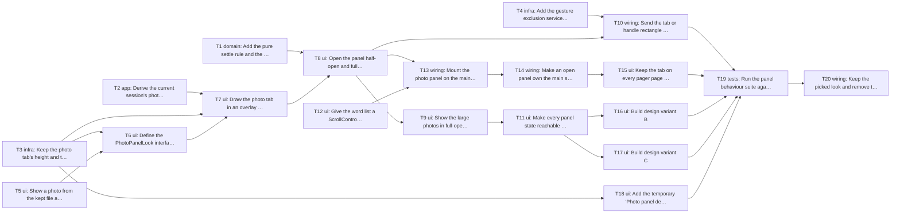

# Epic — side-bar-for-main-screen

> **Spec:** [spec.md](../spec.md) · **Design:** [sad.md](../sad.md) · **UX flows:** [ux-flows.md](../ux-flows.md) · **ADRs:** [adr/](../adr/) · **Data model / API / screens:** none (no schema change, no contract change, no `screens.md`), so the shape comes from sad §4–§6 and the ux-flows screen inventory (SCR-01 to SCR-06).

## Goal

On the main screen, a photo tab with mini previews opens a photo panel half-open (tap a photo to jump to and highlight its rows) or full-open (the photos large, zoomable), and closes step by step without breaking scrolling, the page swipe, Back or the rows' controls (spec §2, goals 1 and 2). Three design variants share that behaviour behind a temporary Settings choice; the owner picks one on the phone and the rest are removed before release (spec §2, goal 3; AC-19, AC-20).

## Scope

- **In:** the app only: `lib/features/word_input/photo_panel/` (derived photos, settle rule, controller, panel, preview, row jump, looks), `word_row_item.dart` (optional highlight), `word_input_screen.dart` (mounting, `ScrollController`, row keys, `PopScope`, touch ownership, pager), `lib/core/` (two preferences, the gesture exclusion service), `MainActivity.kt` (the channel handler), the temporary Settings choice, tests, docs.
- **Out (spec §3):** narrowing or rearranging rows in half-open; editing rows while the panel is open; Quizlet sets in the panel; editing, deleting or re-taking photos; the panel on the dialogue pages (the tab shows there, but opening returns to the words page), the Words screen, History or the shared page. No Worker change, no Isar schema change, no new package, no new domain model.

## Task map

Six tasks start together (T1, T2, T3, T4, T5, T12). The `photo_panel.dart` lane runs T7 → T8 → T9 → T10/T11; the main screen lane runs T12 → T13 → T14 → T15; the two looks wait for the interface to be final (T11).

## Tasks

See [tracker.md](./tracker.md) for status. Machine contract: [tasks.json](../tasks.json).

| # | Task | Layer | Blocked by | DoD (short) |
|---|---|---|---|---|
| T1 | Add the pure settle rule and the photo panel controller | domain | — | `photo_panel_stops_test.dart` and `photo_panel_controller_test.dart` pass: settle picks the nearest stop, a f… |
| T2 | Derive the current session's photos with words | app | — | `photos_with_words_test.dart` passes: only photo sources of the current session with at least one linked row … |
| T3 | Keep the photo tab's height and the review-only design variant in preferences | infra | — | `photo_panel_prefs_test.dart` passes: `photo_tab_top` is read back after a restart, the first default sits be… |
| T4 | Add the gesture exclusion service and its Android channel handler | infra | — | `system_gesture_exclusion_test.dart` passes against a mocked `vocab/system_gesture_exclusion` channel (rects … |
| T5 | Show a photo from the kept file at preview size, with a not-available placeholder | ui | — | `photo_preview_test.dart` passes: a readable source decodes with `cacheWidth` = width × device pixel ratio, a… |
| T6 | Define the PhotoPanelLook interface and build look A | ui | T3, T5 | `photo_panel_look_test.dart` passes: look A is returned for variant `a`, its tab is at most 200 dp tall (the … |
| T7 | Draw the photo tab in an overlay and let it be dragged up or down | ui | T2, T3, T6 | `photo_tab_position_test.dart` passes: no photo with words draws nothing; the tab sits beside the first rows,… |
| T8 | Open the panel half-open and full-open, settle at stops, and step back | ui | T1, T7 | `photo_panel_open_test.dart` passes: a tap settles half-open within `pump(300 ms)` with no animation running … |
| T9 | Show the large photos in full-open with zoom and neighbour-only decoding | ui | T8 | `photo_panel_full_open_test.dart` passes: full-open starts at the selected photo (or the first), a two-finger… |
| T10 | Send the tab or handle rectangle to the gesture exclusion service at every change | wiring | T4, T8 | `photo_panel_exclusion_test.dart` passes against the mocked channel: closed sends the tab's on-screen rectang… |
| T11 | Make every panel state reachable and closable with a screen reader | ui | T9 | `photo_panel_semantics_test.dart` passes with `tester.ensureSemantics()`: the tab is one node labelled "Sessi… |
| T12 | Give the word list a ScrollController, row keys, a row highlight and the jump to a row | ui | — | `row_jump_test.dart` passes with 200 rows of mixed heights: after the jump and `pump(500 ms)` the first linke… |
| T13 | Mount the photo panel on the main screen with Back stepping, highlight and jump | wiring | T8, T12 | `main_screen_photo_panel_test.dart` passes on the real `WordInputScreen`: a session with photos shows the tab… |
| T14 | Make an open panel own the main screen's touches and close on a session change | wiring | T13 | `main_screen_photo_panel_test.dart` passes the new cases: with the panel open a tap on a row, the top bar, it… |
| T15 | Keep the tab on every pager page and open the panel only over the words page | ui | T14 | `photo_panel_pager_test.dart` passes on a session with dialogues: a drag on the tab on the words page leaves … |
| T16 | Build design variant B | ui | T11 | `photo_panel_look_test.dart` passes for look B (variant `b` maps to it, tab ≤ 200 dp, highlight non-null), an… |
| T17 | Build design variant C | ui | T11 | `photo_panel_look_test.dart` passes for look C (variant `c` maps to it, tab ≤ 200 dp, highlight non-null), an… |
| T18 | Add the temporary "Photo panel design" choice to Settings | ui | T3 | `settings_screen_test.dart` passes the new case: the "Photo panel design" choice lists the variants, styled l… |
| T19 | Run the panel behaviour suite against every look and write the device-pass checklist | tests | T10, T15, T16, T17, T18 | `photo_panel_test.dart` runs the AC-01 to AC-18 cases once per `PhotoPanelVariant` and passes for all, includ… |
| T20 | Keep the picked look and remove the others, the variant choice and its key | wiring | T19 | Only the picked look remains and `PhotoPanel` uses it directly; `grep -rn "photo_panel_variant\|PhotoPanelVar… |

## Risks / Hard rules

- **External dependency:** T15 starts only after roadmap #22 (get-words-from-subtitles-improvment, task T19, the main screen pager) is merged; it was `todo` on 2026-10-13. T1 to T14 and T16 to T18 do not need the pager (sad §11).
- **Owner gate:** T20 waits for the owner's design pick on the phone from the review build (AC-20). The release build is made only after T20.
- **CLAUDE.md rule 3:** with no photo with words the main screen looks and behaves exactly as today (AC-02, QG-3c); `WordRowItem` with no highlight is today's row. The only visible additions are those rule 3 lists for this feature.
- **CLAUDE.md rules 1, 2, 5:** the panel opens no route; services and preferences come from `lib/core/providers.dart`; transient state stays in widget `State`; no new package or domain model.
- **Gesture limit:** every look's tab is at most 200 dp tall (Android's per-edge limit, asserted by `PhotoPanelLook`, ADR-0002).
- **Shared files:** `lib/core/providers.dart` (T3, T4, T20), `photo_panel.dart` (T7–T11, T14, T15), `word_input_screen.dart` (T12–T15), `looks.dart` (T6, T16, T17, T20) — `implement` serializes these by `files_hint`.
- **NFRs** (spec §6) are measured by hand on the owner's phone from `device-pass.md` (T19); widget tests cover only the 300 ms open and the 500 ms jump.
- **Spec §8:** "step to the next highlighted row" (due before tasks) is taken at its default, no. "Two or three variants" stays at the default three; T17 is dropped if the owner chooses two.
