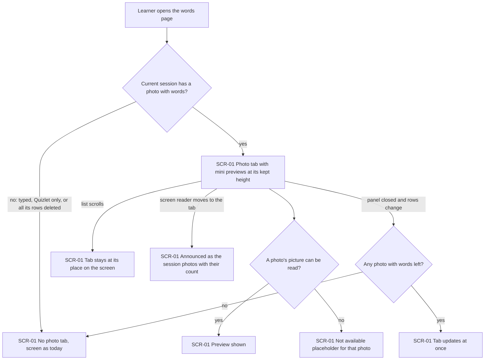
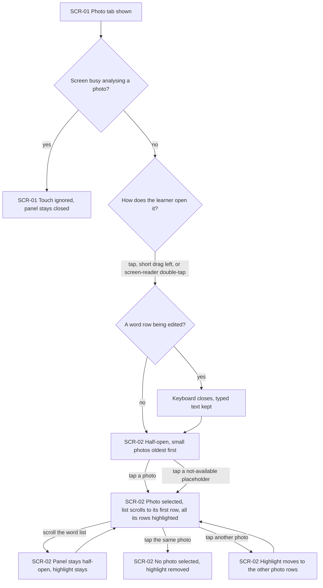
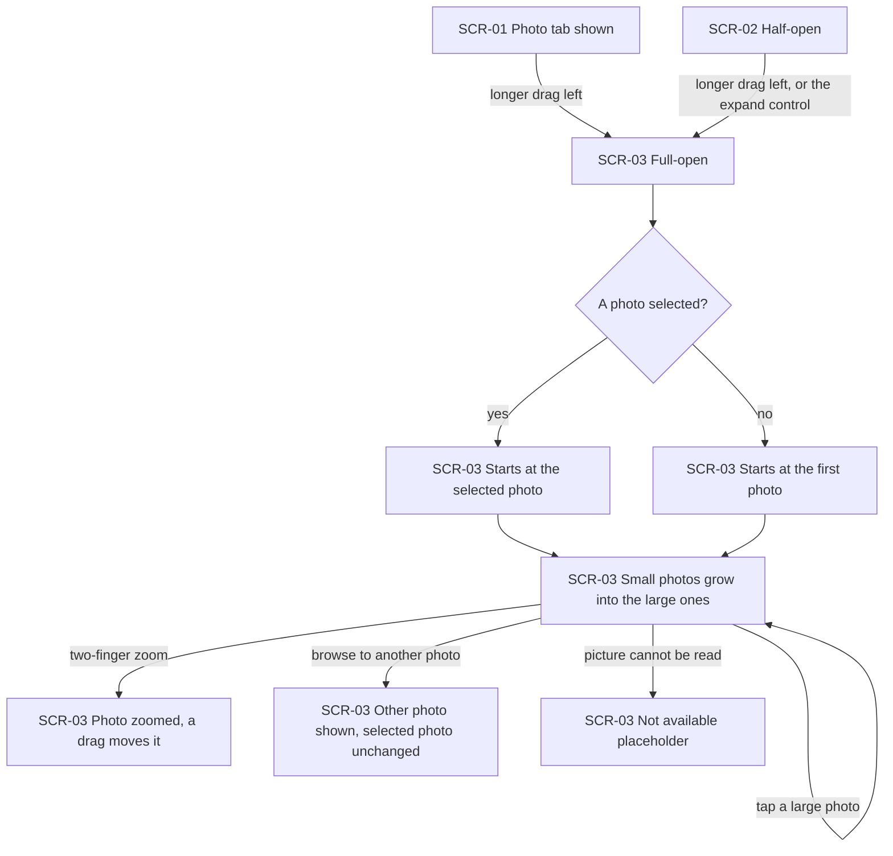
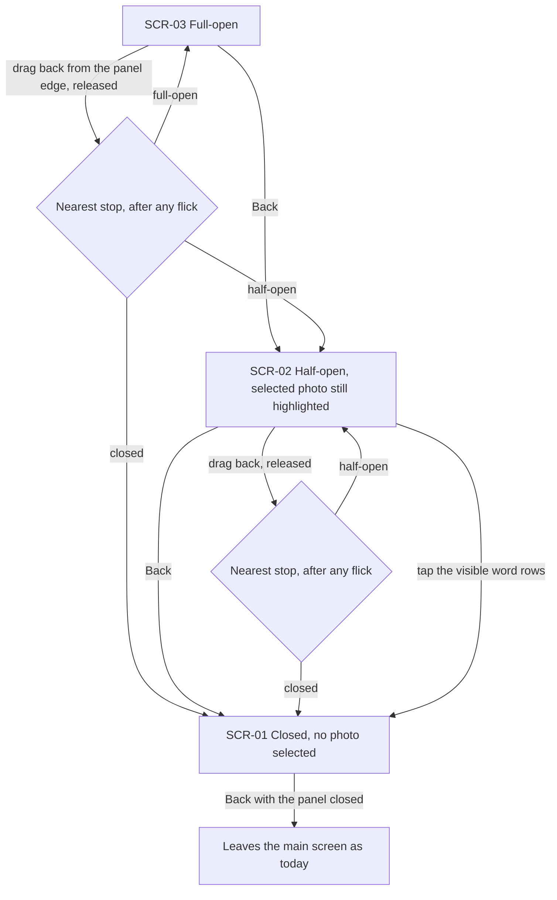
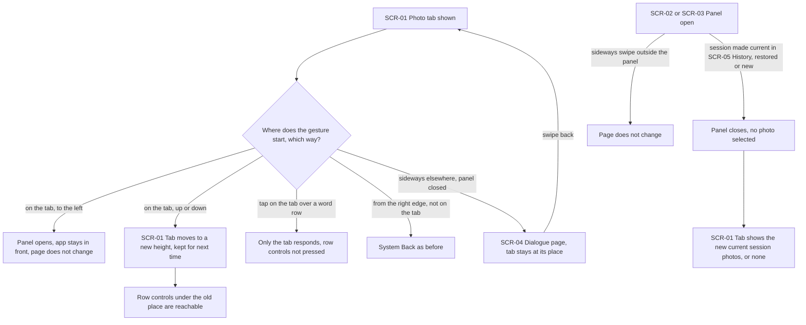
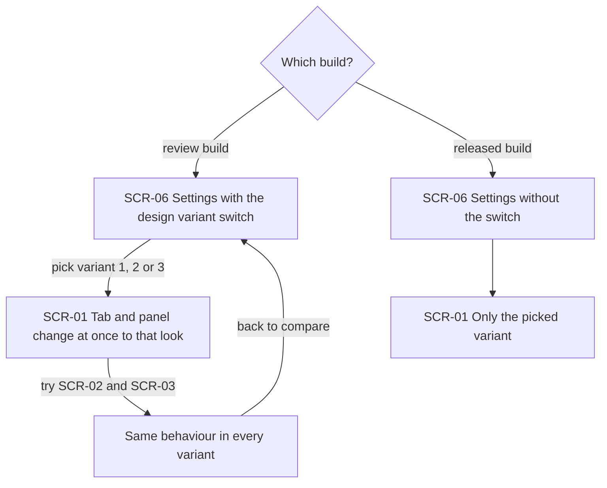

# UX flows — side-bar-for-main-screen

> User flows for every UI-touching §4 user story of [spec.md](./spec.md), produced by `ux-flows` (after `clarify`, before `design`) and read by `design` (evidence for the target-surface + UI-architecture decisions), `sequences` (UI-driven flows align on SCR ids), `screens` (details every inventory row) and `plan-tests` (the e2e-through-UI paths). **Always markdown + mermaid `flowchart`**, whatever the design tool — this artifact is flow-altitude, not visual design.

## Platform decisions

- **Posture:** mobile-only, the app on a phone held upright, with touch and the system Back (button or gesture), as in get-words-from-subtitles-improvment. The shared page is not touched (§3). There is no `docs/design-system.md` yet.
- **The photo panel is not a new page.** Closed, half-open and full-open are three states of one panel over the main screen's words page (SCR-01). Opening it never navigates away, so Back first walks the panel back one step and only leaves the main screen when the panel is closed (AC-10).
- **The photo tab has two drag directions.** A drag to the left opens the panel; a drag up or down moves the tab to another height, which is kept (AC-14). Which direction a drag takes is decided by the way the finger first moves.
- **While the panel is open, the main screen is for looking only.** A tap on the visible word rows closes the panel and does nothing else, and no swipe changes the main screen's page (AC-11, AC-13).
- **This builds on the main screen pager from get-words-from-subtitles-improvment** (roadmap #22): the words page is page 1 and the dialogue pages (SCR-04) follow it. Work starts after #22 is merged (spec §1).
- **Design input flagged, not decided here:** how a drag on the tab is kept from the system's right-edge Back gesture (AC-12); how the tab's height is stored; how the temporary variant switch reaches the main screen at once (AC-19); how previews stay small in memory (§6).

## Screen inventory

| ID | Screen | Purpose | Entry | Exit |
|---|---|---|---|---|
| SCR-01 | Words page of the main screen, panel closed | The current session's word rows as today. With at least one photo with words, the photo tab is on the right side at its kept height; with none, nothing changes | App launch; a session made current from History; back from Settings; swiping back from a dialogue page | SCR-02 or SCR-03 through the tab; SCR-04 by swiping; SCR-05 from the side menu; SCR-06 from the settings button |
| SCR-02 | Photo panel, half-open | A column of small photos with words, oldest first, beside the still-visible word rows; tapping a photo selects it and highlights its rows | Tap, short drag left or screen-reader double-tap on the tab in SCR-01; one step back from SCR-03 | SCR-03 by a longer drag or the expand control; SCR-01 by Back, a drag back or a tap on the word rows |
| SCR-03 | Photo panel, full-open | The photos large, covering the word rows, starting at the selected photo; a large photo can be zoomed with two fingers | A longer drag left from SCR-01 or SCR-02; the expand control in SCR-02 | SCR-02 by Back or a short drag back; SCR-01 by a long drag back |
| SCR-04 | Dialogue page of the main screen | Existing page from get-words-from-subtitles-improvment; the photo tab stays at its place over it | Swiping from SCR-01 while the panel is closed | Swiping back to SCR-01; opening the photo tab returns to SCR-01 first, then SCR-02 or SCR-03 |
| SCR-05 | History | Existing list of sessions; making one current changes what SCR-01 shows | Side menu on SCR-01 | SCR-01 when a session is made current |
| SCR-06 | Settings screen | Existing settings plus, in the review build only, the temporary switch between the two or three design variants | The settings button on SCR-01 | Back to SCR-01 |

## Flows

### Flow: US-01 — Notice my session's photos

The learner opens the words page. If the current session has no photo with words (typed by hand, only from a Quizlet set, or every row from its photos deleted), there is no tab and the screen is exactly as today (AC-02). Otherwise the photo tab shows on the right side with mini previews, beside the first word rows the first time and later at the height the learner last left it (AC-01, AC-14). A photo whose picture can no longer be read shows a "not available" placeholder while the others show normally (AC-09). Scrolling the list leaves the tab where it is, unless the design variant hides it while scrolling (AC-01, AC-19). A screen reader announces it as the session's photos with their count (AC-18). If rows are deleted or a new photo adds words while the panel is closed, the tab updates at once and disappears when no photo with words is left (AC-15). Only the current session's photos ever appear (AC-16).

### Flow: US-02 — Find a photo's words

On the words page with the tab shown, a touch on the tab is ignored while the screen is busy analysing a photo (AC-17). Otherwise a tap, a short drag to the left, or a screen-reader double-tap opens the panel half-open (AC-03, AC-18). If a word row was being edited, the keyboard closes first and what was typed is kept (AC-03). Half-open shows a small picture of each photo with words, oldest first, with the rows still visible beside it. Tapping a photo selects it: the list scrolls so that its first row, in the list as shown now, is in view, and all its rows are highlighted (AC-04). Scrolling the list keeps the panel half-open and the highlight in place (AC-06). Tapping the same photo again removes the selection; tapping another photo moves the highlight to its rows, and only one photo is ever selected (AC-05). A "not available" placeholder can still be tapped and highlights its rows (AC-09). A drag released between stops settles at the nearest one, or one stop further after a quick flick (AC-08); that rule is drawn in the US-04 flow.

### Flow: US-03 — Look at the photos large

A longer drag to the left from the tab, or from half-open, opens the panel full-open; from half-open the expand control does the same without any drag, which also serves screen-reader users (AC-07, AC-18). Full-open starts at the selected photo, or at the first photo when none is selected, and the small photos visibly grow into the large ones on the way (AC-07, AC-07b). The learner can zoom a large photo with two fingers to read the page, and while it is zoomed a drag moves the photo. Browsing to another large photo, in whichever way the design variant browses, does not change the selected photo. A tap on a large photo does nothing else (AC-07b). A photo that cannot be read shows the placeholder (AC-09).

### Flow: US-04 — Close the panel step by step

From full-open, Back goes one step to half-open, and the selected photo's rows are still highlighted there (AC-10, AC-07b). A drag back starts on the panel's edge or handle and, when released, settles at the nearest stop: half-open, closed after a long drag, or back at full-open after a very short one; a quick flick moves it one stop further in its direction (AC-08, AC-10). From half-open, Back or a drag back closes it, and a tap on the visible word rows closes it without focusing a field or pressing any row control (AC-11). Closing removes the selection and its highlight (AC-05). While the panel is open, Back never leaves the main screen; only with the panel closed does Back do what it does today (AC-10). Every open state can be closed without any drag (AC-18).

### Flow: US-05 — Keep the main screen working

A drag that starts on the tab and goes left opens the panel; on phones with gesture navigation it never sends the app to the background and never changes the page (AC-12, AC-13). A drag on the tab that goes up or down moves the tab to another height, which is kept after the app is closed and opened again, so the controls of a row it covered can be reached even in a short list (AC-14). A tap on the tab over a word row reaches only the tab, never the row's delete, translation-options or lightning controls (AC-14). A swipe in from the right edge that does not start on the tab still works as Back (AC-12). With the panel closed, a sideways swipe elsewhere changes to a dialogue page; the tab stays at its place there, and opening it first returns to the words page (AC-13). With the panel open, no swipe changes the page (AC-13). When the current session changes (picked in History directly or through the side menu, restored from the offer, or a new session) the panel closes, no photo stays selected, and back on the words page the tab shows only the new current session's photos with words, or is gone (AC-15b, AC-16).

### Flow: US-06 — Pick the look of the tab and panel

In the review build, the owner opens Settings and uses the temporary switch to pick one of the two or three design variants; the tab and panel change to that look at once (AC-19). Every variant behaves the same through all of AC-01 to AC-18 and differs only in its look (including how highlighted rows look), in how full-open browses the large photos, and in whether the tab hides while the list scrolls. The owner goes back and forth until one is picked. In the released build the switch is gone from Settings, the learner sees only the picked variant, and nothing about its look changes without the owner's approval (AC-20).

## AC coverage

| AC | Shown by | Notes |
|---|---|---|
| AC-01 | Flow US-01 → yes branch, D; list-scroll branch H | Kept height from AC-14 |
| AC-02 | Flow US-01 → no branch, C | |
| AC-03 | Flow US-02 → D to G, keyboard branch F | Oldest first in node G |
| AC-04 | Flow US-02 → tap a photo, H | |
| AC-05 | Flow US-02 → J and K; Flow US-04 → D (closing clears) | |
| AC-06 | Flow US-02 → scroll branch, I | |
| AC-07 | Flow US-03 → A to C and B to C | |
| AC-07b | Flow US-03 → D to I; Flow US-04 → A to B (highlight still there) | |
| AC-08 | Flow US-04 → decisions C and E | Also any release in Flow US-02 and US-03 |
| AC-09 | Flow US-01 → G; Flow US-02 → placeholder tap; Flow US-03 → J | |
| AC-10 | Flow US-04 → Back and drag-back branches, F | |
| AC-11 | Flow US-04 → tap the visible word rows | |
| AC-12 | Flow US-05 → C and G | Gesture safety measured in §6 |
| AC-13 | Flow US-05 → C, H and J | |
| AC-14 | Flow US-05 → D, E and F; Flow US-01 → D (kept height) | |
| AC-15 | Flow US-01 → J and K | |
| AC-15b | Flow US-05 → K and L | |
| AC-16 | Flow US-05 → L; Flow US-01 prose | |
| AC-17 | Flow US-02 → busy branch, C | |
| AC-18 | Flow US-01 → I; Flow US-02 → double-tap; Flow US-03 → expand control; Flow US-04 prose | |
| AC-19 | Flow US-06 → B to D | |
| AC-20 | Flow US-06 → E and F | |
