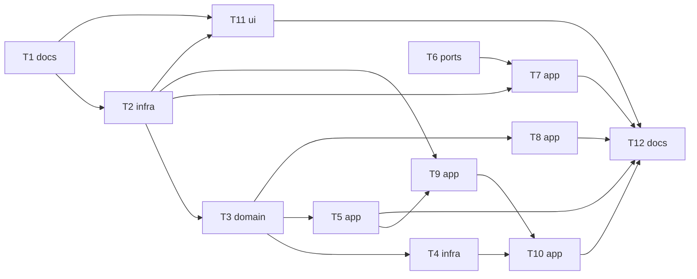

# Epic — word-context

> **Spec:** [spec.md](../spec.md) · **Design:** [sad.md](../sad.md) · **ADRs:** [adr/](../adr/) · **Brief:** [owner-brief](../../learn-welcome/owner-brief.md)

## Goal

Every word knows its source type, film details, the learner's edits and a context sentence, ready for Learn's cards and stories ([spec §2](../spec.md)).

## Scope

- **In:** the word model, the store, the words editing path, photo and subtitle imports, the dictionary path, a launch backfill, the word popup, the Worker's `/analyze`.
- **Out:** editing context by hand, re-analysing old photos, context on the shared page or in exports ([spec §3](../spec.md)).

## Task map

## Tasks

See [tracker.md](./tracker.md) for status. Machine contract: [tasks.json](../tasks.json).

| # | Task | Layer | Blocked by | DoD (short) |
|---|---|---|---|---|
| T1 | Record word-context approvals in CLAUDE.md rules 3 and 5 | docs | — | rule 3 lists the popup's context line; rule 5 lists WordOrigin, SourceType, ContextKind, the new WordPair fields and SessionSource.fullText |
| T2 | Add WordOrigin, SourceType, ContextKind and the new row and photo fields | infra | T1 | build_runner regenerates; copy/JSON round-trip and store put keep every new field |
| T3 | Add the pure origin rules: derive type, edit flags, word change, episode from a file name, first line time | domain | T2 | unit tests for every rule incl. S02E05 / s2e5 / 2x05 / none, whole-word first-line match, word change clearing |
| T4 | Derive origins of old rows once on load | infra | T3 | store test: an old collection gets typed/image/movie/set types and film details once; a second load changes nothing |
| T5 | Set the edit flags on learner edits and clear on a word change | app | T3 | notifier tests: typing or picking an option sets the flag, lightning/import does not; a word change clears context and flags |
| T6 | Return the photo's full text and per-word context with its kind from /analyze | ports | — | vitest: prompt asks full_text and context_source; parser accepts answers with and without them; exercise-sheet answers carry ai |
| T7 | Save photo context, its kind and the full text when a photo is imported | app | T2, T6 | service test parses the new fields; import test: rows get origin image, context and kind; the source gets fullText |
| T8 | Keep subtitle cue times and save the movie origin and context on film rows | app | T3 | parser test: timed lines keep cue starts, parse() output unchanged; import test: search-picked and file-picked films give name/season/episode/time/context |
| T9 | Set the dictionary example as context when a definition is filled or picked | app | T2, T5 | tests: lightning or option pick of a sense with an example sets context (source); no example → empty; translation-only row stays empty |
| T10 | Backfill empty contexts at launch from the dictionary and stored text | app | T4, T9 | fake-clock tests: ≤ 20 words a minute, typed/set via define, film via stored dialogue lines, photo via stored full text, tried rows skipped |
| T11 | Show the context in the Words screen word popup | ui | T1, T2 | widget test: italic context with "from the source" or "written by AI" + sparkle in AppDecor.aiAccent; nothing when empty |
| T12 | Finish word-context: generated code, analyze, changed tests, grep check, deploy note | docs | T5, T7, T8, T10, T11 | CLAUDE.md before-finishing commands pass; a device check list and the Worker deploy step are written for the owner |

## Risks / Hard rules

- rule 5: only the fields approved in T1.
- rule 3: the popup line is the only visible change.
- `WordPair` is embedded: every copy path must carry the new fields (AC-14).
- T6 changes the Worker: deploy only when the owner says so.
